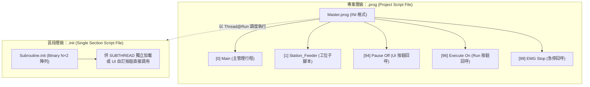

# ARCOSharp 開發者指南 (Developer Guide & Architectural Invariants)

> **【系統最高架構準則 (Supreme Architectural Invariant)】**  
> **以程式執行速度為第一核心目標，視覺即時更新絕非 ARCOSharp 的重點。**  
> **UI 視覺呈現必須放到合適的時機進行；凡非當前 Active 的 UI 元件、分頁或視窗，絕對嚴禁進行任何更新與重繪！**

---

## 1. 核心哲學：執行速度絕對優先 (Execution Speed is Supreme)

ARCOSharp 的本質是一套專注於工業級自動化機台的高吞吐、低延遲直譯與運動控制系統：
* **核心使命**：多執行緒虛擬機（`ArcosThreadVM`）、單步指令調度器（`CommandExecutor`）、六大子引擎（`BasicEngines`）與硬體驅動票據（`DriverTicket`）的運算效率與極速響應，是整個系統的**唯一最高優先級**。
* **UI 定位為次要觀察者 (Secondary Observer)**：工業機台在連續高速運轉時（例如每秒數千次 IO 判斷、高精度座標解算、微步打卡 Record），**視覺畫面的「即時動態更新」對實際生產毫無效益，反而只會成為效能殺手**。
* **杜絕 UI 拖累後端**：Avalonia UI 的 Layout Measure/Arrange、字串格式化、UI 執行緒切換（`Dispatcher.UIThread`）與垃圾回收（GC）是造成系統卡頓與抖動的主要根源。因此，代碼架構必須保證**即使前端 UI 完全凍結或關閉，後端直譯與硬體控制仍能以全速滿載運轉**。

---

## 2. UI 更新三大鐵律 (Three UI Architectural Invariants)

任何參與 ARCOSharp 開發、模組擴充或維護的工程師與 AI Agent，必須在所有代碼設計與 Code Review 中嚴格遵守以下三大鐵律：

### 🛑 鐵律一：非 Active 的 UI 絕對禁止更新 (Zero-Cost Inactive UI)

凡是**當前不可見、未被選中或非 Active** 的畫面，一律視為「不存在」，嚴禁浪費任何 CPU 週期進行狀態同步：
1. **分頁未選中 (Inactive Tab)**：
   * 若使用者當前停留於 `User Tab`，則背景被遮蔽的 `Capture`、`Modules Info`、`Sequencer Editor` 等面板**嚴禁更新**。
   * 嚴禁在定時器迴圈中遍歷不可見的 512 點 IO 列表、嚴禁刷新隱藏的相機影像、嚴禁更新隱藏的 DRO 座標顯示。
2. **模組未選中 (Inactive Module View)**：
   * 在 `Modules Info` 頁面中，若當前選取的不是 `SYSTEM` 模組，**嚴禁**更新 `RecordIndex`、`TxtSystemCycleTime` 或 2000 格 Record 表格。
   * 若當前選取的不是 `MOTION` 模組，**嚴禁**更新 7 軸同動座標（`TxtDroX` ~ `TxtDroH`）。
3. **視窗不可見或最小化 (Hidden / Minimized / Inactive Window)**：
   * 當主視窗最小化、失去焦點或被其他對話框覆蓋時，所有 UI 輪詢定時器必須立即暫停或直接 Early Exit。
4. **切換至 Active 時才「按需一次性拉取」 (Lazy Pull on Activation)**：
   * UI 應採用「延遲拉取」而非「即時推播」。當使用者主動點擊並切換到特定 Tab 或模組時，由 UI 事件觸發一次性的狀態快照載入，平時在背景保持零開銷。

---

### 🛑 鐵律二：嚴禁在直譯器或驅動熱點路徑中同步分發 UI (No Synchronous UI Dispatching in Hot Paths)

1. **零阻塞執行緒**：
   * 嚴禁在 `CommandExecutor`、`IModuleHandler.Execute`、`Driver.ExecuteCommand` 或高速循環中呼叫 `Dispatcher.UIThread.InvokeAsync` 或進行任何同步等待。
2. **純記憶體緩衝**：
   * 任何底層事件（如 `IoChanged`、`Record.Add`、`Log`）**只准寫入執行緒安全的記憶體緩衝區**（如 Concurrent 結構或 Ring Buffer），完全不碰 UI 執行緒。
3. **推遲到合適時機 (Opportunistic Update)**：
   * UI 端採用低頻節流定時器（如 100ms~200ms）或閒置期批次拉取。若非 Active 狀態，連定時器拉取都直接跳過。

---

### 🛑 鐵律三：環狀固定容量緩衝區，杜絕動態擴容 GC (Pre-allocated Ring Buffer, Zero Allocation)

1. **固定槽位與原地賦值**：
   * 針對高頻記錄（如 `Record`、`SYSTEMLOG`、波形取樣）：
   * 嚴禁使用動態 `List.Add`、`ObservableCollection.Add` 或字串 `+=` 拼接，以避免高頻記憶體複製與 GC 凍結。
   * 強制使用預先分配固定容量（如 2000-slot Ring Buffer），透過 `Index % Capacity` 原地更新純 POCO 槽位物件屬性（零 `INotifyPropertyChanged` 事件觸發開銷）。

---

## 3. 使用者觸發之按需查詢哲學 (User-Triggered On-Demand Pull Architecture)

> **「自動化只需要內部資料正確，顯示經由正確的觸發再正確顯示就可以了，不然時間都花在 UI 更新上了！」**

在 ARCOSharp 與原版 ARCOS 架構中，所有給人類工程師或操作員審視的資訊清單，**全數嚴格遵守「按需拉取 (On-Demand Pull)」哲學**，嚴禁在背後即時串流刷新：

### 🎯 七大資訊清單統一交互模式 (The 7 Inspection Lists Pattern)

| 模組清單 | 對應觸發按鈕 / 交互 | 執行期行為 (Running) | 查詢呈現行為 (On-Demand Pull) |
| :--- | :--- | :--- | :--- |
| **`RECORD LIST`** | `[Get RecordS]` / 選取通道項 | 僅以 $O(1)$ 寫入記憶體環狀槽位，**UI 0 刷新** | 點擊後一次性拉取該通道 2000 槽位快照與最新 Index 呈現 |
| **`VARIABLE LIST`** | `[Get Variables]` / 選取變數項 | 變數引擎純記憶體極速讀寫，**UI 0 刷新** | 點擊後一次性載入當前系統變數快照列表 |
| **`POINT&PATH LIST`** | `[Get Points]` / 選取點位項 | 點位引擎數值解算，**UI 0 刷新** | 點擊後一次性載入點位座標清單 |
| **`CAM LIST`** | `[Get Cameras]` / 選取相機項 | 相機連續硬體取像/演算法比對，**UI 0 刷新** | 點擊後才拉取當前相機清單與手動 Snap 預覽 |
| **`MOTION LIST`** | `[Get Motion]` / 選取軸卡項 | 運動控制器高速脈波輸出，**UI 0 刷新** | 點擊後一次性拉取軸卡組態與當前狀態 |
| **`DAQ LIST`** | `[Get DAQ]` / 選取採樣項 | 高速多通道電壓/電流連續採樣，**UI 0 刷新** | 點擊後一次性載入採樣通道狀態 |
| **`WAVEFORM LIST`** | `[Get Waveforms]` / 選取波形項 | 波形緩衝區寫入與檔案持久化，**UI 0 刷新** | 點擊後一次性讀取快照波形進行圖表繪製 |

#### 關鍵實現準則：
1. **解耦 Reactive Binding**：UI 清單的 `ItemsSource` **絕不可直接綁定**到後端運行中頻繁修改的即時資料集合。
2. **靜態快照呈現**：當且僅當使用者點擊 `[Get XXX]` 按鈕、或在 ListBox 中點擊選中某項目、或按下 `Clear` 時，UI EventHandler 才從子引擎讀取當前資料並複製一份**靜態快照（Snapshot）**指派給 UI。
3. **無動作時絕對安靜**：在使用者未點擊時，無論後端腳本迴圈執行了數萬次 `System@Record` 或變數修改，UI 表格與文字完全靜止不動，零 CPU 消耗！

---

## 4. 必要自動更新 UI 之三大工程紀律 (Three Engineering Disciplines for Auto-Updating UI)

針對少數使用者**當前視線可見且確有監控必要之自動更新 UI**（例如：機台運轉紅綠 LED 指示燈、當前可見的 7 軸同動 DRO 座標、可見的 Cycle Time 計時等），必須嚴格遵守以下三大工程紀律：

### 🕒 紀律一：頻率嚴格壓低，1 秒 5 ~ 10 次已足夠 (Low Frequency 5~10 Hz)
* **人類視覺極限**：人眼視覺暫留約 100ms，對機台監控而言，**1 秒更新 5~10 次（間隔 100ms ~ 200ms，建議 150ms / 約 6.7 Hz）** 已完全能提供即時平滑的視覺反饋。
* **嚴禁超頻更新**：嚴禁將 UI 定時器設為 10ms、20ms 或 50ms。盲目提高刷新率只會造成 UI 執行緒不斷搶奪 CPU、引發重排（Measure/Arrange）與電氣噪訊，對操作員毫無附加價值。

### 📨 紀律二：非阻塞 NOTIFY 機制，只更新最後一個值 (Non-Blocking Conflated Notify / Last-Value-Wins)
* **絕不阻斷程式執行**：UI 更新行程必須採用非同步 Notification（Notify）或低頻 Pull 方式進行，嚴禁任何會造成後端等待的同步調用。
* **合併覆蓋，只留最新值 (Conflation / Coalescing)**：
  - NOTIFY 的核心價值在於**「只更新最後一個值（Last-Value-Wins）」**。
  - 當後端在 100ms 內高頻變更了 1,000 次（例如高速運動脈波、連續 IO 翻轉、密集打卡），後端**絕不要將 1,000 筆中間狀態依序發送至 UI 訊息佇列**。
  - UI 只需要在下一次繪製週期讀取當下的「最後最新數值」，中間 999 筆視覺過渡值直接自動被吞沒合併，徹底杜絕訊息堆疊與 UI 卡死。

### 📉 紀律三：UI 更新行程之優先權恆為全系統最低 (Lowest Priority)
* **核心業務享有絕對優先調度**：直譯執行緒（VM）、硬體驅動通訊（`DriverTicket`）、即時邏輯判斷與運動控制擁有最高 CPU 優先權。
* **背景優先級調度**：所有調度至 UI 執行緒的委派任務或定時器，必須明確指定最低優先權：
  ```csharp
  // Avalonia Dispatcher 最低背景優先權調度
  Dispatcher.UIThread.Post(action, DispatcherPriority.Background);
  // 定時器亦必須以 Background 優先權運作
  _uiTimer = new DispatcherTimer(TimeSpan.FromMilliseconds(150), DispatcherPriority.Background, UiTimer_Tick);
  ```
  這保證了唯有當 CPU 處理完所有實體控制、通訊與演算法後，有餘裕時才順便繪製 UI，絕不反客為主！

---

## 5. STEP 單步與 AUTO 自動執行之指標語意與 NOTIFY 機制 (STEP & AUTO Execution Pointer Semantics)

在排程器編輯器（`SequencerEditorControl`）與測試執行緒編輯器（`TestThreadWindow`）中，指令執行指標（紅色高亮游標 `IsCurrentPC`）的行為嚴格遵循以下工程準則：

### 🎯 一、STEP 單步執行之指標判定哲學 (STEP Semantics)

* **核心指標定義**：紅色游標所在的行號，恆代表**「下一個即將被執行的指令 (Next Instruction to be Executed)」**。

#### 按下 STEP 時的兩種狀態判定：
1. **未完成狀態 (Incomplete / Waiting)**：
   * 若該指令需要非阻塞多步等待（例如：`System@Delay::0.1` 尚未逾時、`System@WaitIO` 仍在等待外部氣缸訊號、馬達軸卡尚未到位）：
   * 引擎回傳 `CommandStatus.Waiting`，紅色游標必須停留在原地（維持同一個 Index）。
   * 操作員再次按 STEP 時，系統繼續推動該指令的同一微步狀態機。
2. **已完成狀態 (Completed / Finished)**：
   * 當該指令正式滿足結束條件並完成時，執行引擎推進 PC 指標。
   * 紅色游標立即跳轉至下一個目標位置：
     * **一般指令**：順向跳至下一行（`Index + 1`）。
     * **條件分支跳轉**（`Thread@If`、`Thread@Jump`、`Thread@Call`、`Thread@Else`）：直接跳到對應的 Label 標籤或副程式。
     * **異常處理跳轉**（`ErrorHandler` / `[[Label]]`）：若發生硬體或通訊錯誤，游標立即跳轉到錯誤處理區段。

#### 🎯 操作員人機交互價值：
* **確認上一步是否順利完成**：只要看到紅色游標前進或跳轉，就確信上一個指令已經成功結案；若游標不動，代表仍在等待中。
* **明確預知下一步**：游標當前停在哪裡，下一次按下 STEP 就會精準執行該行指令。

---

### ⚡ 二、AUTO（自動）之非阻塞 NOTIFY 機制 (AUTO Non-Blocking Notify)

1. **核心執行緒全速推進，絕不等待 UI 渲染**：
   * 在 AUTO 模式下，VM 直譯器是以 CPU 全速滿載運行，絕對不因為要等 UI 畫出紅色光棒而踩煞車。
2. **非阻塞 NOTIFY（最後值合併 Last-Value-Wins）**：
   * 執行位置的更新採用 `Interlocked.Exchange(ref _latestNoticedPC, pc)` 進行極速原子賦值。
   * 前端 UI 的節流排程器（`_pcDrainerTimer`）以低頻率（10 Hz / 100ms）在背景最低優先權（`DispatcherPriority.Background`）讀取當前最新 PC 並繪製。
3. **視覺效果與安心感**：
   * 當程式全速運轉時，許多微秒級指令直接一閃而過，人眼可能根本看不到停在哪一行。
   * 但操作員能看到紅色游標在程式區段間平滑跳躍與流動，明確感受到系統正在健康、全速地自動化運轉，兼顧了執行極速與視覺安心感！

---

### 🎨 三、視覺解耦與指標隔離律 (PC Pointer & Range Selection Decoupling Invariant)

在排程編輯器（`SequencerEditorControl`）與測試視窗（`TestThreadWindow`）中，為了徹底避免**指令執行指針（PC Pointer）**與**滑鼠範圍選取（Range Selection）**相互混淆覆蓋，系統強制實施**「欄位正交視覺隔離」**鐵律：

| 視覺語意元件 | 允許呈現之欄位 | 樣式規範 | 職責與互動邊界 |
| :--- | :--- | :--- | :--- |
| **PC 執行指針**<br>(`IsCurrentPC`) | **僅限 `i` 索引欄**<br>(Strictly Column `i`) | 紅底粉色圓角膠囊（`#FFE4E6`）<br>加粗紅色字體（`#DC2626`, Bold）<br>紅色外邊框（`#F87171`） | 代表 VM 直譯器**下一個即將執行之微步指令**。<br>指令與參數欄絕對不染紅，保持程式代碼之純淨可讀性與對比度。 |
| **範圍選取高亮**<br>(`IsRangeSelected`) | **僅限 `Command` 與 `Parameters` 欄**<br>(Strictly Command & Param) | 淺藍色背景（`#E0F2FE`）<br>藍色上下邊框（`#BAE6FD`）<br>深深色文字保持高對比 | 代表操作員選取之指令區塊，供複製、移動、整段刪除。<br>`i` 索引欄絕對不染藍，確保 PC 紅色游標即使在選取區內仍清晰可見。 |

```
┌───────┬─────────────────────────┬──────────────────────┐
│   i   │         Command         │      Parameters      │
├───────┼─────────────────────────┼──────────────────────┤
│ [ 1 ] │ System@Log Message      │ 1                    │  <-- PC 游標僅在此膠囊中 (紅底紅字)
├───────┼─────────────────────────┼──────────────────────┤
│   2   │ █ System@Log Message    │ █ 2                  │  <-- Shift+Click 範圍選取 (淺藍色底)
├───────┼─────────────────────────┼──────────────────────┤
│   3   │ █ System@Log Message    │ █ 3                  │  <-- 兩者完全正交解耦，互不覆蓋
└───────┴─────────────────────────┴──────────────────────┘
```

#### 🎯 關鍵架構守衛：
1. **空間正交性 (Spatial Orthogonality)**：PC 游標與範圍選取在 X 軸欄位上完全隔離，從根本上杜絕「整列染色導致 PC 消失」或「操作員無法辨識到底選了哪幾行」的 UI 混淆。
2. **零干擾運行**：即便操作員在編輯器內選取數十行指令進行搬移或複製，背景全速運轉的執行緒 PC 指針依然在 `i` 欄自由穿梭跳躍，人機協同零衝突。

---

## 6. 專案檔格式與程式區架構 (.prog 與 .init 雙層架構)

ARCOSharp 將自動化腳本的儲存與生命週期明確劃分為「**全專案檔 (`.prog`)**」與「**單一程式區檔案 (`.init`)**」兩層架構：



### 📁 一、.prog 全專案腳本檔案規範 (Project Script File)

- **檔案副檔名**：`.prog`（預設檔名：`Master.prog`，向後相容舊版 `.pro`）。
- **架構定義**：代表**整個機台專案**的所有程式區集合（0~99 區段，共 100 個槽位）。
- **底層格式**：採用標準 Windows INI 格式儲存（`[0]`, `[1]`, ..., `[99]`），內含區段 `Name`、`Type`、`Size` 與各行指令。
- **UI 交互按鈕**：
  - `[ 📁 READ .PROG ]`：將磁碟中的 `.prog` 載入至記憶體與當前專案。
  - `[ 💾 SAVE .PROG ]`：將當前 100 個程式區段整體序列化並寫入 `.prog`。
- **路徑解析**：透過 `ArcosPaths.ResolveProgPath(fileName)` 自動定位於應用程式根目錄，若找不到 `.prog` 則自動嘗試同名 `.pro` 舊檔。

### 📄 二、.init 獨立單一程式區檔案 (Standalone Section Script File)

- **檔案副檔名**：`.init`。
- **架構定義**：代表**單一獨立程式區段**的封裝，主要用於子執行緒（SubThread）或 UI 自訂按鈕獨立掛載調用。
- **底層格式**：採用高效能二進位（Binary $N \times 2$ 字串陣列）封裝，包含總列數與各指令/參數之長度標頭與原始字串。
- **UI 交互按鈕**：
  - `[ 📗 READ .INIT ]`：載入單一腳本至當前選中之 Program Section。
  - `[ 💾 SAVE .INIT ]`：將當前選中之單一 Program Section 導出為獨立 `.init`。

### 🏷️ 三、System@ProgramSection 動態程式區命名與 ProgSelector

ARCOSharp 支援在腳本執行時或載入時動態變更程式區段的語意化名稱：

1. **指令語法**：
   - `System@ProgramSection, $no, $name`：指定將第 `$no` 區段命名為 `$name`（例如：`System@ProgramSection, 1, Station_Feeder`）。
   - `System@ProgramSection, $name`：單一參數模式，將**目前執行中之區段**直接命名為 `$name`。
2. **UI ProgSelector 即時聯動**：
   - 排程編輯器之程式區下拉選單（`ProgSelector`）即時呈現格式化標籤：
     `0: Main`、`1: Station_Feeder`、`94: Pause Off`、`96: Execute On`、`99: EMG Stop`。
   - 若區段未自訂名稱，則依慣例顯示預設編號（如 `12: Prog 12`）。

### ⚡ 四、排程器高速編輯互動規範 (Ctrl+Click Insertion Acceleration & Section Operations)

為大幅加速工程師編輯與測試腳本，排程器實作快捷交互與行/區操作守衛：
- **`Ctrl + 滑鼠單擊 Command 欄位`**：
  - 功能完全等同於工具列之 `+`（`BtnAdd`）插入按鈕。
  - **精確插入於當前游標所在列位置（`cur`）**，原列及後續指令順延下移一格（非插入至下一列）。
  - 自動彈出指令選擇視窗（`ComSelectWindow`）；若選定指令，則無縫接續開啟**參數導引視窗（`ParameterGuidance`）**，取消時不殘留空行，實現零鍵盤指令建構體驗。
- **工具列 `+` 按鈕 (`BtnAdd`)**：
  - 若有選取行，於該選取行位置插入（原行下移）；若無選取，則新增至末端。
  - 同樣自動開啟 `ComSelectWindow` 與 `ParameterGuidance` 進行配置。
- **表格空白處單擊 (Empty Area Click)**：
  - 於指令表末端新增一行，並自動跳出 `ComSelectWindow` 挑選指令與引導參數（避免殘留預設值行）。
- **工具列 `-` 按鈕 (`BtnMinusLine`)**：
  - 刪除目前選取之單一指令行（Delete Row），具備完整 Undo/Redo 歷程防護。
- **工具列 `X` 按鈕 (`BtnDelete`)**：
  - **清空當前這一個程式區 (Clear Current Program Section)**，將當前 Program Slot 所有指令行清空並同步回 VM，支援 `Ctrl+Z` 完整復原。

---

## 7. 標準程式碼範例與實作模式 (Best Practice Code Patterns)

### ✅ 模式 1：UI 定時器之 Active 守衛模式 (Active Guard Pattern)

在任何 UI 刷新定時器回呼函式（如 `UiTimer_Tick`）中，必須由外向內進行層層守衛：

```csharp
private void UiTimer_Tick(object? sender, EventArgs e)
{
    // 守衛 1：主視窗不可見或最小化時，直接退出
    if (!this.IsVisible || this.WindowState == WindowState.Minimized) return;

    var mainTab = this.FindControl<TabControl>("MainTabControl");
    int activeTabIdx = mainTab?.SelectedIndex ?? 0;

    // 守衛 2：僅當在 Capture Tab (Index 1) 時，才刷新 IO 點位
    if (activeTabIdx == 1)
    {
        UpdateCaptureIoList();
    }

    // 守衛 3：僅當在 Modules Info Tab (Index 2) 時，依據選中模組進行細項刷新
    if (activeTabIdx == 2)
    {
        string selectedModule = GetCurrentlySelectedModule();
        switch (selectedModule)
        {
            case "SYSTEM":
                UpdateSystemModuleUi(); // 僅刷新 SYSTEM 狀態與 Record
                break;
            case "MOTION":
                UpdateMotionDroUi();    // 僅刷新 DRO 座標
                break;
        }
    }

    // 守衛 4：User Tab (Index 0) 僅刷新必要的機台運轉紅綠狀態指示燈
    if (activeTabIdx == 0)
    {
        UpdateUserTabStatusLeds();
    }
}
```

---

### ✅ 模式 2：Tab 切換時的按需拉取模式 (Lazy Catch-Up on Tab Selection)

不要在背景持續維護不可見畫面的資料，改在使用者切換分頁時進行一次性快照刷新：

```csharp
private void OnMainTabSelectionChanged(object? sender, SelectionChangedEventArgs e)
{
    if (sender is not TabControl tc) return;

    switch (tc.SelectedIndex)
    {
        case 1: // 切換至 Capture：一次性同步當前所有 IO 與點位
            RefreshCaptureTabSnapshot();
            break;
        case 2: // 切換至 Modules Info：一次性同步當前選中模組
            RefreshActiveModuleSnapshot();
            break;
    }
}
```

---

### ✅ 模式 3：高速資料寫入純解耦模式 (Decoupled Hot Data Ingestion)

核心記錄操作必須是 $O(1)$ 純記憶體操作，完全不依賴 Dispatcher：

```csharp
public void Record(string recordName, string message)
{
    var channel = _channels.GetOrAdd(recordName, name => new RecordChannel(name, 2000));
    channel.Add(message); // 純記憶體環狀槽位寫入，0 UI Dispatcher 調用，極速返回
}
```

---

## 8. Code Review 檢核清單 (Pull Request & Development Checklist)

在提交任何 ARCOSharp 程式碼變更前，必須自檢以下項目：

- [ ] **無熱路徑 UI 調用**：`ARCOS.Core` 下所有程式碼（直譯器、Handler、子引擎）完全無 `Avalonia` 命名空間引用，不發起任何 UI Thread 調用。
- [ ] **非 Active 不更新**：所有 UI 更新定時器或事件處理常式，均具備 `IsVisible` 與 `ActiveTab` 守衛檢查。
- [ ] **低頻與背景優先級**：自動更新定時器頻率限制於 5~10 Hz（100~200ms），調度一律指定 `DispatcherPriority.Background`。
- [ ] **按需拉取與無高頻動態記憶體配置**：高頻日誌與記錄使用預分配環狀緩衝區，七大資訊清單（Record/Var/Point/Cam/Motion/Daq/Wf）一律採使用者點擊按需拉取快照。
- [ ] **視覺空間正交解耦**：PC 執行指標紅色高亮僅限欄位 `i`，多選範圍選取淺藍色高亮僅限欄位 `Command` 與 `Parameters`，兩者不可混用或整列通染。
- [ ] **專案檔與單一腳本分離**：全專案存取使用 `.prog`（相容相容 `.pro`），單一子執行緒或按鍵腳本使用 `.init`。
- [ ] **異常降級保護**：即使 UI 發生例外或重繪延遲，背景腳本執行緒與硬體通訊完全不受干擾、繼續全速執行。

---

## 9. 詳細技術白皮書與章節目錄

進一步的架構細節與各子系統規格，請參閱 `docs/dev-guide/` 目錄下各專題文檔：

| 章節 | 文件連結 | 核心內容說明 |
|---|---|---|
| **00** | [二次開發指南導覽](docs/dev-guide/00_README.md) | 全套開發規格書索引與 CSVI 三位一體哲學 |
| **01** | [整體架構總覽](docs/dev-guide/01_ARCHITECTURE_OVERVIEW.md) | 分層架構、生命週期、執行緒模型與並發調度 |
| **02** | [ARCOS.Core API 參考](docs/dev-guide/02_CORE_API_REFERENCE.md) | 核心組件 Public API 與直譯器擴充 |
| **03** | [ARCOS.App API 與 UI 規範](docs/dev-guide/03_APP_API_REFERENCE.md) | Avalonia 主程式、參數導引與 MCP 介面 |
| **04** | [ARCOS.Remoter 通訊協定](docs/dev-guide/04_REMOTER_API_REFERENCE.md) | Telnet 遠端遙控 Sidecar 協定 |
| **05** | [動態模組擴充教學](docs/dev-guide/05_EXTEND_MODULE.md) | `IModuleHandler` 與指令擴充 |
| **06** | [硬體驅動與 Driver CSVI 設計](docs/dev-guide/06_EXTEND_DRIVER_CSVI.md) | `IDriver` 與 `DriverTicket` 票據架構 |
| **07** | [ExternalModules 單檔外掛開發](docs/dev-guide/07_EXTEND_EXTERNAL_CSVI.md) | `ICallCommand` 與單檔演算法外掛 |
| **08** | [User Panel 自訂操作面板](docs/dev-guide/08_EXTEND_USER_PANEL.md) | `UserPanel.csvi` 與 HMI 客製化 |
| **09** | [架構瓶頸分析與審查報告](docs/dev-guide/09_ARCHITECTURE_REVIEW.md) | 架構弱點診斷與重構指引 |
| **10** | [擴充者可用 API 總目錄](docs/dev-guide/10_EXTENSION_API_CATALOG.md) | Public API 與子引擎速查手冊 |
| **11** | [邏輯表達式編輯器指南](docs/dev-guide/11_LOGIC_EDITOR_GUIDE.md) | 複合邏輯與運算子體系 |
| **12** | [統一模組中心與 CSVI Studio 規格](docs/dev-guide/12_UNIFIED_MODULES_INFO_SPEC.md) | 內嵌 IDE、六大分頁與 MCP 自動化 |
