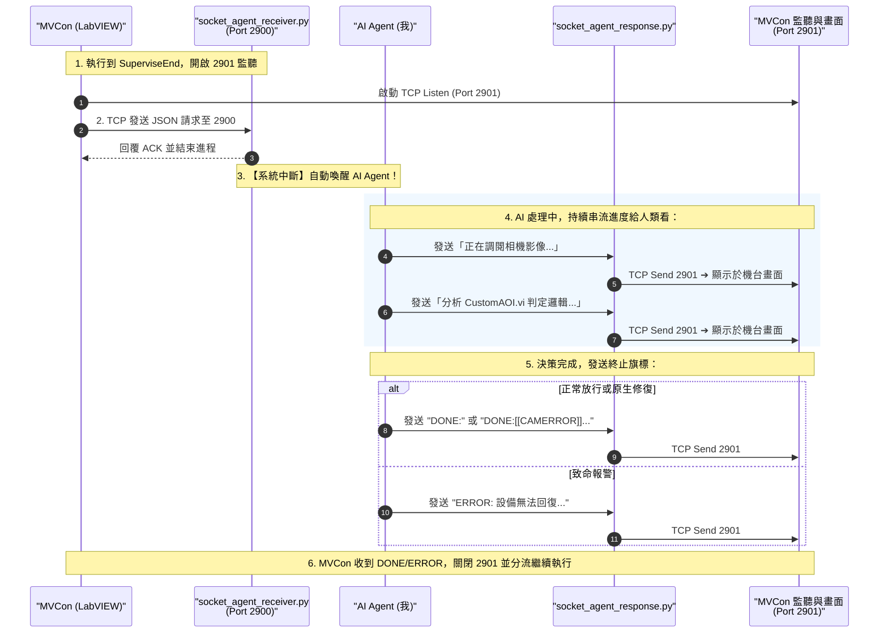

# MVCon AIAgent 模組參考手冊

這是針對 **MVCon AIAgent 模組** 專門設計的 Agent 協作指南。身為 MVCon 自動化系統專家，當遇到需要進行 AI 視覺監督、AOI 影像輔助判定、或在異常發生時交由 AI Agent 進行現場排查與後備決策時，請參照以下規範。

---

## 🎯 模組前置宣告與職責

1. **模組引入**：在腳本首行必須宣告引入模組：
   ```text
   System@IncludeModule::AIAgent;
   ```
2. **啟動條件**：當使用者的請求、任務或討論內容中明確提到「**AIAgent**」、「**AI 監督 (Supervise)**」、「**AOI 檢測覆核**」、「**異常排查 (ErrorHandle)**」等關鍵字時，自動套用本技能。
3. **分派核心**：模組底層由 `ExternalModules/AIAgent/AIAgent#CMDExecute.vi` 負責指令解析、TCP 通訊與流程分派。

---

## 🔌 核心通訊介面：雙 TCP Socket 協定 (Port 2900 / 2901)

為避免硬碟 I/O 損耗並支援「思考過程即時可視化」，MVCon 與 AI Agent 之間採用**雙通訊埠分工協作架構**：

- **Port 2900 (MVCon ➔ AI Agent 請求通道)**：
  - 由 `socket_agent_receiver.py` 監聽。
  - 當 MVCon 執行到 `SuperviseEnd`，連線發送 JSON 請求後，接收端即刻退出進程喚醒 AI Agent。
- **Port 2901 (AI Agent ➔ MVCon 進度串流與決策通道)**：
  - 由 MVCon 開啟 Port 2901 TCP 監聽服務。
  - AI Agent 分析期間，可多次調用 `socket_agent_response.py` 發送即時進度（例如「正在調閱相機 cam 影像...」），MVCon 即時呈現於操作介面。
  - 當收到以 **`DONE:`** 或 **`ERROR:`** 開頭的字串時，MVCon 獲知決策完成，隨即關閉 Port 2901 並執行對應流程分流！

### 完整通訊與串流協作時序



---

## 📦 請求格式：MVCon ➔ AI Agent (JSON Payload)

當執行到 `AIAgent@SuperviseEnd::` 或 `AIAgent@ErrorHandle::` 時，LabVIEW 將相關上下文組裝為 JSON 送出：

```json
{
  "action": "supervise",
  "prompt": "幫我確認相機是否正確判定OK及NG。數量或是分類正不正確。若有問題，請即時修正AOI程式後再往下進行",
  "commands": [
    "Capture@Snap::cam,,[[CAMERROR]]camera snap error!",
    "Call@USERCallVISample-IMAQDisplay.vi::cam,PartType,Score,[[USERVIERROR]]USER VI NG!"
  ],
  "timeout_ms": 10000
}
```

* **`action`**：`"supervise"`（視覺監督）或 `"error_handle"`（異常排查）。
* **`prompt`**：腳本中傳入的自然語言提示詞。
* **`commands`**：在 `SuperviseStart` 到 `SuperviseEnd` 之間所執行的所有指令列表（包含各指令的後備錯誤標籤 `[[Label]]`）。
* **`timeout_ms`**：逾時毫秒數（Supervise 預設 10000，ErrorHandle 預設 15000）。

---

## 🚦 決策回傳協議：AI Agent ➔ MVCon

AI Agent 分析完畢後，透過 TCP 連線回傳單行純文字字串，MVCon 據此進行分流：

| 狀態類型 | 回傳語法格式 | 說明與 MVCon 對應動作 |
| :--- | :--- | :--- |
| **1. 正常放行** | **`DONE:`** | **審查通過或 AI 已自癒放行**。<br>• 演算法判定正確，或 AI 已透過 Telnet 覆寫放行。<br>• **動作**：推進下一動（`State Index + 1`），繼續執行原腳本。 |
| **2. 原生錯誤分流** | **`DONE:[[標籤]]錯誤說明`** | **硬體/演算法確實異常，交由機台原生修復**。<br>• 例如相機取像失敗、客製 VI 報錯、產品瑕疵判定 NG。<br>• 範例：`DONE:[[CAMERROR]]camera snap error!`<br>• **動作**：直接跳轉至腳本對應的 `Thread@ErrorHandler::[[標籤]]`，執行原生重連（`AddCam`）、剔除廢料或重試（`ErrorRetry`）。 |
| **3. 致命報警停機** | **`ERROR: 錯誤原因`** | **不可逆致命異常，緊急停機保全設備**。<br>• 偵測到機構嚴重卡死、撞機風險、人員危害，且無法透過腳本重試解決。<br>• 範例：`ERROR: 設備無法回復，需要停止程序，以免傷害人或機台`<br>• **動作**：執行緒立刻中止停機（等同 `Thread@Stop::True`），觸發 Alarm 停機。 |
| **4. 人工中止 (Abort)** | **`User Abort AI Agent Supervise`** | **現場作業員手動放棄**。<br>• 作業員在 LabVIEW 前面板點擊 `Abort` 按鈕。<br>• **動作**：終止當前監督流程，跳出警報或中止。 |

> [!IMPORTANT]
> **逾時處置 (Timeout Fallback)**：
> 若 LabVIEW 在 `timeout_ms` 內未收到 AI 回應（例如網路斷線或推論逾時），LabVIEW 視同 `ERROR: AI Agent Timeout`，自動回退執行該指令的後備處置或報警，絕不造成產線死鎖。

---

## 📜 常用指令對照表

### 1. 全模組統一「~」停用/旁路開關 (Universal Bypass Convention)
在 Prompt 提示詞最前方加上 **`~`**（例如 `~Prompt`），即可**立即停用該項 AI 功能**，達成產線零成本快速回退：
- `AIAgent@SuperviseStart::~$prompt;` ➔ **停用 AI 視覺監督**：純傳統流程，不連線 Port 2900，完全依賴自訂 VI 判定。
- `AIAgent@ErrorHandle::~$prompt,Message=$fallback;` ➔ **停用 AI 異常排查**：不等待 AI，直接跳轉執行 `Message=` 指定的後備標籤。

### 2. 常用指令語法
| 指令 | 參數範例 | 說明 |
| :--- | :--- | :--- |
| **SuperviseStart** | `$prompt`<br>或 `~$prompt` | 標記 AI 監督區段起點，傳入檢測提詞。**帶 `~` 前綴直接停用**。 |
| **SuperviseEnd** | *(無參數)* | **觸發點**：打包區段內指令與提示詞，透過 Port 2900 送出 JSON，並於 Port 2901 同步等待 AI 回傳 `DONE:` / `ERROR:`。保留 `::` 且參數留空。 |
| **ErrorHandle** | `$prompt, Message=$fallback`<br>或 `~$prompt, Message=$fallback` | 觸發現場異常排查。透過 Port 2900 送出 JSON，於 Port 2901 等待決策，失敗或逾時跳轉至 `Message=` 指定之後備標籤。**帶 `~` 前綴直接停用**。 |

---

## 💡 標準工業實戰腳本樣板

以下展示完整的 AI 監督、硬體原生自癒、與 AI 異常排查的工業實戰架構：

```markdown
// 0. 載入 AIAgent 模組
System@IncludeModule::AIAgent;

// 1. 啟動 AI 監督流程
AIAgent@SuperviseStart::幫我確認相機是否正確判定OK及NG。數量或是分類正不正確。若有問題，請即時修正AOI程式後再往下進行;

// 2. 拍照與執行客製 AOI VI（各指令皆附帶機台原生的錯誤處置標籤）
Capture@Snap::cam,,[[CAMERROR]]camera snap error!;
Call@USERCallVISample-IMAQDisplay.vi::cam,PartType,Score,[[USERVIERROR]]USER VI NG!;

// 3. 結束 AI 監督並觸發審核 (透過 Port 2900 送出請求並於 Port 2901 等待回傳)
AIAgent@SuperviseEnd::;

// 4. 正常流程結束
Thread@Thread Stop::;

// ==========================================
// 5. 機台原生硬體異常處置區段 (相機重連自癒)
// ==========================================
System@#Comment--->>::Camera Error;
Thread@ErrorHandler::[[CAMERROR]];
Capture@AddCam::cam,NULL;
Thread@ErrorRetry::;

// ==========================================
// 6. 客製 VI 執行異常處置區段
// ==========================================
Thread@ErrorHandler::[[USERVIERROR]];
Thread@Thread Stop::True,USER VI NG;

// ==========================================
// 7. 機構運動異常處置區段 (交由 AI Agent 現場排查)
// ==========================================
System@#Comment--->>::robot Error;
Thread@ErrorHandler::[[motionerror]];
AIAgent@ErrorHandle::ROBOT出錯，請幫我檢查！,Message=[[AIAgentFatal]]無法自癒;
Thread@ErrorRetry::;

// ==========================================
// 8. 致命不可修復停機區段
// ==========================================
System@#Comment--->>::AI Agent can't solve this problem!;
Thread@ErrorHandler::[[AIAgentFatal]];
Thread@Thread Stop::True,robot fatal error!;
```
