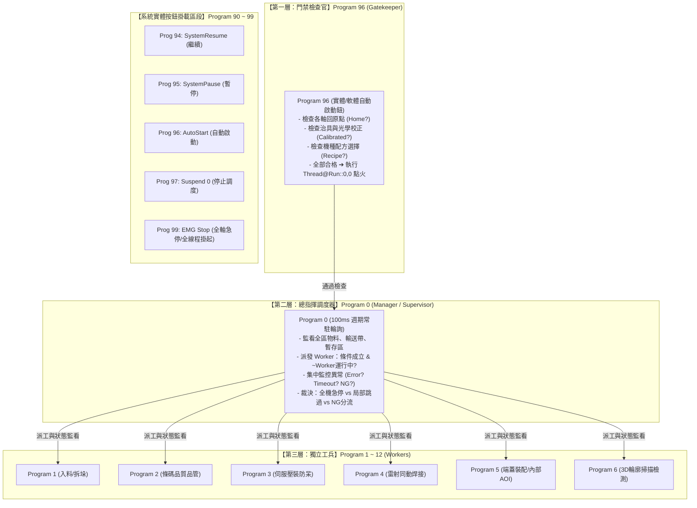

# MVCon 三層式調度與故障隔離架構 (Supervisor-Worker & Fault Isolation Pattern)

本手冊是 MVCon 專案開發中**最高層級的系統架構標準**。
在設計大型自動化工作站、雙軌流水線或多手臂協同站點時，Agent 與自動化工程師必須遵循本架構規範進行模組化切割，以確保產線具備**「高稼動率、故障隔離不擴散、支援現場單站獨立調試」**之工業級健壯性。

---

## 🎯 核心設計哲學與三層金字塔架構

傳統自動化程式若將全機動作循序寫死在單一流程中，任何單一感測器逾時或不良品都會導致全線停擺，且現場無法對單一工位進行獨立測試。
MVCON 採用**三層階層式分工（Three-Tier Hierarchy）**與**系統事件鉤子（System Hooks）**徹底解耦：



---

## 📜 系統保留區規範 (Program 90 ~ 99 System Hooks)

MVCON 系統將 90~99 號程式段預留為操作面板實體/虛擬按鈕的硬體映射入口：

| 程式段 | 系統映射功能 | 標準責任與行為 |
| :--- | :--- | :--- |
| **`[Program 94]`** | **SystemResume (繼續)** | 呼叫 `System@SystemResume::`，恢復因暫停而中斷的動作。 |
| **`[Program 95]`** | **SystemPause (暫停)** | 呼叫 `System@SystemPause::`，暫停當前軸運動與主流程。 |
| **`[Program 96]`** | **AutoStart (自動啟動)** | **門禁檢查官**：嚴密驗證全機安全條件，全數合格後調用 `Thread@Run::0,0` 喚醒 Program 0。 |
| **`[Program 97]`** | **SystemStop (停止)** | 呼叫 `Thread@Suspend::0`，掛起主調度器（停止派工，但讓執行中的 Worker 完成退刀）。 |
| **`[Program 99]`** | **EMG Stop (全機急停)** | 執行 `Motion@Stop::` 強制停止所有軸，並逐一 `Thread@Suspend::1~12` 掛起所有工作線程。 |

---

## 🧱 三層標準 INI 代碼範本 (Canonical Templates)

### 範本 1：Program 96 門禁檢查官 (Gatekeeper Pattern)
> **規則**：絕對不可無條件啟動 Program 0。必須依序檢查機械原點、校正狀態與機種配方，未通過時彈窗提示並終止。

```ini
[Program 96]
Name="AutoStartCheck"
Type="0"
Size="6"
; 1~3: 逐一檢驗關鍵前置條件，未通過則彈窗提示並阻斷
1="Thread@Thread Stop	Machine-Home ==NULL,<<請先執行全機回原點!!>>"
2="Thread@Thread Stop	Fixture-Calibration ==NULL,<<請先執行治具校正!!>>"
3="Thread@Thread Stop	Recipe-Selected ==NULL,<<請先選擇生產機種!!>>"
; 4: 啟動看門狗或超時監控定時器
4="System@TimerReset	SystemTimeOut,600"
; 5: 確保舊有的調度子線程復歸
5="Thread@SubThreadSuspend	SystemTimeout"
; 6: 通過所有檢查，點火啟動 Program 0 作為 Thread 0
6="Thread@Run	0,0"
```

---

### 範本 2：Program 0 總指揮調度器 (Manager Pattern)
> **規則**：
> 1. 派工必須包含 `~ThreadX#Run?` 防重入互鎖，杜絕 100ms 掃描引發執行緒無限增生。
> 2. 結尾必須是 `System@Delay::0.1` 搭配 `Thread@Thread Repeat::`，維持類似 PLC 的穩定掃描週期。
> 3. 不良品分流與輸送帶控制以 `SubThread` 常駐運行，不阻塞主調度。

```ini
[Program 0]
Name="MainManager"
Type="0"
Size="12"
; 1~2: 初始化各 Worker 的虛擬錯誤監控旗標
1="IO@AddVirtualIO	Thread1#Error?,Off"
2="IO@AddVirtualIO	Thread2#Error?,Off"
; 3~4: 依條件派工 (條件成立 & ~ThreadX#Run? 互鎖)
3="Thread@Run	1-FeedIn,1,1,InletSensor? & ~Thread1#Run?"
4="Thread@Run	2-PressFit,2,2,Station2_Ready? & ~Thread2#Run?"
; 5~9: 背景不良品分流監控 (SubThread 常駐)
5="Thread@SubThreadStart	NG_Diverter"
6="Thread@If	Part_Is_NG? & Diverter_Sensor?"
7="    IO@SetPort	NG_Conveyor_Pusher"
8="    IO@ClrPort	Part_Is_NG?"
9="Thread@EndIf	"
10="Thread@SubThreadEnd	NG_Diverter"
; 11~12: 100ms 穩定掃描週期
11="System@Delay	0.1"
12="Thread@Thread Repeat	"
```

---

### 範本 3：Program 1~12 獨立工兵 (Worker Pattern)
> **規則**：
> 1. 單一職責：只專注自身工位動作，不跨站操作其他工站專屬硬體。
> 2. **工站彈窗分級**：在第 1 行宣告 `Thread@MutePopupMessage`（`1`=自動容錯不彈窗；`0`=硬體關鍵故障需人員現場確認）。
> 3. 獨立閉環：正常結束必須有 `Thread@Thread Stop::`。
> 4. 異常處置：本地微小異常重試；品質不良標記 `NG` 後正常交差，交由 Manager 分流。

```ini
[Program 2]
Name="2-PressFit"
Type="0"
Size="10"
; 1: 宣告本 Worker 執行緒行為 (1=靜音無人化模式, 異常時設 Thread2#Error?=TRUE 交由 Program 0 踢料)
1="Thread@MutePopupMessage	1"
; 2~3: 執行前防呆與讀碼
2="Call@SR-X100.vi&	192.168.254.22,PartSN,TimeOut=2,[[BarcodeFail]]"
3="Call@MES.vi	PressStart,$(PartSN)"
; 4~5: 執行加工動作
4="Call@Janome.vi&	ProgSet,2"
5="Call@Janome.vi&	Run,TimeOut=60,[[PressFail]]"
; 6: 回傳加工數據並正常終止
6="Call@MES.vi	PressResult,$(PartSN),$PressForce,$PressDepth"
7="Thread@Thread Stop	"
; 8~10: 異常處理常式
8="Thread@ErrorHandler	[[PressFail]]"
9="Variable@Set	Part_Is_NG?,On,Global"
10="Thread@Thread Stop	"
```

---

## 🚨 故障分級與隔離決策準則 (Fault Isolation Policy)

當設備在生產中發生異常時，Worker 與 Manager 應採取**分級響應**，嚴禁無差別報警停線：

| 故障等級 | 具體情境 | 處置層級 | 系統行為規範 |
| :--- | :--- | :--- | :--- |
| **Level 1: 本地可恢復異常** | 夾爪開關延遲、讀碼器偶發性未對焦、通訊短暫超時 | **Worker 本地** | 透過 `Thread@ErrorHandler` 執行原處重試 1~2 次（`Thread@ErrorRetry`），成功即繼續，不驚擾 Manager。 |
| **Level 2: 工件品質不良 (NG)** | 壓裝噸位過大、尺寸測量超差、雷射二維碼評級不合格 | **Worker 標記 ➔ Manager 裁決** | Worker 將全域變數 `Part_Is_NG` 設為 `On`，正常交差終止；**Manager 接手將不良品導入 NG 輸送帶排出，整條產線良品不停機、繼續生產**。 |
| **Level 3: 單站致命故障** | 氣缸卡死超時、伺服軸 Alarm、雷射機出光失敗 | **Manager 局部隔離** | Worker 觸發 `ThreadX#Error?` 旗標；Manager 停止對該 Worker 派工，但**允許後方已在線上的成品繼續做完出料**，最後在 HMI 顯示特定工位警報。 |
| **Level 4: 全機硬體致命故障** | 安全門開啟、光柵觸發、手臂碰撞保護、緊急停止按鈕 (EMG) | **Program 99** | 調用 `[Program 99]`：`Motion@Stop::` 強制斷電急停，並掛起全部線程，確保人身與機台硬體安全。 |

### 5. 工站級人機介入分級：靜音錯誤彈窗 (`Thread@MutePopupMessage`)

> [!WARNING]
> **極重要概念：此指令必須在「每一個 Worker (Program 1~12)」開頭獨立設定，而非在 Program 0 全域只設一次！**
> 因為產線上各工站的物理性質截然不同：有些工站可以全自動分流容錯，有些工站則必須強迫人員親臨現場檢查！

MVCon 提供了工站級彈窗控制指令：
```ini
; 宣告本 Worker 執行緒的錯誤彈窗行為 (1=靜音無人化模式, 0=恢復預設彈窗)
Thread@MutePopupMessage	1
```

- **工站分級決策準則**：
  * **類型 A：可自主容錯工站（如：讀碼對位、外觀 AOI、尺寸量測） ➔ 設為 `1`**：
    - 此類工站發生讀取超時或檢驗 NG 時，**絕不彈窗阻塞產線**。
    - 系統自動將 `ThreadX#Error?` 設為 **`TRUE`**，交由 Manager（Program 0）驅動氣缸將料件踢入 NG 輸送帶，全線不停機繼續生產。
  * **類型 B：關鍵硬體/危險工站（如：重型伺服壓床卡死、機器人撞擊警報、主料倉缺料） ➔ 設為 `0` (預設)**：
    - 此類物理故障如果自動忽略會引發連環撞機或設備嚴重毀損，**必須跳出 Windows 模態彈窗**，強迫技術員到現場排除物理卡料、確認機構完好並手動按「確定」後才准復歸。

---

## 🧬 物件導向多工實例化：Program (代碼樣板) 與 Thread (執行實體) 解耦

在多穴位平行測試機（Multi-DUT Parallel Tester）、多工位平行加工站點中，最常犯的架構錯誤就是**「把相同工序複製貼上成 Program 1, 2, 3, 4，只為了改 IP 或 COM Port」**。
這違反了軟體工程的 DRY（Don't Repeat Yourself）原則，會導致後續維護的重大災難。

MVCON 在設計上原生支援純粹的**物件導向（Class-Instance）實例化機制**：
* **`Program` ＝ 類別／函式樣板 (Class / Function)**：純工藝代碼，使用通用的 `$IP`、`$COM` 等變數名，嚴禁硬編碼。
* **`Thread` ＝ 執行動態實體 (Instance / Object)**：分配 CPU 時間與獨立呼叫堆疊的真正執行緒。
* **`Variable Section` ＝ 實例獨立變數空間 (Instance Field)**：Section 1 對應 Thread 1，Section 2 對應 Thread 2。

```mermaid
flowchart TD
    subgraph Manager["Program 0 (Manager 調度經理)"]
        Init["變數分區賦值 (Section 1~N):\nVariable@Set::IP, 192.168.0.1, 1\nVariable@Set::IP, 192.168.0.2, 2"]
        Spawn["並行實例化派發 (同一個 Program 1):\nThread@Run::1, 1 (以 Section 1 跑 Thread 1)\nThread@Run::1, 2 (以 Section 2 跑 Thread 2)"]
        Init --> Spawn
    end

    subgraph Template["Program 1 (唯一測試工藝樣板 - Class)"]
        Logic["1. 連線儀器 ($IP, $COM)\n2. 執行取像與量測\n3. 上傳 MES\n4. Thread Stop"]
    end

    Spawn -->|實例 1 (讀取 Section 1)| Template
    Spawn -->|實例 2 (讀取 Section 2)| Template
```

### 多工位平行實例化標準範本：

#### 1. Program 0（Manager）：在分區注入參數並派發不同 Thread
```ini
[Program 0]
Name="Manager_MultiBay"
Type="0"
Size="10"
; 1~4: 為第 1 區與第 2 區獨立注入硬體通道參數
1="Variable@Set	IP,192.168.0.1,1"
2="Variable@Set	COM,COM3,1"
3="Variable@Set	IP,192.168.0.2,2"
4="Variable@Set	COM,COM4,2"

; 5~6: 派發：執行「同一個 Program 1」，但在「不同 Thread」實例化並行！
5="Thread@Run	1,1,Bay1_Ready? & ~Thread1#Run?"
6="Thread@Run	1,2,Bay2_Ready? & ~Thread2#Run?"

7="System@Delay	0.1"
8="Thread@Thread Repeat	"
```

#### 2. Program 1（Worker）：全站共用的唯一標準工藝（Zero Duplication）
```ini
[Program 1]
Name="Universal_DUT_Test"
Type="0"
Size="5"
1="Thread@MutePopupMessage	1"
; 2: 自動存取本 Thread 變數分區的 $IP 與 $COM！完全不需修改程式碼！
2="Call@TestInstrument.vi&	$IP,$COM"
3="Call@MES.vi	Upload,$IP,$TestResult"
4="Thread@Thread Stop	"
```
> **優勢**：當量測標準或測試邏輯需要微調時，工程師**只需修改 Program 1 這一份程式碼**，所有平行工位（Bay 1~Bay N）立刻全部同步生效！

---

## 🌐 產線級分散式架構：多 MVCON 專案與 Redis 跨站總線 (Line-Level Architecture)

當一套自動化產線由多個工作站（如：上料站、壓裝站、雷射焊接站、AOI 檢驗站）組成時，系統採用**「分散式獨立專案 + Redis 狀態總線」**架構：

```mermaid
flowchart LR
    subgraph StationA["【工站 1】上料打標專案 (MVCon A)"]
        PA_P0["Program 0 (Manager A)"]
    end

    subgraph RedisBus["⚡ Redis 即時狀態與資料總線 (Port 6379)"]
        K1["工件序號與履歷 (Carrier_SN)"]
        K2["前後站交握信號 (StA_Ready? / StB_Allow?)"]
        K3["整線廣播通道 (LineBroadcast Channel)"]
    end

    subgraph StationB["【工站 2】伺服壓裝專案 (MVCon B)"]
        PB_P0["Program 0 (Manager B)"]
    end

    PA_P0 -->|Redis@Set / Publish| RedisBus
    RedisBus -->|Redis@Get / Subscribe| PB_P0
```

### 1. 專案獨立性與複製即部署 (Self-Contained Projects)
- 每個 MVCON 目錄都是一個**完全自洽、獨立的專案副本**，擁有自己獨立的 `.pro`、設定檔與通訊埠號（Ports）。
- 將一個專案目錄整包複製一份後，即可作為全新工站的獨立開發基底。

### 2. AI Agent 的視角維度切換 (Agent Scope Detection)
- **單站視角 (Single-Station Scope)**：若 Agent 被指派在某個特定的 MVCON 目錄內，僅需聚焦該工站內部的 `Prog 96 ➔ Prog 0 ➔ Prog 1~12`。
- **整線視角 (Line-Level Scope)**：若 Agent 指向包含多個 MVCON 專案的上一層根目錄，Agent 必須以**「產線總工程師」**視角同時檢視所有子專案，並檢查站點間的物流銜接、交握協議與 Redis 鍵值映射。

### 3. 跨站標準通訊協議：Redis 總線 (Inter-Project State Bus)
不同的 MVCON 專案之間，**預設嚴格使用 `Redis` 模組進行狀態交握與工件履歷傳遞**（詳見 [`references/Redis.md`](references/Redis.md)）：

#### 前站（Station A 出料）寫入 Redis 範本：
```ini
; 1. 載入 Redis 模組並建立 Session
System@IncludeModule	Redis
Redis@CreateSession	LineBus,127.0.0.1:6379

; 2. 上傳目前載具上的工件序號與檢驗狀態
Redis@Set	LineBus,Carrier_01_SN=$PartSN
Redis@Set	LineBus,Carrier_01_Quality=PASS

; 3. 發送交接就緒信號通知下站
Redis@Set	LineBus,StationA_Ready?=On
```

#### 後站（Station B 入料）監聽 Redis 範本：
```ini
; 1. 載入 Redis 模組
System@IncludeModule	Redis
Redis@CreateSession	LineBus,127.0.0.1:6379

; 2. 在 Program 0 調度器中監控前站就緒信號與防重入鎖
Thread@Run	1-FeedIn,1,1,StationA_Ready? & ~Thread1#Run?

; 3. 在 Program 1 (Worker) 中繼承前站工件資料並清除交握旗標
Redis@Get	LineBus,Carrier_01_SN
Redis@Set	LineBus,StationA_Ready?=Off
```

---

## 🛠️ AI Agent 開發與代碼審查檢核清單 (Architecture Checklist)

當 Agent 負責生成、重構或審查 MVCON `.pro` 專案時，必須強制逐項核對：

- [ ] **檢查點 1（啟動門禁）**：`Program 96` 是否包含了全機回原點、校正與機種參數的攔截檢查？末端是否明確呼叫 `Thread@Run::0,0`？
- [ ] **檢查點 2（防重入鎖）**：`Program 0` 中的每一條 `Thread@Run` 是否都有 `& ~ThreadX#Run?` 互鎖條件？
- [ ] **檢查點 3（掃描心跳）**：`Program 0` 結尾是否具備 `System@Delay::0.1` 與 `Thread@Thread Repeat::`？
- [ ] **檢查點 4（Worker 隔離）**：每個 Worker 結尾是否以 `Thread@Thread Stop::` 封閉，且異常處理不會穿透墜落？
- [ ] **檢查點 5（單站單動能力）**：每個 Worker 是否能在不執行 Program 0 的情況下，單獨在測試介面點擊運行並完成單動？
- [ ] **檢查點 6（系統保留區完整）**：專案是否正確保留 `Program 94`（繼續）、`95`（暫停）、`96`（啟動）、`97`（停止）、`99`（急停）？
