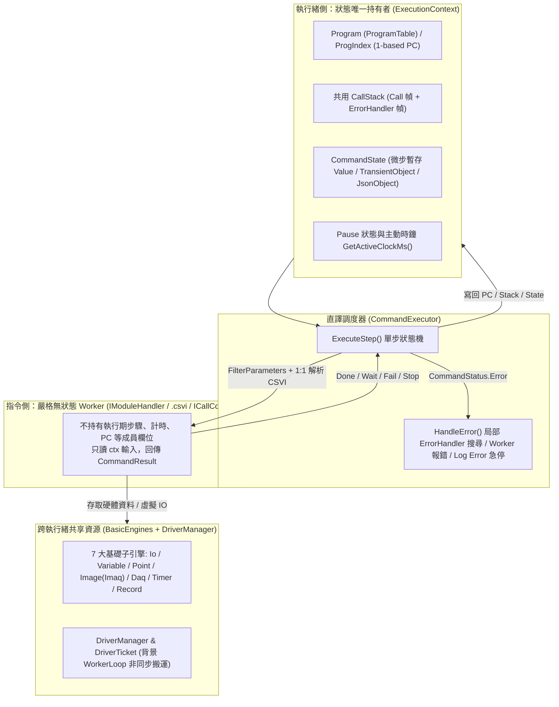

# ARCOSharp 核心架構與設計哲學白皮書 (Code-Verified Architecture Spec)

> **文件定位**：本文件依據目前實際可編譯與實測通過的 `src/` 程式碼重新整理而成，專門補足舊版 [`00_DEV_GUIDE.md`](./00_DEV_GUIDE.md) 與 [`00_README.md`](./00_README.md) 遺漏、寫反或過時的核心執行模型。  
> **核心主軸**：**無狀態指令 (Stateless Command) ＋ 執行緒持有狀態 (Stateful Thread) ＋ Manager–Workers 隔離模型 ＋ `Call` / `ErrorHandler` 共用 Stack ＋ `EMG STOP` 雙態鎖定**。

---

## 1. 系統第一原理：為什麼執行引擎這樣設計？

ARCOSharp 承襲自 LabVIEW `CMDEXECUTE` 狀態機架構，整個控制系統建立在三個不可動搖的架構分界上：

1. **執行速度絕對優先於 UI 渲染**：直譯迴圈與硬體驅動全速獨立運轉，UI 僅為低優先權的觀察者；即使前端完全靜止或無 UI，背景多執行緒直譯仍全速運作。
2. **指令必須無狀態 (Stateless Command)、執行緒才持有狀態 (Stateful Thread)**：同一時間最多有 13 條主執行緒與任意數量的動態 `SubThread` 在不同程式區平行運作，同時呼叫同一顆指令。唯有將所有執行期狀態完全留在執行緒側 (`ExecutionContext`)，指令本身保持無狀態純函式，才能做到零鎖競爭與完全可重入。
3. **每個程式區彼此獨立、Manager 與 Worker 職責分離**：Worker 程式區只專注完成自己站點的流程，不偷看也不干預其他程式區；單站發生未攔截錯誤時只停下自己並舉起專屬旗標，由 `ThreadMain`（Manager）統一監控全場並決定機台級的調度策略；全機急停 (`EMG STOP`) 則是獨立的最高層硬/軟鎖定機制。



---

## 2. Stateless Command vs. Stateful Thread 契約

### 2.1 為什麼指令實作嚴禁持有狀態？
* [`ModuleRegistry`](../../src/ARCOS.Core/Execution/ModuleRegistry.cs) 會依據檔案修改時間快取已載入的模組與 `<Action>.csvi` `IModuleHandler` 實例（`_csviActionCache`）。
* 這代表**同一個指令 Handler 實例可能會被 `ThreadMain`、`Thread1..Thread12` 與多個 `SubThread` 同時呼叫**。
* **鐵律**：任何模組主控、`<Action>.csvi` 或 `ExternalModules/*.csvi` 的類別中，**嚴禁使用欄位 (`private int _step`、`private long _startTime`) 儲存當前執行進度**；所有與該次指令執行相關的中間狀態，必須寫入傳入參數 `ExecutionContext ctx` 內的 `ctx.State`。

### 2.2 `ExecutionContext` 持有的完整狀態
定義於 [`src/ARCOS.Core/Execution/ExecutionContext.cs`](../../src/ARCOS.Core/Execution/ExecutionContext.cs)：

| 屬性 / 方法 | 實際型別與真實語義 |
|---|---|
| `Program` / `ProgIndex` | 當前執行中的 [`ProgramTable`](../../src/ARCOS.Core/Execution/ProgramTable.cs)（含完整指令表 `Count`、`Items`、`this[1..Count]`、`FindLabel()`、`FindErrorHandler()`）與 1-based 行號 (PC)。設定 `ProgIndex` 時以 `Interlocked.Exchange` 更新無鎖指標 `ReportedProgIndex`，觸發非阻塞 `OnProgIndexNoticed` 並標記 `IsPcModified`。 |
| `Jump()` / `Call()` / `Return()` / `Retry()` | 供指令直接操作當前執行緒跳轉、呼叫副程式、返回與錯誤重試的安全輔助方法，搭配 `CommandResult.Done()` 即生效。 |
| `CallStack` | `Stack<ExecutionStackFrame>`，同時承載 `Call` 與 `ErrorHandler` 兩種堆疊幀。 |
| `FailedPC` | 最近一次觸發 `HandleError` 時記錄的失敗行號（無堆疊幀時供 `Retry` 退回使用）。 |
| `State` | [`CommandState`](../../src/ARCOS.Core/Model/CommandState.cs) 微步狀態暫存器。**注意：實際屬性為 `Value` (`int`)、`TransientObject` (`object?`)、`Data` / 索引子 `ctx.State["key"]` (`JsonObject`)、`Get<T>(key)`、`HasData` 與 `Reset()`**（舊文件誤植的 `Step` / `TimerMs` / `Tag` 並不存在）。 |
| `CurrentSection` | 變數分區名稱（預設 `"Global"`）。 |
| `IsLocalPaused` / `IsBypassPause` | 單一執行緒局部暫停；當 `ThreadName.EndsWith('&')` 時 `IsBypassPause == true`，可穿透全域暫停。 |
| `GetActiveClockMs()` | 扣除 Local Pause 與 Global Pause 凍結期間後的有效執行時鐘（供 `System@Delay` 等計時指令精準扣時）。 |

### 2.3 高速 `CMDEXECUTE` 背景迴圈與 PC 控制契約 (`StartBackgroundLoop`)
每個啟動的執行緒皆跑在獨立的 `StartBackgroundLoop` 背景迴圈中：
* **指令讀取指令表自行定位，並直接修改 PC／堆疊**：每一顆指令執行時皆可透過 `ctx.Program` 讀取當前程式區的完整指令表（`ctx.Program[1..ctx.Program.Count]`、`Items`、`FindLabel`），自行前後掃描配對區塊或跳躍目標（如 `If`/`ElseIf`/`Else`/`ForeachBreak`/`SubThreadStart`），直接賦值 `ctx.ProgIndex = ...` 或呼叫 `ctx.Jump(...)` / `ctx.Call(...)` / `ctx.Return()` / `ctx.Retry()`，然後單純回傳 **`CommandResult.Done()`**。新增任何新奇的流程跳躍語法都只需寫在 `.csvi` 本身，無須修改核心 `CommandExecutor`。
* **PC 推進不重覆 `+1` 契約**：`CommandExecutor` 在執行步驟前會重置 `IsPcModified`，**僅在指令未動過 PC 時才執行 `ctx.ProgIndex++`**；只要指令有修改過 PC（包含原地跳轉 `ctx.ProgIndex = ctx.ProgIndex`），回傳 `Done()` 時不會多加 1，且同樣會重設 `ctx.State`。`CommandStatus` 僅保留純粹的 4 種結果狀態：`Completed` (`Done`)、`Waiting` (`Wait`)、`Error` (`Fail`)、`Stop` (`Stop`)。
* **非阻塞微步等待**：指令尚未完成（例如 `System@Delay`、`System@MessageBox`、`IO@WaitPortOn`）時回傳 `CommandResult.Wait()`，保留 `ProgIndex` 與 `ctx.State`；迴圈偵測 `ProgIndex == prevPC` 時才 `await Task.Delay(1, token)` 讓出 CPU。
* **瞬時指令全速衝刺**：只要指令推進了 PC（`ProgIndex != prevPC`），迴圈以零 `Task.Delay` 全速連續執行，每累積 `128` 步才執行一次 `Thread.Yield()`。
* **指令完成自動歸零**：當指令完成或跳離當前指令時，`CommandExecutor` 自動呼叫 `ctx.State.Reset()` 清理單步暫存（僅保留 `AIAgent_` 前綴之工作階段標記）。

---

## 3. 三層核心資源架構與 7 大 `BasicEngines`

ARCOSharp 的系統能力由下而上分為三個清楚層次，且 `ARCOS.Core` 完全不依賴 Avalonia UI：

1. **第一層：`BasicEngines`（7 大基礎子引擎）＋ `DriverManager`**（定義於 [`BasicEngines.cs`](../../src/ARCOS.Core/Drivers/BasicEngines.cs)）：
   * `Io` (`IoEngine`)：實體點位 (`P0.0`~)、點位別名、以及全域/執行緒 `#` 虛擬 IO 狀態池。
   * `Variable` (`VariableEngine`)：分區變數表、`$(Var)` / `[Var]` 前置替換與運算式計算。
   * `Point` (`PointEngine`)：7 維空間座標 (`XYZUVWH`)、料盤與路徑。
   * `Image` / 別名 `Imaq` (`ImageEngine`)：影像緩衝區與非破壞性標註。
   * `Daq` (`DaqEngine`)：多通道採樣波形與統計/比對。
   * `Timer` (`TimerEngine`)：計時器與計數器，並維護全域暫停狀態 (`IsSystemPaused` / `System#Pause?`)。
   * `Record` (`RecordEngine`)：2000 槽位 $O(1)$ 環狀緩衝日誌（含 `SYSTEMLOG` 通道與週期計時）。
   * **硬體隔離**：`IDriver` 透過背景 `WorkerLoop` 與 `DriverTicket` 非同步搬運硬體資料，避免主直譯迴圈卡死在慢速通訊 I/O 上。
2. **第二層：功能模組 (`MODULES/<Module>/`)**：
   * 每個模組由 `<Module>.csvi` 擔任模組跳板與 `Modules Info` 一級前面板；核心指令已全面要求 **1:1 對應 `MODULES/<Module>/<Action>.csvi`**（見 `CommandExecutor.ExecuteStep` 檢查清單：`System`、`Variable`、`Thread`、`IO`、`Motion`、`Capture`、`DAQ`、`Python`、`Point&Path`、`User`、`MultiStation`、`Redis`、`AIAgent`），找不到 `.csvi` 直接回傳 `CommandResult.Fail`，不再靜默退回內建 switch-case。
3. **第三層：單檔擴充 (`ExternalModules/*.csvi`)**：
   * 實作 `ICallCommand` 之獨立演算外掛，由腳本以 `Call@<Name>`、`Call@<Name>&` 或 `Call@<Name>&&` 隨選呼叫並自動回填接收變數。
   * 所有 `.csvi` 統一透過 `PluginLoadManager`（可回收 `CollectiblePluginContext`）於記憶體串流載入，支援 Windows 下 0 鎖檔熱重載。

---

## 4. Manager–Workers 執行緒隔離模型

[`ArcosThreadVM`](../../src/ARCOS.Core/Execution/ArcosThreadVM.cs) 管理 **100 個程式區 (`0`~`99`)**、**13 個固定主執行緒槽位 (`ThreadMain`, `Thread1`~`Thread12`)** 以及任意數量的 **動態 `SubThread`**：

### 4.1 程式區與執行緒邊界原則
* **程式區互相獨立**：每個正在執行的程式區段（`ProgramTable`）只擁有並管理自己的指令清單、`_labelIndex` 與 `_errorHandlerIndex`。Worker 執行緒在自己的程式區運作時，**不跨區查看也不直接控制其他執行緒的流程**。
* **專屬執行緒狀態虛擬 IO**：VM 初始化或動態建立執行緒時，會為每個執行緒註冊並維護三個專屬 `#` 虛擬 IO 旗標：
  * `<ThreadName>#Run?`：該執行緒是否正在運行（啟動時設 `true`，結束或異常停止時設 `false`）。
  * `<ThreadName>#Pause?`：該執行緒是否處於局部暫停。
  * `<ThreadName>#Error?`：該執行緒是否發生**未由自身 `ErrorHandler` 攔截處理**的指令錯誤（啟動時自動重設為 `false`）。

### 4.2 Manager (`ThreadMain`) 與 Worker (`Thread1..12`) 協作範式
```
[Worker 執行緒: Thread1]                        [Manager 執行緒: ThreadMain]
  執行各自工位 Program                              輪詢全場 Worker 狀態
        │                                               │
  發生硬體/逾時錯誤                                 Thread@If :: Thread1#Error?
        ├──▶ 若當前程式區有 ErrorHandler ──▶ 本地自癒 / ErrorRetry
        │                                               │
        └──▶ 若找不到 ErrorHandler:                      ├─ True: 決定處置方式
             1. Thread1#Error? = True                    │   (例如修復後重啟 Thread@Run
             2. 寫入 SYSTEMLOG                            │    或呼叫 System@Log Error 急停)
             3. 彈出 MessageBox (非靜音時)               │
             4. 停下自己 (Thread1#Run? = False)          └─ False: 繼續正常監控流程
             ※ 絕不主動觸發 99: EMG Stop
```

### 4.3 系統事件程式區 (`94`~`99`) 與 `&` 特權執行緒
`InitializeDefaultSystemPrograms()` 會為系統事件保留區寫入預設行為（若專案檔未覆寫）：

| 程式區 | 事件觸發來源 | SubThread 名稱 | 出廠預設指令 | 說明 |
|---|---|---|---|---|
| `94: Pause Off` | 解除暫停按鈕 | `PauseOff&` | `System@Resume` | 帶 `&` 免暫停特權，可在全機暫停下恢復執行。 |
| `95: Pause On` | 進入暫停按鈕 | `PauseOn&` | `System@Pause` | 進入全機暫停並停結各執行緒時鐘。 |
| `96: Execute On` | Operator `Run` 啟動 | `ExecuteOn&` | `Thread@Run::0,0` | 預設啟動 `ThreadMain (0)` 執行 `0: Main`。 |
| `97: Execute Off` | 停止 / 主執行緒結束 | `ExecuteOff&` | *(空)* | 供使用者自訂收尾動作。 |
| `98: End Script` | 主視窗關閉 (`OnClosing`) | `EndScript&` | *(空)* | 若非空，先等待此區執行完畢才關閉視窗。 |
| `99: EMG Stop` | 面板 `!! STOP !!` 或 `System@Log Error` | `EMGStop&` | `Motion@Stop` | 即使系統處於 `IsEmgStopped` 鎖定，唯獨 99 仍允許啟動以執行全軸急停等安全動作。 |

---

## 5. `Call` 與 `ErrorHandler` / `ErrorRetry` 共用 Stack 機制

這是最關鍵、也最容易被舊文件誤導的執行期機制：在 ARCOSharp 中，**副程式呼叫 (`Call`) 與錯誤攔截 (`ErrorHandler`) 共用同一條 `ctx.CallStack` (`Stack<ExecutionStackFrame>`)**。

### 5.1 堆疊幀結構 (`ExecutionStackFrame`)
```csharp
public enum StackFrameKind
{
    Call,
    ErrorHandler
}

public readonly record struct ExecutionStackFrame(
    ProgramTable Program,
    int ReturnLine,
    StackFrameKind Kind = StackFrameKind.Call);
```

### 5.2 四條核心堆疊不變量 (Stack Invariants)
1. **Strict Per-Program Isolation（錯誤搜尋不跨程式區）**：
   當執行緒在 `ctx.Program` 某行回傳 `CommandStatus.Error` 時，`CommandExecutor.HandleError` **只呼叫當前 `ctx.Program.FindErrorHandler(errorLabel)`** 搜尋同一份 `ProgramTable` 內的 `Thread@ErrorHandler::[[Label]]` 或通用 `Thread@ErrorHandler`（見 [`ProgramTable.cs`](../../src/ARCOS.Core/Execution/ProgramTable.cs#L105-L134)）。絕對不會往外翻找呼叫者 (`Call` caller) 的 `ErrorHandler`。
2. **`ErrorHandler` Push 進共用 Stack**：
   若在當前 `ctx.Program` 找到對應的 `healingLine`，系統會把 `(ctx.Program, ctx.ProgIndex, StackFrameKind.ErrorHandler)` Push 進 `ctx.CallStack`，接著重設 `ctx.State` 並跳到 `healingLine` 繼續執行（注意：`ReturnLine` 存的是「出錯那一行」，因為重試要回到原行或相對偏移）。
3. **`ErrorRetry` (`CommandStatus.Retry`) 彈出最近錯誤幀重試**：
   在 `ErrorHandler` 區段中執行 `Thread@ErrorRetry` 時，`CommandExecutor` 會從 `ctx.CallStack` 頂端持續 Pop 掉任何內層幀，直到遇到最近一個 `StackFrameKind.ErrorHandler` 幀並將其 Pop 出，然後將 `ctx.Program` 與 `ctx.ProgIndex = Math.Max(1, errFrame.ReturnLine + offset)` 還原，重試該處指令（若無 `ErrorHandler` 幀才退回 `ctx.FailedPC + offset`）。
4. **`Return` 或走到底端時自動清除未重試的 `ErrorHandler` 幀**：
   如果在進入 `ErrorHandler` 後，腳本決定**不重試**而直接 `Thread@Return` 或自然執行到程式尾端 (`ProgIndex > Program.Count`)，`CommandExecutor` 會先把堆疊頂端連續的 `StackFrameKind.ErrorHandler` 幀清理拋棄，再檢查底層是否還有 `StackFrameKind.Call` 幀可返回上層副程式，徹底避免把「失敗行號」誤當成「副程式返回行號」造成無限重跑。

```
範例堆疊演進（Main 呼叫 SubProg A，SubProg A 第 5 行失敗並進入自身 ErrorHandler）：
  Step 1 (Main 第 3 行 Thread@Call::A)
     Stack Top -> [Call: Main, ReturnLine=4]
  Step 2 (SubProg A 第 5 行 IO@WaitPortOn 失敗，跳往本區 Thread@ErrorHandler)
     Stack Top -> [ErrorHandler: SubProg A, ReturnLine=5]
                  [Call: Main, ReturnLine=4]
  Step 3A (若 ErrorHandler 決定重試：執行 Thread@ErrorRetry)
     Pop ErrorHandler -> 回到 SubProg A 第 5 行重試；底層 [Call: Main, 4] 完好保留。
  Step 3B (若 ErrorHandler 處理完畢不重試：直接 Thread@Return 或走到程式尾端)
     自動丟棄頂端 [ErrorHandler: SubProg A, 5] -> 接著 Pop [Call: Main, 4] 正常返回 Main 第 4 行。
```

---

## 6. 錯誤處置 vs. 全機 `EMG STOP` 狀態機

ARCOSharp 嚴格區分「局部可自癒錯誤」、「單執行緒未處理異常」與「全機急停 (`EMG STOP`)」三條路徑，對應程式碼位於 [`CommandExecutor.HandleError`](../../src/ARCOS.Core/Execution/CommandExecutor.cs#L237-L299)、[`SystemModuleHandler.cs`](../../src/ARCOS.Core/Execution/Handlers/SystemModuleHandler.cs#L56-L73) 與 [`ArcosThreadVM.cs`](../../src/ARCOS.Core/Execution/ArcosThreadVM.cs#L602-L645)：

| 情境 | 觸發條件 | 執行期行為 | 是否設 `<ThreadName>#Error?` | 是否鎖定並執行 `99: EMG Stop` | 恢復方式 |
|---|---|---|---|---|---|
| **1. 可自癒局部錯誤** | 一般指令回傳 `Fail`，且當前 `ProgramTable` 存在對應 `ErrorHandler` | Push `ErrorHandler` 幀並跳轉局部修復／`ErrorRetry` | ❌ 否 | ❌ 否 | 執行 `ErrorRetry` 或自然返回 |
| **2. Worker 未攔截錯誤** | 非 `System@Log Error` 之指令回傳 `Fail`，且當前 `ProgramTable` 找不到對應 `ErrorHandler` | 記 Log、跳非阻塞 `MessageBox`（非靜音時）、**僅停下該 Thread** | ✅ **是** (`true`) | ❌ **否**（交由 Manager 輪詢處置） | 下次啟動該 Thread 時自動清除；或由 Manager 處置 |
| **3. 全機 `EMG STOP`** | 按下 UI `!! STOP !!` 按鍵，或腳本執行 `System@Log Error`（無本地 ErrorHandler 攔截時） | `TriggerEmgStop()`：設 `IsEmgStopped = true` ➔ `StopAll()` 停下所有執行緒 ➔ 觸發 `99: EMG Stop` (`EMGStop&`) ➔ UI 徽章顯示紅底白字 `EMG STOP` | 依當前 Thread 狀態，系統層主鎖定為 `IsEmgStopped` | ✅ **是**（全機鎖定，禁止啟動或恢復一般執行緒與 94~98 Hook） | **必須執行 `System@Clear Error`** 呼叫 `ClearEmgStop()` 解除鎖定 |

> [!IMPORTANT]
> **`System#Error?` 已全面廢除**：請勿在任何新寫的模組、`.csvi` 或腳本中讀取或寫入 `System#Error?`。要檢查執行緒錯誤請使用 `<ThreadName>#Error?`（例如 `Thread1#Error?`）；要判定或解除全機急停鎖定請透過 `ArcosThreadVM.IsEmgStopped` 與 `System@Log Error` / `System@Clear Error`。

---

## 7. 舊版文件 (`DEV-GUIDE.md` / `docs/dev-guide/*`) 關鍵勘誤表

若你或未來的開發者／Agent 需要對照閱讀舊目錄的文件，請以此表覆寫舊文件中的誤區：

| 項目 | 舊文件誤寫 / 過時記載 | 現行程式碼真實行為 |
|---|---|---|
| **錯誤狀態旗標** | 舊文件 (`01`, `10`, `13`) 記載 `ctx.Log(..., isError: true)` 會寫入全域 `System#Error?` | **`System#Error?` 已移除**。執行緒錯誤改為精確寫入 `<ThreadName>#Error?`，由 Manager (`ThreadMain`) 監控處理。 |
| **指令失敗後的系統動作** | `13` 記載任何 `CommandResult.Fail` 若無 `[[Label]]` 就會觸發 `99: EMG Stop` 或全機暫停 | 一般指令失敗**只停下該條 Thread + 記 Log + 彈出 MessageBox + 設 `<ThreadName>#Error?`**，不會觸發 99。只有 UI `!! STOP !!` 與 `System@Log Error` 才會觸發 `EMG STOP` 與 `99: EMG Stop`。 |
| **`System@Log Error` / `Clear Error`** | 舊文件全數漏寫 | `System@Log Error` = 腳本觸發面板 `EMG STOP`（進入 99 並鎖機）；`System@Clear Error` = 清除 `EMG STOP` 鎖定與系統錯誤狀態。 |
| **`CallStack` 型別與 `ErrorRetry`** | `01`, `02` 寫成 `Stack<(ProgramTable Program, int ReturnLine)>`，並以為只有 `FailedPC` | 實際為 `Stack<ExecutionStackFrame>`，共用 `Call` 與 `ErrorHandler` 兩種 `StackFrameKind`；`ErrorHandler` 嚴格限縮於當前 `ProgramTable`，`ErrorRetry` 從堆疊 Pop 後重試。 |
| **`CommandState` 屬性** | `05`, `13` 的範例碼寫 `ctx.State.Step`、`ctx.State.TimerMs`、`ctx.State.Tag` | **這些屬性不存在**。實際為 `ctx.State.Value`、`ctx.State.TransientObject`、`ctx.State["key"]` (`JsonObject`)、`ctx.State.Get<T>(key)`。 |
| **`BasicEngines` 數量** | `DEV-GUIDE.md`, `00` 名詞表, `01`, `02` 寫「6 大子引擎」，同目錄 `00` 索引與 `13` 又寫「7 大」 | 實際 [`BasicEngines.cs`](../../src/ARCOS.Core/Drivers/BasicEngines.cs) 確為 **7 個**（包含 `RecordEngine`）。 |
| **幻覺範例指令** | `DEV-GUIDE.md` L121 提到 `System@WaitIO` | 全專案無此指令；IO 等待指令屬於 `IO@` 模組（如 `IO@WaitPortOn`）。 |
| **專案檔副檔名** | `01`, `02` 寫 `.pro`，`DEV-GUIDE.md` 寫 `.prog` | 預設為 `.prog`（`ScriptSerializer` 向後相容 `.pro`）；單一獨立區段為二進位 `.init`。 |
| **`MainWindow.axaml.cs` 規模** | `09_ARCHITECTURE_REVIEW.md` 記載「超過 1,700 行」 | 實際已成長至 **2,877 行**，為早期過時快照。 |
