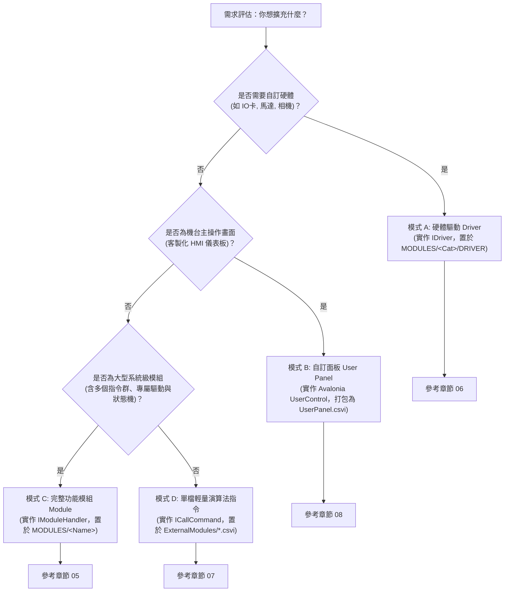

# ARCOSharp 二次開發指南與技術規格白皮書

> [!IMPORTANT]
> **【系統最高架構準則 (Supreme Architectural Invariant)】**  
> **以程式執行速度為唯一第一目標，視覺即時更新絕非重點。**  
> **UI 視覺呈現必須放到合適時機進行；凡非當前 Active 的 UI 元件、分頁或視窗，絕對嚴禁進行任何更新與重繪！**  
> 完整開發規範請見根目錄主文檔：[DEV-GUIDE.md](../../DEV-GUIDE.md)。

本指南專為有意於 **ARCOSharp** 自動化機台控制系統進行**二次開發、功能擴充、外掛整合與硬體驅動移植**的架構師與工程師撰寫。所有介面規格、通訊協定、路徑拓撲與生命週期流程均**嚴格依據真實原始碼實作**編寫。

---

## 📚 文件章節索引 (Documentation Index)

| 章節 | 文件名稱 | 核心內容說明 |
|---|---|---|
| **01** | [整體架構總覽 (Architecture Overview)](./01_ARCHITECTURE_OVERVIEW.md) | 分層架構、啟動流程、指令生命週期、執行緒模型與發行目錄拓撲 |
| **02** | [ARCOS.Core API 參考手冊 (Core API Reference)](./02_CORE_API_REFERENCE.md) | `ARCOS.Core` 核心組件所有 Public API 簽章、參數、行為與最小使用範例 |
| **03** | [ARCOS.App API 與 UI 規範 (App API Reference)](./03_APP_API_REFERENCE.md) | Avalonia 主程式 Public API、參數導引搜尋順序、快捷鍵機制與 MCP 自動化伺服器 |
| **04** | [ARCOS.Remoter 通訊協定 (Remoter Reference)](./04_REMOTER_API_REFERENCE.md) | Telnet 遠端遙控 Sidecar 協定、命令格式、執行範例與安全建議 |
| **05** | [動態模組擴充教學 (Extend Module)](./05_EXTEND_MODULE.md) | 從零開發自訂模組（`IModuleHandler`）、指令註冊、`Init.csvi` 初始化與參數導引 |
| **06** | [硬體驅動與 Driver CSVI 設計 (Extend Driver CSVI)](./06_EXTEND_DRIVER_CSVI.md) | Directory-Per-Driver 隔離架構、`IDriver`、`DriverTicket` 票據通訊與新驅動開發 |
| **07** | [ExternalModules 單檔外掛開發 (Extend External CSVI)](./07_EXTEND_EXTERNAL_CSVI.md) | `ICallCommand` 單檔演算法外掛、`Call@` 指令調度機制與 CsviStudio 工具鏈 |
| **08** | [User Panel 自訂操作面板 (Extend User Panel)](./08_EXTEND_USER_PANEL.md) | `UserPanel.csvi` 生命週期、主介面掛載、雙向變數/IO/腳本通訊與範例 |
| **09** | [架構瓶頸分析與審查報告 (Architecture Review)](./09_ARCHITECTURE_REVIEW.md) | 現行架構弱點診斷（耦合性、記憶體洩漏、安全性、併發鎖定）與重構指引 |
| **10** | [擴充者可用 API 總目錄 (Extension API Catalog)](./10_EXTENSION_API_CATALOG.md) | **【必讀】** 擴充者能調用的所有 Public API、子引擎、上下文與事件速查矩陣 |
| **11** | [複合邏輯表達式編輯器使用指南 (Logic Editor Guide)](./11_LOGIC_EDITOR_GUIDE.md) | `$logic` 編輯器使用時機、運算子體系（IO/Variable/區間/空值）、操作方法與二次開發調用 |
| **12** | [統一模組中心、內嵌 CSVI Studio 與 MCP 規格書 (Unified Modules Info Spec)](./12_UNIFIED_MODULES_INFO_SPEC.md) | 底部 6 大分頁、統一模組中心、CSVI Studio 內嵌 IDE、動態 MCP Server 與零依賴 Roslyn 編譯架構 |

---

## 💡 CSVI 核心哲學：大一統三元架構 (The Unified Trinity of CSVI)

無論 CSVI 被應用於**指令模組**、**硬體驅動**、**使用者主面板 (User Panel)** 還是**單檔演算法擴充**，其內部皆嚴格具備三個實體組成（**三位一體**），僅在 ARCOSharp 系統中的**載入與調度時機**不同：

1. **C# 代碼 (Code Behind / Logic)**：核心業務邏輯、硬體通訊協議、演算法或後端計算。
2. **UI 前面板 (Front Panel HMI)**：即時監控、硬體狀態儀表板或操作員專屬生產畫面。
3. **參數導引 UI (Parameter Guidance Wizard)**：在排程器編輯器中點選指令時彈出的視覺化配置精靈，防止語法錯誤並即時生成指令參數。

---

## 🧭 四大擴充路徑快速選型指引

在開始二次開發前，請依據您的應用情境選擇最適合的擴充模式：

---

## 📖 核心名詞與術語對照表 (Glossary)

| 術語 | 英文縮寫 / 原名 | 定義與在 ARCOS 中的角色 |
|---|---|---|
| **CSVI** | C# Virtual Instrument | ARCOS 的虛擬儀器包（副檔名 `.csvi`），本質為包含 Manifest 元數據、Runtime XAML、原始碼封包的標準 .NET 組件。 |
| **BasicEngines** | Basic Engines | 機台六大子引擎集合容器，包含 `Io`、`Variable`、`Point`、`Image` (Imaq)、`Daq`、`Timer`。 |
| **ExecutionContext** | Execution Context | 腳本執行緒即時上下文，持有所屬 ProgramTable、PC 指標、微步狀態機 `CommandState`、子引擎參照與系統日誌。 |
| **Module Handler** | `IModuleHandler` | 指令直譯處理器，負責解析特定前綴的指令（如 `IO@`、`Motion@`、`System@`），將動作派發至子引擎或 Driver。 |
| **Driver Ticket** | `DriverTicket` | 弱耦合硬體通訊票據，透過字串命令、結構化參數與多載承載物件（Payload）向 Driver 發送請求並回傳結果。 |
| **Test Thread Editor** | Test Thread (`Ctrl+T`) | 獨立測試執行緒編輯器，支援半透明懸浮置頂、單步執行 (`Step`)、快速鍵腳本編輯與熱除錯。 |
| **User Panel** | User Front Panel | 機台主畫面「User Tab」所承載之動態外掛 HMI 面板，支援透過 `Init(BasicEngines)` 雙向綁定機台狀態。 |
| **MCP Server** | Model Context Protocol | 內建於 `127.0.0.1:19528` 的 JSON-RPC 2.0 自動化伺服器，供 AI Agent 或外掛程式進行零干擾實機操作。 |
| **Remoter** | Telnet Sidecar | 獨立運行的 TCP 服務（Port 9527），提供輕量級文字協定供產線 MES 或遠端系統讀寫變數與 IO。 |
