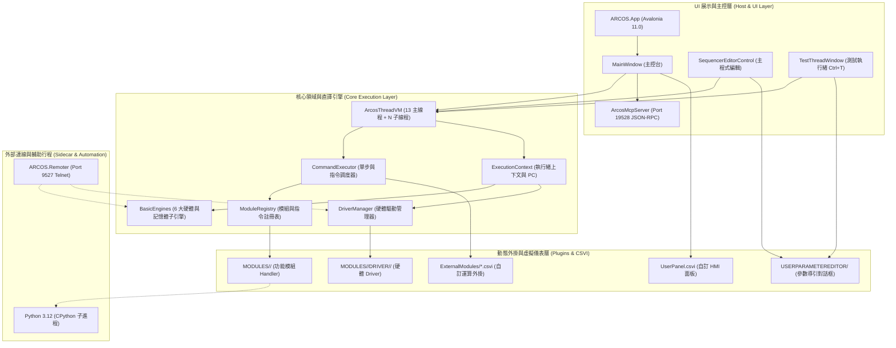
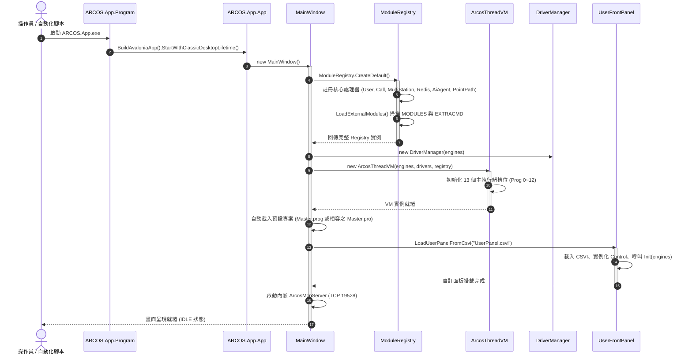
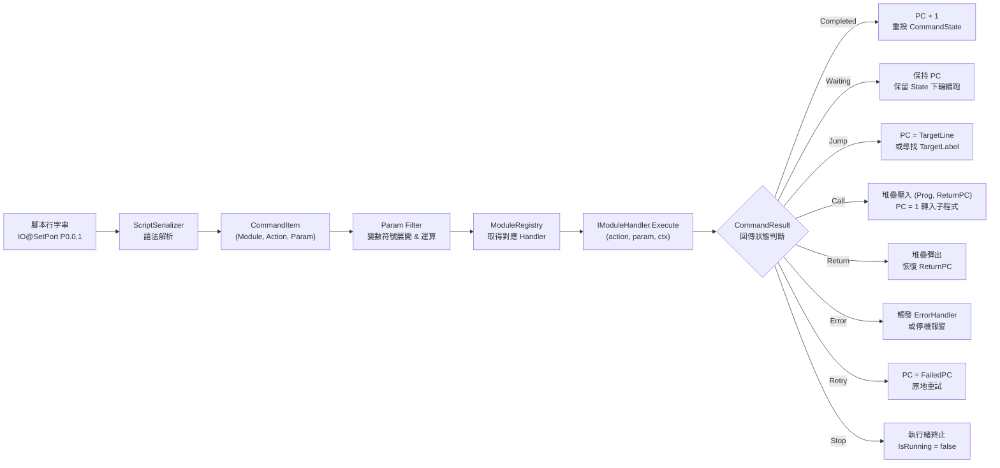
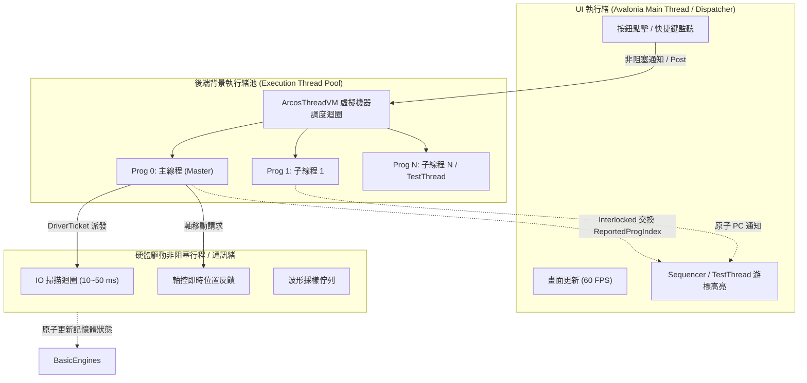

# 01. ARCOSharp 整體架構總覽 (Architecture Overview)

> [!IMPORTANT]
> **【系統最高架構準則】程式執行速度為唯一第一指標，UI 延遲更新、非 Active 絕對不更新**  
> 核心調度（VM / Executor / Engines / Drivers）全速運轉，與 UI 完全解耦。UI 僅為次要觀察者，凡非當前 Active 之畫面嚴禁更新（詳細規範詳見 [DEV-GUIDE.md](../../DEV-GUIDE.md)）。

本文檔全面剖析 **ARCOSharp** 自動化控制系統的軟體分層、啟動生命週期、指令執行狀態機、並發執行緒模型與部署拓撲。

---

## 1. 軟體分層與依賴架構 (Layering Architecture)

ARCOSharp 採用**領域核心驅動 (Domain-Core Driven) 與動態外掛隔離架構**。底層執行引擎（`ARCOS.Core`）與上層展示層（`ARCOS.App` Avalonia UI）完全解耦，外掛模組、硬體驅動與自訂面板皆以獨立動態組件形式掛載：



### 各層職責界定

1. **ARCOS.Core (`src/ARCOS.Core`)**：
   - 系統核心領域庫，純 .NET 8 類別庫，**完全不依賴任何 UI 元件**。
   - 負責腳本序列化（`.pro` / `.init`）、語法剖析、變數替換（Param Filter）、指令分發（`CommandExecutor`）、虛擬機器調度（`ArcosThreadVM`）、六大基礎子引擎（`BasicEngines`）與硬體通訊票據路由（`DriverManager`）。
2. **ARCOS.App (`src/ARCOS.App`)**：
   - 基于 Avalonia 11 的跨平台桌面主控台。
   - 負責機台整體 UI 佈局、分頁切換、圖表渲染、即時視覺化、Test Thread 獨立懸浮編輯器、快捷鍵處理、動態 XAML 載入與內建 MCP 自動化伺服器。
3. **ARCOS.Remoter (`src/ARCOS.Remoter`)**：
   - 獨立的 Telnet 側車 (Sidecar) 服務，提供純文字 TCP 指令集（`$GetIO`, `$SetIO`, `$GetVariable`, `$SetPoint`, `$Execute` 等），供產線工控電腦或 MES 遠端調用。
4. **MODULES 與 Drivers (`src/MODULES/`)**：
   - 各領域獨立實作的模組執行邏輯與硬體驅動程式，遵循 Directory-Per-Driver 目錄隔離規範。

---

## 2. 系統啟動與初始化時序 (Startup Sequence)



---

## 3. 單行指令完整生命週期與狀態機 (Command Lifecycle & State Machine)

每當機台執行一行腳本指令時，核心引擎經歷以下管道階段：



### CommandStatus 列舉狀態與語意表

| 列舉值 | 意義 | 核心處理行為 |
|---|---|---|
| `Completed` | 動作成功完成 | `ctx.ProgIndex++`；重設 `ctx.State`（清空計時與步驟變數）。 |
| `Waiting` | 異步等待 / 微步進行中 | 保持目前 `ctx.ProgIndex` 不變；保留 `ctx.State`，於下一個循環繼續調用 `Execute`。 |
| `Jump` | 跳躍指令 | 將 `ctx.ProgIndex` 設為指定之行號或跳至標籤所在行。 |
| `Call` | 副程式呼叫 | 將當前 `(ProgramTable, ReturnLine)` 壓入 `ctx.CallStack`，將 PC 設為目標程式第一行。 |
| `Return` | 副程式返回 | 從 `ctx.CallStack` 彈出上一層程式與返回行號，恢復 PC。 |
| `Error` | 異常報警 | 記錄錯誤日誌至 `System#Error?`，若設有 `ErrorLabel` 則跳轉至錯誤處理常式，否則暫停機台。 |
| `Retry` | 原處重試 | 將 PC 設回 `ctx.FailedPC`，再次嘗試執行上一失敗指令。 |
| `Stop` | 終止執行緒 | 設定 `ctx.IsRunning = false`，該執行緒退出循環。 |

---

## 4. 並發與執行緒模型 (Threading & Concurrency Model)

ARCOSharp 採用**非同步雙重節奏並發模型 (Dual-Paced Concurrency)**：



### 關鍵並發守則
1. **原子化 PC 回報 (`ReportedProgIndex`)**：
   - 核心執行緒在更新行號時，透過 `Interlocked.Exchange(ref _reportedProgIndex, pc)` 進行無鎖交換。
   - 訂閱 `OnProgIndexNoticed` 之 UI 處理常式**絕不可在回呼內進行同步阻塞**，必須使用節流或 `Dispatcher.UIThread.Post` 異步更新反白游標。
2. **微步非阻塞狀態機 (Micro-stepping)**：
   - 所有等待型指令（如 `IO@WaitPortOn`、`System@Delay`、`Motion@WaitMotion`）**嚴禁使用 `Thread.Sleep()`**。
   - 必須透過 `ctx.State` 記錄起始時間戳記，若未逾時則回傳 `CommandResult.Wait()`，將 CPU 執行權交回 VM 調度迴圈。

---

## 6. CSVI 3.0 大一統三元架構 (The Grand Unified Trinity Architecture)

在 **ARCOSharp** 的核心哲學中，**每一個 `.csvi` 套件在本質上都是平等的，且在架構上皆嚴格遵循「三元一體」的統一實作規範**：

```
┌────────────────────────────────────────────────────────────────────────┐
│                   CSVI 3.0 虛擬儀表 (4-in-1 組件封裝)                  │
├────────────────────┬────────────────────┬──────────────────────────────┤
│ 1. C# 核心代碼     │ 2. UI 監控前面板   │ 3. 參數導引視窗              │
│ (Core Logic CS)    │ (FrontPanel HMI)   │ (Parameter Guidance UI)      │
├────────────────────┼────────────────────┼──────────────────────────────┤
│ • 業務邏輯 / 驅動  │ • 即時監控 / 儀表  │ • 參數引導精靈 / 對話框      │
│ • 後端資料計算     │ • 嵌入視窗或獨立運行│ • 視覺化選單與語法即時預覽   │
│ • 引擎雙向資料同步 │ • 手動操作與點檢   │ • 一鍵生成參數回填排程器     │
└────────────────────┴────────────────────┴──────────────────────────────┘
```

### 三大應用情境之「使用時機」與「槽位對照矩陣」

雖然所有 CSVI 都包含這三個維度，但根據其在系統中扮演的角色，**ARCOSharp 在執行時期調用與掛載這三者的時機各有不同**：

| CSVI 應用類型 | 1. C# 代碼 (CS Logic) | 2. UI 前面板 (FrontPanel) | 3. 參數導引 UI (Guidance) |
|---|---|---|---|
| **模組主控 CSVI**<br>(Master Module)<br>例: `IO/IO.csvi`, `HELLO/Hello.csvi` | **【調用時機】模組級指令跳板**<br>實作 `IModuleHandler` 擔任該模組的唯一主控入口，自動掃描並快取派發同目錄下的 `<Action>.csvi`（主程式無需內建 `<Module>ModuleHandler.cs`）。 | **【調用時機】Modules Info 切換**<br>實作模組級監控儀表板，於點擊 `Modules Info` 左側模組清單時嵌入展示全域點位/狀態。 | **【調用時機】模組級參數設定**<br>實作 `IParameterGuidance`，供 CSVI Studio 預覽或模組級設定使用。 |
| **單一指令 CSVI**<br>(Action Command)<br>例: `IO/SetPort.csvi`, `IO/InitIOPort.csvi` | **【調用時機】被動式單步呼叫**<br>實作 `IModuleHandler.Execute()`，於排程器執行至 `<Module>@<Action>` 時被動受呼叫並執行單步邏輯。 | **【調用時機】單步除錯面板**<br>實作單一指令測試面板，供 CSVI Studio 預覽與單步觸發。 | **【調用時機】編輯器指令雙擊**<br>實作 `IParameterGuidance`，在 Sequencer 雙擊指令參數欄時彈出 `Wizard.axaml` 引導設定。 |
| **驅動型 CSVI**<br>(Driver)<br>例: `MockIO.csvi`, `MockMotion.csvi` | **【調用時機】主動式背景常駐服務**<br>實作 `IDriver`，於執行 `IO@AddIODriver` 時啟動獨立 `WorkerLoop` 執行緒，每隔 `IntervalMs` 主動搬運硬體點位並處理 `INITIOPORT` / `FORCEUPDATE` 票券。 | **【調用時機】Driver 面板切換**<br>實作 `CreateDriverView()`，由 `Modules Info` 二級面板嵌入顯示即時燈號與點位別名（`InitIOPort` 後自動換名）。 | **【調用時機】AddDriver 參數設定**<br>實作於 View 的第二分頁或 Guidance，在配置設備時引導挑選 COM/IP/點位區間。 |
| **使用者面板 CSVI**<br>(User Panel)<br>例: `UserPanel.csvi` | **【調用時機】HMI 後端邏輯運作**<br>負責計數統計、工單追蹤、調用 SubThread 腳本與配方管理。 | **【調用時機】UserPanelOpen 指令**<br>實作機台操作員專屬的主畫面，下達 `System@UserPanelOpen` 時嵌入主畫面中央畫布。 | **【調用時機】UserPanelCMD 設定**<br>在設定按鈕綁定（`UIBinding`）、Tip strip 或切換屬性時彈窗引導設定。 |
| **單檔擴充 CSVI**<br>(External CSVI)<br>例: `ExternalModules/*.csvi` | **【調用時機】Call@ 指令下達**<br>實作 `ICallCommand.Execute()`，於主腳本執行 `Call@mycsvi.csvi&` 時隨選執行自訂演算法並回寫變數。 | **【調用時機】演算法自訂監控**<br>提供演算法輸入/輸出結果之專屬調試圖表視圖。 | **【調用時機】Call 兩階段導引**<br>在排程器設定 `Call@` 參數時提供自訂輸入介面。 |

---

系統編譯或經由 `tools/pack_runtime.ps1` 打包發布後，目錄結構如下：

```
dist/ARCOS_Runtime/
├── ARCOS_App.exe                  # 主程式主控台
├── ARCOS.Core.dll                 # 核心執行引擎
├── CSVI_Studio.dll                # 內嵌 Roslyn CSVI 編譯器與 IDE 工作台
├── UserPanel.csvi                 # 預設自訂操作面板 (4-in-1 組件)
├── Master.prog                    # 預設全機自動化專案腳本 (舊版相容 .pro)
├── MODULES/                       # 核心功能與擴充模組目錄 (純 CSVI 架構，免 .Module.dll)
│   ├── IO/
│   │   ├── IO.csvi                # IO 模組同名主控跳板與模組前面板 (IModuleHandler + IParameterGuidance)
│   │   ├── AddIODriver.csvi       # 單一指令 CSVI (包含 Logic.cs + Wizard.axaml + Panel.axaml)
│   │   ├── SetPortName.csvi       # 單一指令 CSVI (綁定實體點位與語意別名)
│   │   ├── InitIOPort.csvi        # 單一指令 CSVI (收網同步別名至 Driver UI 並可覆寫掃描間隔)
│   │   ├── ForceUpdate.csvi       # 單一指令 CSVI (強制 Driver 立即插隊執行一次硬體讀寫)
│   │   ├── SetPort.csvi           # 單一指令 CSVI (支援尾綴 ForceUpdate)
│   │   ├── *.csvi                 # 其餘 IO 指令 CSVI (ClrPort, WaitPort, CheckLogicOn...)
│   │   └── DRIVER/                # 硬體驅動隔離目錄
│   │       └── MockIO/
│   │           └── MockIO.csvi    # 主動式硬體驅動封裝 (IDriver + 前面板 + 參數精靈)
│   ├── POINT&PATH/                # 點位與幾何路徑模組 (Point&Path.csvi + Calculate.csvi...)
│   ├── HELLO/                     # 範例純 CSVI 模組 (Hello.csvi + Init.csvi + SayHello.csvi...)
│   ├── MOTION/                    # 運動控制模組 (軸卡驅動、點位移動)
│   ├── CAPTURE/                   # 視覺取像模組 (相機驅動、幾何匹配)
│   ├── DAQ/                       # 類比量測模組 (資料擷取卡、濾波)
│   ├── SYSTEM/                    # 系統控制模組 (延遲、日誌、面板開啟)
│   ├── THREAD/                    # 流程控制模組 (Jump, Call, If, Loop)
│   ├── VARIABLE/                  # 變數計算模組 (Set, Calc, Stack)
│   └── PYTHON/                    # 外部腳本模組 (Init.csvi, Script)
├── ExternalModules/               # 輕量級單檔 .csvi 擴充外掛 (ICallCommand)
│   └── mycsvi.csvi
├── POINT&PATH/                    # 教導點位與路徑軌跡檔案 (*.pt / Points.ini)
├── WAVEFORM/                      # 採樣波形數據目錄 (*.csv)
├── PICTURE/                       # 視覺圖像存檔目錄
├── SCRIPT/                        # 備用與自訂腳本目錄
└── LOGS/                          # 當日營運日誌 (yyyyMMdd-HHmmss.log)
```
