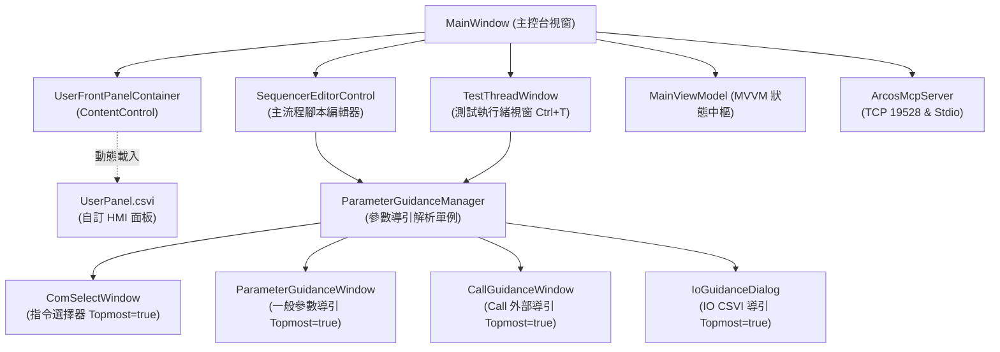
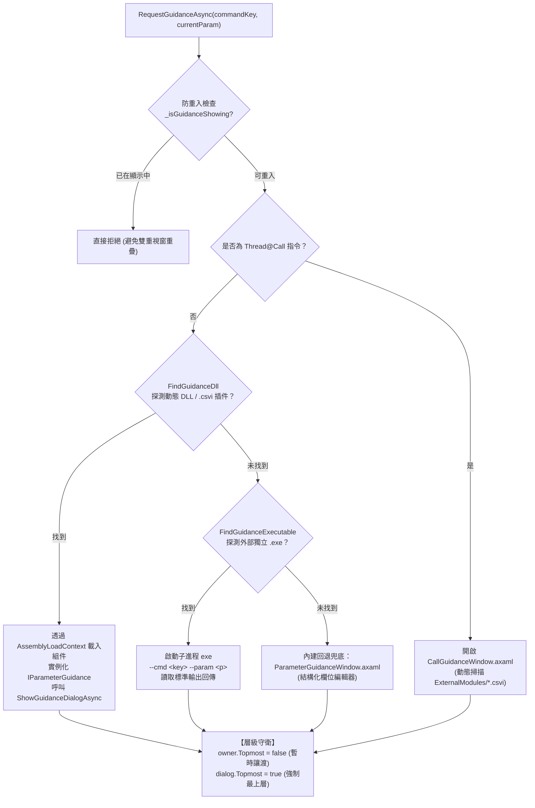

# 03. ARCOS.App API 與 UI 規範 (App API Reference)

> [!IMPORTANT]
> **【UI 開發最高準則】程式執行速度優先，非 Active UI 絕對禁止更新**  
> 任何 UI 元件與定時器必須遵循 [DEV-GUIDE.md](../../DEV-GUIDE.md) 規範：未被選中之分頁、隱藏之面板與失去焦點之視窗，禁止發起任何 DOM 遍歷、資料格式化或屬性更新，所有資料採切換分頁時按需拉取（Lazy Catch-Up）。

本文檔詳述展示層 **`ARCOS.App`** 的元件結構、Public API、參數導引視窗動態解析順序、編輯器操作快捷鍵，以及內建 **ArcosMcpServer** 自動化介面。

---

## 1. App 內部結構圖 (App Component Architecture)



---

## 2. 公開型別與 API (Public Classes & APIs)

### 2.1 MainWindow
- **路徑**：[`src/ARCOS.App/MainWindow.axaml.cs`](../../src/ARCOS.App/MainWindow.axaml.cs)
- **用途**：主控台視窗，負責整合排程編輯器、子面板載入與後端引擎。

#### 主要 Public 屬性
```csharp
public BasicEngines Engines { get; }
public DriverManager DriverManager { get; }
public ArcosThreadVM VM { get; }
public SequencerEditorControl? Sequencer { get; }
public TestThreadWindow? TestThreadWindow { get; }
```

#### 主要 Public 方法
- `ToggleTestThreadWindow() -> void`
  - **說明**：切換 Test Thread Editor 顯示狀態（開啟/最小化/置頂恢復）。支援全域 `Ctrl+T` 呼叫。
  - **執行緒限制**：必須在 UI Thread（`Dispatcher.UIThread`）呼叫。
- `LoadUserPanelFromCsvi(string csviNameOrPath) -> bool`
  - **說明**：動態解析並將指定 CSVI 自訂面板掛載至「User Tab」容器，並自動呼叫其 `Init(BasicEngines)`。
  - **傳回值**：掛載成功回傳 `true`，檔案遺失或型別無效回傳 `false`。

---

### 2.2 TestThreadWindow
- **路徑**：[`src/ARCOS.App/Dialogs/TestThreadWindow.axaml.cs`](../../src/ARCOS.App/Dialogs/TestThreadWindow.axaml.cs)
- **用途**：獨立的測試執行緒編輯與執行視窗，支援半透明調節（SliderOpacity）、單步執行（`BtnStep`）與指令編輯。

#### 主要 Public 方法
- `LoadProgramSlot(int progNo) -> void`：將指定主執行緒槽位的程式載入至 UI 供測試。
- `OpenParameterGuidanceForRowAsync(int rowIndex) -> Task<string?>`：非阻塞開啟指定列的參數導引對話框，自動暫時讓渡置頂權限，防遮蔽。
- `OpenCommandSelectForRowAsync(int rowIndex) -> Task<string?>`：開啟指令選擇器（`ComSelectWindow`）。
- `PasteFromClipboard(int targetIndex) -> void`：自全域剪貼簿貼入多行指令。
- `MoveSelectedRange(int targetIndex) -> void`：移動所選多行至目標位置。
- `DeleteSelectedRange() -> void`：刪除目前選取之連續區間。

---

### 2.3 ParameterGuidanceManager
- **路徑**：[`src/ARCOS.App/Guidance/ParameterGuidanceManager.cs`](../../src/ARCOS.App/Guidance/ParameterGuidanceManager.cs)
- **用途**：全域單例管理器，負責多層級解析指令對應的參數導引對話框。

#### 公開 API
```csharp
public static ParameterGuidanceManager Instance { get; }
public Task<string?> RequestGuidanceAsync(string commandKey, string currentParam, BasicEngines? engines, Window? owner, Action<string>? onCommandUpdated = null);
public Control? GetFrontPanel(string commandKey);
```

---

## 3. 參數導引視窗動態解析順序 (Resolution Hierarchy)

當使用者在編輯器單元格上雙擊，或透過 MCP 觸發 `RequestGuidanceAsync` 時，系統遵循以下**四級精準搜尋管道**：



### 候選路徑搜尋清單 (FindGuidanceDll 順序)
1. `MODULES/<Module>/USERPARAMETEREDITOR/<Action>.Guidance.dll`
2. `MODULES/<Module>/USERPARAMETEREDITOR/<Action>.csvi`
3. `MODULES/<Module>/USERPARAMETEREDITOR/<Module>@<Action>.csvi`
4. `MODULES/<Module>/USERPARAMETEREDITOR/<Module>.Guidance.dll`
5. `EXTRACMD/USERPARAMETEREDITOR/<Action>.csvi`

---

## 4. 編輯器快捷鍵與操作規範 (Shortcuts & Gestures)

### 鍵盤與滑鼠互動矩陣

| 動作 / 快捷鍵 | 作用範圍 | 行為說明 |
|---|---|---|
| **`Ctrl + T`** | 全域視窗 | 喚起或切換 `TestThreadWindow`（測試執行緒編輯器）。 |
| **`滑鼠左鍵單擊`** | Command 欄位 | 開啟 `ComSelectWindow`（可依分類挑選 8 大模組之指令）。 |
| **`Ctrl + 滑鼠單擊`** | Command 欄位 | **高速插入新指令**：行為等同點擊工具列之 `+` 按鈕，於當前列位置插入（原列順延下移），並自動彈出 `ComSelectWindow` 與接續啟動 `ParameterGuidance`。 |
| **`滑鼠左鍵單擊`** | 表格空白處 | **尾端新增指令**：於列表末端新增行並自動開啟 `ComSelectWindow` 選擇指令，取消時不產生殘留。 |
| **工具列 `+` 按鈕** | 工具列 (`BtnAdd`) | 於所選位置插入新指令行（原列順延下移），並彈出 `ComSelectWindow` 導引。 |
| **工具列 `-` 按鈕** | 工具列 (`BtnMinusLine`) | 刪除目前選取之單一行指令。 |
| **工具列 `X` 按鈕** | 工具列 (`BtnDelete`) | **清空當前程式區**：清空目前 Program Section 所有指令，支援 `Ctrl+Z` 復原。 |
| **`滑鼠左鍵雙擊`** | Parameters 欄位 | 啟動對應指令之參數導引對話框（如 IO 點位下拉選單、延遲設定等）。 |
| **`Shift + 滑鼠單擊`** | 資料列 | **連續區間反白多選**：高亮標記（淺藍底色 `#E0F2FE`）**嚴格限定只作用於 Command 與 Parameters 兩欄**，`i` 索引欄絕對不染藍。 |
| **`Ctrl + 滑鼠單擊`** | 行號 / 非指令格 | 單行選取反轉（切換單獨一行之選取狀態）。 |
| **`Ctrl + Z`** | 編輯器 | 復原上一動（`BtnUndo`）。 |
| **`Ctrl + Y`** | 編輯器 | 重做動作（`BtnRedo`）。 |
| **`Ctrl + F`** | 編輯器 | 開啟即時關鍵字搜尋浮動列。 |

### 視覺空間正交解耦規範 (Visual Decoupling Invariant)
1. **PC 游標光棒（紅底粉色膠囊 `#FFE4E6`、加粗紅字）**：**嚴格限定於 `i` 索引欄**，指令與參數欄絕對不染紅。
2. **範圍選取高亮（淺藍底色 `#E0F2FE`、上下邊框 `#BAE6FD`）**：**嚴格限定於 `Command` 與 `Parameters` 兩欄**，`i` 索引欄絕對不染藍。
3. 兩者在欄位維度上徹底解耦，即使操作員進行多行選取，PC 游標依然能在 `i` 欄自由穿梭跳躍，清晰可見！

### 專案與程式區管理介面 (Project & Section UI Buttons)
- **`[ 📁 READ .PROG ]`**：將磁碟中的全專案檔（`*.prog` 或舊版相容 `*.pro`）讀入至 0~99 程式區槽位中。
- **`[ 💾 SAVE .PROG ]`**：將當前 100 個程式區段整體序列化寫入 `.prog` 專案檔。
- **`[ 📗 READ .INIT ]`**：載入單一程式區腳本（二進制 $N \times 2$ 格式）至當前選定之 Program Section。
- **`[ 💾 SAVE .INIT ]`**：將目前選定之單一 Program Section 導出為獨立 `.init` 二進制腳本（供 SubThread 或 UI 調用）。
- **`ProgSelector` 下拉選單**：支援 `System@ProgramSection` 動態命名，格式化顯示 `0: Main`, `1: SectionName`, `94: Pause Off`, `99: EMG Stop`。

---

## 5. MCP 自動化介面規格 (ArcosMcpServer API)

- **通訊方式**：JSON-RPC 2.0 over Stdio 及 本地 TCP Socket (`127.0.0.1:19528`)
- **封包格式**：以換行符號 `\n` 結尾之 UTF-8 JSON 字串。

### 工具列表 (Tools Catalog)

| 工具名稱 (`name`) | 支援的動作參數 (`action`) | 用途說明 |
|---|---|---|
| **`arcos_get_state`** | *(無)* | 查詢主視窗狀態（目前 PC、分頁、機台模式、運行狀態、IO 點位快照）。 |
| **`arcos_list_controls`** | `filter` | 枚舉 Avalonia 視覺樹所有可互動控制項。 |
| **`arcos_click`** | `controlName` | 模擬點擊指定按鈕或分頁。 |
| **`arcos_input`** | `controlName`, `value` | 輸入文字框或切換 ComboBox 選項。 |
| **`arcos_sequencer_action`** | `add_row`, `edit_row`, `select_row`, `open_guidance`, `step`, `run`, `pause`, `reset` | 主排程編輯器各項自動化指令操作。 |
| **`arcos_test_thread`** | `toggle`, `load_pro`, `step`, `open_guidance`, `open_com_select`, `set_opacity`, `set_section` | 測試執行緒專屬自動化控制。 |
| **`arcos_io_action`** | `get`, `set`, `toggle`, `set_port_name`, `add_virtual_io`, `force_update` | IO 點位原子讀寫與別名設定。 |
| **`arcos_capture_ui`** | `outputPath`, `target` (`MainWindow` / `TestThread` / `Dialog` / `Auto`) | 高解析度將當前畫面或彈出對話框合成輸出為 PNG/JPG。 |
| **`arcos_clipboard_action`** | `select`, `copy_insert`, `move`, `delete` | 跨編輯器指令複製、搬移與刪除管理。 |

### Python 快速調用範例
```python
import socket, json

def call_mcp(tool_name, arguments):
    s = socket.socket()
    s.connect(('127.0.0.1', 19528))
    payload = {
        "jsonrpc": "2.0",
        "id": 1,
        "method": "tools/call",
        "params": {
            "name": tool_name,
            "arguments": arguments
        }
    }
    s.sendall((json.dumps(payload) + '\n').encode('utf-8'))
    data = b""
    while True:
        chunk = s.recv(4096)
        if not chunk: break
        data += chunk
        if b'\n' in chunk: break
    s.close()
    return json.loads(data.decode('utf-8'))

# 範例：切換 TestThread 視窗並開啟第 0 列參數導引
print(call_mcp("arcos_test_thread", {"action": "open_guidance", "rowIndex": 0}))
```

---

## 6. 統一模組中心 (Modules Info)、兩層式 SubPanel 與內嵌 CSVI Studio

為了達成機台介面極致模組化並解決底部分頁過度膨脹問題，`ARCOS.App` 實施 **統一模組導航、兩層式 SubPanel 體系與內嵌 CSVI Studio**：
1. **底部分頁終極精簡（6 大分頁）**：
   - `User Tab`（純淨 SubPanel 容器）
   - `Capture`（視覺對位主視窗，CamList 直選相機，Snap 支援單擊單張/雙擊連續 5fps）
   - `Modules Info`（9 大核心與硬體模組清單，左側清單 + 右側 SubPanel）
   - `Panel CMD`（終端指令輸入列）
   - `Remote`（遠端連線監控）
   - **`CSVI STUDIO: MCP <PORT>`**（內嵌 IDE 與動態 TCP Port 之 MCP Server）
2. **硬體 Driver 延遲載入 (On-Demand Loading Discipline)**：
   - 開機嚴禁自動預載硬體 Mock 實例；直到執行 `IO@AddIODriver`、`Capture@AddCam`、`Motion@AddMotion`、`DAQ@AddDAQ` 時才動態載入並掛載至次級 SubPanel。
3. **兩層式 SubPanel (Two-Tier Routing)**：
   - **第一層**：點擊模組載入對應 `MODULES/<Name>/<Name>.csvi` 的 FrontPanel。
   - **第二層**：硬體多裝置模組在模組視圖內列出 Devices，點擊特定 Device 載入專屬 `IDriver.CreateDriverView()`。
4. **CSVI Studio 動態 MCP 服務**：
   - 啟動時自動探索可用 TCP Port 號（如 `48800` 起算），分頁標籤動態回顯 `CSVI STUDIO: MCP <PORT>`，多開實例互不衝突，AI Agent 可透過 JSON-RPC over TCP 直接遠端操作。

> 完整設計規範、版面拓撲圖與調用循序圖，請詳閱：[12. 統一模組中心與兩層式 SubPanel 規格書](./12_UNIFIED_MODULES_INFO_SPEC.md)。

