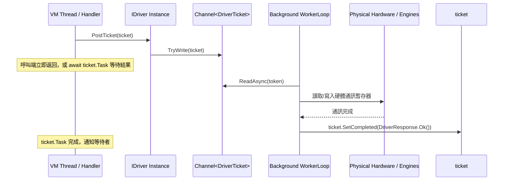

# 06. 硬體驅動與 Driver CSVI 設計指南 (Extend Driver CSVI)

在 **ARCOSharp** 架構中，**Driver CSVI** 是整個工控系統對接底層實體硬體（PLC、軸卡、視覺相機、DAQ 擷取卡、儀表等）的核心橋樑。

本手冊詳盡剖析 **Driver CSVI** 的標準規格、真實介面契約、雙模執行架構、四大硬體類別之標準 Ticket 指令協定，以及完整的二次開發實作範本。

---

## 1. 核心定位：什麼是 Driver CSVI？

Driver CSVI 既是一個**可熱抽換的外掛組件**，也是一個**具備自我除錯能力的獨立測試工具**。其核心職責包含：
1. **硬體搬運工 (Hardware Transporter)**：在背景執行緒中持續將實體硬體狀態批次搬入/搬出 `BasicEngines`（如 `IoEngine.SetBatch` / `GetBatch`、`PointEngine`、`ImageEngine`、`DaqEngine`）。
2. **通訊票據處理 (DriverTicket Dispatcher)**：接收來自模組處理器（`IModuleHandler`）派發的弱耦合信號票據（`DriverTicket`），執行硬體動作並將結果非阻塞塞回私有信號通道。
3. **狀態旗標自動回寫 (Virtual IO & Flag Synchronization)**：將硬體就緒、忙碌、警報與完成旗標（如 `$(Device)#Busy?`、`$(Device)#Done?`、`$(Device)#OK?`）即時同步至虛擬 IO，供排程器腳本條件等待。
4. **專屬除錯 HMI 前面板 (`CreateDriverView`)**：提供 Avalonia XAML 視覺介面，既可嵌入主程式右側 `SubPanel`，亦可在未開啟主程式時單獨作為桌面工具執行。

---

## 2. Driver CSVI 三位一體設計架構 (The Trinity Architecture)

一個合規且完整的 **Driver CSVI** 在架構上必須同時具備**三大核心維度（三位一體）**：

```
┌────────────────────────────────────────────────────────┐
│            Driver CSVI (4-in-1 虛擬儀表封裝)           │
├───────────────────┬───────────────────┬────────────────┤
│ 1. C# 驅動代碼    │ 2. UI 監控前面板   │ 3. 導引視窗    │
│ (Core Logic)      │ (FrontPanel HMI)  │ (Param Wizard) │
├───────────────────┼───────────────────┼────────────────┤
│ • 實作 IDriver    │ • Avalonia View   │ • 參數引導精靈 │
│ • 實體通訊協議    │ • 點位 LED 指示燈 │ • COM / IP 選單│
│ • WorkerLoop 佇列 │ • 手動開關測試點位│ • 點位區間試算 │
│ • 引擎雙向批次搬運│ • 嵌入 SubPanel   │ • 即時指令生成 │
│ • 虛擬旗標回寫    │ • 心跳與刷新監控  │ • 一鍵測試套用 │
└───────────────────┴───────────────────┴────────────────┘
```

### 維度一：C# 核心代碼 (Core Hardware Driver Code)
- **實體通訊對接**：撰寫 RS-232 / RS-485 SerialPort、Modbus RTU/TCP、TCP/IP Socket、軸卡 DLL 或 OpenCV 相機 SDK 的實體收發邏輯。
- **背景非同步搬運**：透過 `Channel<DriverTicket>` 接收指令票據，在背景 `WorkerLoop` 進行非阻塞處理。
- **引擎資料同步**：週期性（如 25ms）將實體硬體狀態批次搬入 `IoEngine`、`PointEngine`、`ImageEngine`、`DaqEngine`。
- **虛擬點位旗標**：自動更新 `$(Device)#Busy?`、`$(Device)#Done?`、`$(Device)#OK?`。

### 維度二：UI 即時監控前面板 (Front Panel HMI)
- 實作於 `<DriverType>View.axaml` 的第一分頁：**`🎛️ 驅動前面板 HMI (Front Panel)`**。
- **主機台掛載**：主程式透過 `driver.CreateDriverView()` 取得該 UserControl，嵌入至主畫面右側 `SubPanel` 面板中。
- **雙向互動與除錯**：
  - **輸出觀察**：以綠/紅 LED 顯示目前實體點位狀態（如 DO 點位、馬達目前座標 `CurrentPos`、相機 Viewfinder、DAQ 實時波形）。
  - **手動測試**：提供 Toggle 開關讓工程師能直接在 UI 手動撥動點位或點擊 Jog 按鈕，直連實體硬體進行調機測試。
  - **狀態監控**：即時顯示通訊 Bus、掃描頻率（如 40Hz / 25ms）、心跳燈號與手動刷新按鈕。

### 維度三：導引視窗與參數精靈 (Parameter Guidance & Wizard)
- 實作於 `<DriverType>View.axaml` 的第二分頁：**`⚙️ 參數導引與連線精靈 (Parameter Wizard)`**，或實作 `IParameterGuidance`。
- **排程器參數設定**：當工程師在排程器編輯 `IO@AddIODriver`、`Motion@AddMotion`、`Capture@AddCam`、`DAQ@AddDAQ` 時，提供視覺化視窗引導輸入，徹底免除人工死背語法或打錯逗號：
  1. **通訊介面選單**：圖形化選擇 COM Port（下拉選單自動列舉本機可用 Serial 埠）、Baud Rate、或 TCP IP/Port。
  2. **點位映射計算器**：輸入起始點（如 `p0.0`）與點數（如 `32`），精靈自動計算並顯示區間徽章（如 `👉 區間: P0.0 ~ P3.7 (32 點)`），防止多個硬體點位重疊衝突。
  3. **即時指令預覽 (Live Command Generator)**：隨時在下方文字框產生標準語法：
     `IO@AddIODriver::IO1, MockIO, Device=com1, OutStart=p0.0, OutPorts=32, InputStart=p4.0, InPorts=32, Interval=25`
  4. **一鍵測試與套用**：點擊「套用」立即以新參數嘗試初始化驅動並驗證硬體通訊，確認正常後直接帶回排程器！

---

所有 Driver CSVI 專案檔預設輸出為 **`WinExe`** 而非純類別庫：

```xml
<Project Sdk="Microsoft.NET.Sdk">
  <PropertyGroup>
    <TargetFramework>net8.0</TargetFramework>
    <OutputType>WinExe</OutputType>
    <AssemblyName>MockIO.Driver</AssemblyName>
    <RootNamespace>ARCOS.Driver.MockIO</RootNamespace>
  </PropertyGroup>
  <ItemGroup>
    <PackageReference Include="Avalonia" Version="11.0.10" />
    <PackageReference Include="Avalonia.Desktop" Version="11.0.10" />
    <PackageReference Include="Avalonia.Themes.Fluent" Version="11.0.10" />
  </ItemGroup>
  <ItemGroup>
    <ProjectReference Include="..\..\..\..\ARCOS.Core\ARCOS.Core.csproj" />
  </ItemGroup>
  <ItemGroup>
    <EmbeddedResource Include="CSVI.Manifest.json" LogicalName="CSVI.Manifest.json" />
    <EmbeddedResource Include="CSVI.Source.Bundle" LogicalName="CSVI.Source.Bundle" />
  </ItemGroup>
</Project>
```

### 雙模運行情境：
- **模式 A：宿主掛載模式 (ARCO Host Plugin)**  
  ARCOSharp 主程式透過 `PluginLoadManager` 將 `.csvi` 或 `.Driver.dll` 動態以記憶體串流載入可收集上下文（`CollectiblePluginContext`），在 Windows 下 0 鎖檔，反射實例化 `IDriver`。
- **模式 B：獨立除錯模式 (Standalone Test Tool)**  
  工程師在現場無需開啟主程式，直接雙擊 `MockIO.Driver.exe`。其內建的 `Program.cs` 會啟動 `StandaloneApp`，彈出完整的驅動除錯視窗，可直接驗證 COM Port 通訊、手動撥動點位或觀察相機影像。

---

## 3. IDriver 介面契約規範

所有驅動程式必須實作 [`ARCOS.Core.Drivers.IDriver`](file:///d:/AntiGravity/ARCOSharp/src/ARCOS.Core/Drivers/IDriver.cs)：

```csharp
namespace ARCOS.Core.Drivers;

public interface IDriver : IDisposable
{
    /// <summary>
    /// 機台內此設備實例名稱 (例如 "IO1", "StationIO", "RobotGantry", "CamTop")
    /// 由下達指令時傳入 (如 IO@AddIODriver::StationIO, MockIO)
    /// </summary>
    string DeviceName { get; }

    /// <summary>
    /// 驅動類別 ("IO", "Motion", "Capture", "DAQ", "Custom")
    /// </summary>
    string Category { get; }

    /// <summary>
    /// 硬體驅動型態名稱 (例如 "MockIO", "MockMotion", "ADLINK8164", "HikCamera")
    /// </summary>
    string DriverType { get; }

    /// <summary>
    /// 初始化驅動並注入第一階段 BasicEngines 與指令參數字串
    /// </summary>
    /// <param name="deviceName">設備識別名</param>
    /// <param name="param">指令傳入之設定字串 (如 Device=COM1,Baud=9600,OutStart=P0.0)</param>
    /// <param name="engines">核心 8 大引擎參照</param>
    void Init(string deviceName, string param, BasicEngines engines);

    /// <summary>
    /// 發送私有信號通訊票券至 Driver 內部工作佇列 (非阻塞)
    /// </summary>
    void PostTicket(DriverTicket ticket);

    /// <summary>
    /// 建立該 Driver 的 Avalonia 前面板調試視圖 (UserControl)
    /// 供主視窗 ContentControl 嵌入顯示或 StandaloneApp 展示
    /// </summary>
    object? CreateDriverView();

    /// <summary>
    /// 停止驅動並釋放硬體連線、取消背景執行緒
    /// </summary>
    void Shutdown();
}
```

---

## 4. DriverTicket 通訊票券與非阻塞佇列架構

驅動程式內部採用 **`Channel<DriverTicket>`** 或 **`ConcurrentQueue<DriverTicket>`** 作為生產者-消費者佇列，配合背景 `WorkerLoop` 進行非同步處理：



### DriverTicket 核心結構：
- `Command`：指令名稱（如 `"FORCE_UPDATE"`, `"Home"`, `"Snap"`, `"Start"`）。
- `Parameter`：參數字串（如 `"Index=0,Value=1"`, `"X=100,Y=200"`）。
- `SetCompleted(DriverResponse.Ok(payload))`：通知成功並回傳酬載。
- `SetFailed(string errorCode, string message)`：通知失敗並夾帶錯誤碼。

---

## 5. 四大硬體類別標準設計規範與 Ticket 協議

### 5.1 IO 驅動程式規範 (Category: `"IO"`)

#### (A) 主動式 Driver CSVI vs. 被動式 Command CSVI
- **Driver CSVI（主動式常駐服務，如 `MockIO.csvi`）**：在 `IO@AddIODriver` 掛載後，內部啟動獨立背景執行緒 (`WorkerLoop`)，每隔 `IntervalMs`（預設 `25ms`）**自動**將輸出點 (`IoEngine.GetBatch`) 刷寫至硬體，並將硬體輸入點 (`IoEngine.SetBatch`) 讀回系統。
- **Command CSVI（被動式單步指令，如 `SetPort.csvi`, `InitIOPort.csvi`, `ForceUpdate.csvi`）**：平時不佔用任何背景資源，僅在排程器執行到該行時被動執行一次。

#### (B) MVCON 標準 IO 生命週期三部曲與硬體立即同步
1. **階段一：掛載硬體與設定實體區間 (`IO@AddIODriver`)**
   - 語法：`IO@AddIODriver::$deviceName, $driverType, OutStart=P0.0, OutPorts=16, InStart=P4.0, InPorts=16, Interval=25`
   - 此時尚未定義別名，一律以實體位址 `PX.X` 開闢硬體讀寫區間並啟動背景輪詢。
2. **階段二：賦予點位語意別名 (`IO@SetPortName`)**
   - 語法：`IO@SetPortName::P0.0, 汽缸下`、`IO@SetPortName::P4.0, 啟動鈕?`
   - 在 `IoEngine` 中建立實體點位與語意別名的雙向映射（內部統一正規化實體點位為大寫 `P{port}.{bit}`）。
3. **階段三：收網同步別名與設定掃描週期 (`IO@InitIOPort`)**
   - 語法：`IO@InitIOPort::$deviceName, [$intervalMs]`
   - `InitIOPort.csvi` 會發送 `DriverTicket("INITIOPORT", $intervalMs)` 給指定的 IO Driver（若未指定裝置名則廣播給所有已掛載之 IO Driver）。
   - Driver 收到 `INITIOPORT` 票券後：
     - **更新掃描間隔**：若傳入第 2 參數 `$intervalMs`（`> 0`），立即覆寫 `IntervalMs`；若未傳入則維持 Driver 預設值（如 `25ms`）。
     - **刷新前面板點位別名**：呼叫 `_engines.Io.GetPortAlias(physPort)` 取得該驅動負責區間內所有點位的最新別名，並觸發 `PortNamesRefreshed` 事件，讓 Driver 前面板 HMI 上的點位標籤即時從 `P0.0` 換名顯示為亮黃色語意名稱（如 `汽缸下`）！
4. **階段四：指令中強制立即插隊同步 (`IO@ForceUpdate` 與尾綴 `ForceUpdate`)**
   - 當高速製程不希望等待下一次背景輪詢（例如 25ms）時，可呼叫 `IO@ForceUpdate::$deviceName`（或在 `IO@SetPort::P0.0, ForceUpdate`、`IO@ClrPort::P0.0, ForceUpdate` 加上尾綴）。
   - 指令會向 Driver 發送 `DriverTicket("FORCEUPDATE", "")` 並等待票券完成（微秒級非阻塞微步或瞬時同步），強制 Driver **立即插隊執行一次完整的硬體輸出寫入與輸入讀取**。

#### (C) 標準 IO Driver 必備實作方法與 Ticket 命令表
一個合規的 IO Driver CSVI（實作 `IDriver`，參考 [`MockIoDriver.cs`](file:///d:/AntiGravity/ARCOSharp/src/MODULES/IO/DRIVER/MockIO/MockIoDriver.cs)）必須支援：
- `Init(string deviceName, string param, BasicEngines engines)`：解析 `OutStart`、`OutPorts`、`InStart`、`InPorts`、`Interval`，向 `_engines.Io.RegisterDriver` 註冊並啟動 `WorkerLoop`。
- `PostTicket(DriverTicket ticket)`：接收並處理以下標準 Ticket 命令（不分大小寫）：
  - **`INITIOPORT` / `INIT_IO_PORT`**：若 `ticket.Parameter` 為有效正整數則更新 `IntervalMs`，接著執行一次硬體同步並觸發 `PortNamesRefreshed` 刷新 UI 點位別名標籤。
  - **`FORCEUPDATE` / `FORCE_UPDATE` / `UPDATE`**：立即強制執行一次雙向硬體批次讀寫 (`SyncOutputFromEngine` + `SyncInputToEngine`) 後完成票券。
  - **`SET_INPUT`**：（供測試/模擬器使用）設定指定輸入點狀態（`Index=0, Value=true`）。
- `CreateDriverView()`：回傳 Avalonia 前面板 `UserControl`（訂閱 `StateChanged` 與 `PortNamesRefreshed` 事件即時更新燈號與別名）。
- `Shutdown()` / `Dispose()`：停止 `WorkerLoop` 並釋放通訊埠。

### 5.2 Motion 運動控制驅動規範 (Category: `"Motion"`)
- **啟動指令**：`Motion@AddMotion::$deviceName, $driverType, $param`
- **標準 16 大 TestCMD 指令協議**：
  1. `Home`：軸復歸原點，完成後置 `IsHomed = true`。
  2. `Go`：以絕對座標移動（`X=10, Y=20, Z=0`）。
  3. `GoPoint`：移至特定點位名稱（如 `P_PICK`），或具體座標。
  4. `ClearPath`：清空軌跡佇列。
  5. `AddPath`：將點位壓入 `PathQueue`。
  6. `RunPath`：連續執行佇列中的平滑路徑。
  7. `Stop`：平滑停止。
  8. `GetPos`：回傳 `CurrentPos` 座標物件。
  9. `GetState`：回傳 `IsBusy`, `IsHomed`, `IsAlarm` 狀態字典。
  10. `SetTool`：設定工具手座標偏置。
  11. `ExtraCMD`：發送軸卡專屬的原生指令。
  12. `SetDO`：設定軸卡自帶之數位輸出（`Index=0, Value=1`）。
  13. `GetDI`：讀取軸卡自帶之數位輸入。
  14. `GetDO`：讀取軸卡自帶之數位輸出目前狀態。
  15. `Close`：關閉通訊。
  16. `UpdateInfo`：強制更新狀態。
- **重要設計細節：Inf 軸屏蔽比對 (Inf Axis Mask)**  
  若傳入的座標值為 `double.PositiveInfinity`，表示該軸保持現狀不運動，驅動必須保留 `CurrentPos` 原值，不得歸零！
- **虛擬 IO 旗標回寫規範**：
  每次運動狀態改變時，驅動必須自動寫入：
  - `_engines.Io.SetPort($"{DeviceName}#Busy?", IsBusy)`
  - `_engines.Io.SetPort($"{DeviceName}#Done?", !IsBusy)`
  - `_engines.Io.SetPort($"{DeviceName}#Homed?", IsHomed)`
  - `_engines.Io.SetPort($"{DeviceName}#Alarm?", IsAlarm)`
  - `_engines.Point.SetPoint($"{DeviceName}_CurPos", CurrentPos)`
  - `_engines.Point.SetPoint($"{DeviceName}_ToGo", ToGoPos)`

### 5.3 Capture 視覺相機驅動規範 (Category: `"Capture"`)
- **啟動指令**：`Capture@AddCam::$deviceName, $driverType, $param`
- **參數慣例**：`Width=640, Height=480, Exposure=20, File=sample.png`
- **標準 Ticket 命令**：
  - `Snap`：單張拍照取像。取像完成後將 OpenCV `Mat` 物件送入 `_engines.Image.SetSingleImage(DeviceName, mat)`，並將 `$(DeviceName)#OK?` 設為 `true`。
  - `Trigger`：飛拍連續觸發。將畫面壓入指定影像佇列 `_engines.Image.AppendImage(arrayName, mat)`，並將 `$(DeviceName)#OK?` 設為 `true`。
  - `Config`：調整曝光時間、增益、ROI 等參數。
  - `Live`：啟動/停止連續串流預覽。

### 5.4 DAQ 資料擷取驅動規範 (Category: `"DAQ"`)
- **啟動指令**：`DAQ@AddDAQ::$deviceName, $driverType, $param`
- **參數慣例**：`Rate=1000, Count=500, Channels=1, Wave=Sin`
- **標準 Ticket 命令**：
  - `Start`：開始背景連續高速取樣。
  - `Stop`：停止取樣。
  - `Sample` / `AnalogInWaveForm`：取樣一段波形數據，直接呼叫 `_engines.Daq.PushWaveform(DeviceName, double[])`。
  - `AnalogIn`：單點電壓即時讀取。
  - `AnalogOut`：類比電壓輸出。

---

## 6. CSVI 套件 4-in-1 內部封裝規格

透過 CsviStudio 或打包腳本產生的 `<DriverName>.csvi` 實體檔案，內部必須包含：

```
[<DriverName>.csvi 內部資源]
├── .NET 8 PE IL 二進位組件 (包含 IDriver 與 Avalonia View 實作)
├── CSVI.Manifest.json
│   ├── "Module": "IO" | "Motion" | "Capture" | "DAQ"
│   ├── "CommandKey": "<DriverType>"
│   └── "ComponentType": 1 (代表 Driver)
├── CSVI.RuntimeXaml.<ViewName>.axaml (可選：熱替換 XAML 介面)
└── CSVI.Source.Bundle (AES 或明文壓縮之 .cs 與 .axaml 原始程式碼)
```

---

## 7. 完整自訂驅動程式範例 (CustomIoDriver)

以下為符合全部工業級標準的完整 Driver CSVI 實作程式碼：

```csharp
using System.Threading.Channels;
using Avalonia.Controls;
using ARCOS.Core.Common;
using ARCOS.Core.Drivers;

namespace ARCOS.Driver.CustomIo;

public class CustomIoDriver : IDriver
{
    private BasicEngines? _engines;
    private readonly Channel<DriverTicket> _ticketQueue = Channel.CreateUnbounded<DriverTicket>();
    private CancellationTokenSource? _cts;
    private Task? _workerTask;

    public string DeviceName { get; private set; } = string.Empty;
    public string Category => "IO";
    public string DriverType => "CustomIO";

    public string OutStart { get; private set; } = "P0.0";
    public int OutPorts { get; private set; } = 16;
    public string InStart { get; private set; } = "P1.0";
    public int InPorts { get; private set; } = 16;
    public int IntervalMs { get; private set; } = 25;

    public void Init(string deviceName, string param, BasicEngines engines)
    {
        DeviceName = deviceName;
        _engines = engines;

        // 1. 解析指令傳入參數
        var args = ArgParaHelper.ParseKeyValueArgs(param, out _);
        if (args.TryGetValue("OutStart", out var os)) OutStart = os;
        if (args.TryGetValue("OutPorts", out var op) && int.TryParse(op, out int oCount)) OutPorts = oCount;
        if (args.TryGetValue("InStart", out var @is)) InStart = @is;
        if (args.TryGetValue("InPorts", out var ip) && int.TryParse(ip, out int iCount)) InPorts = iCount;
        if (args.TryGetValue("Interval", out var iv) && int.TryParse(iv, out int interval)) IntervalMs = interval;

        // 2. 啟動背景搬運與 Ticket 處理迴圈
        _cts = new CancellationTokenSource();
        _workerTask = Task.Run(() => WorkerLoop(_cts.Token));
    }

    public void PostTicket(DriverTicket ticket)
    {
        _ticketQueue.Writer.TryWrite(ticket);
    }

    public object? CreateDriverView()
    {
        // 回傳自訂 Avalonia UserControl 前面板視圖
        return new CustomIoView(this);
    }

    private async Task WorkerLoop(CancellationToken token)
    {
        while (!token.IsCancellationRequested)
        {
            try
            {
                // 1. 處理佇列中的 Ticket
                while (_ticketQueue.Reader.TryRead(out var ticket))
                {
                    ExecuteTicket(ticket);
                }

                // 2. 雙向批次搬運 (讀硬體輸入寫入 IoEngine，從 IoEngine 讀輸出寫入硬體)
                if (_engines != null)
                {
                    bool[] hardwareInputs = ReadFromHardware(InPorts);
                    _engines.Io.SetBatch(InStart, hardwareInputs.AsSpan());

                    bool[] targetOutputs = _engines.Io.GetBatch(OutStart, OutPorts);
                    WriteToHardware(targetOutputs);
                }

                await Task.Delay(IntervalMs, token);
            }
            catch (OperationCanceledException)
            {
                break;
            }
            catch (Exception ex)
            {
                // 容錯防禦日誌
            }
        }
    }

    private void ExecuteTicket(DriverTicket ticket)
    {
        switch (ticket.Command.ToUpperInvariant())
        {
            case "FORCE_UPDATE":
                if (_engines != null)
                {
                    bool[] inputs = ReadFromHardware(InPorts);
                    _engines.Io.SetBatch(InStart, inputs.AsSpan());
                    bool[] outputs = _engines.Io.GetBatch(OutStart, OutPorts);
                    WriteToHardware(outputs);
                }
                ticket.SetCompleted();
                break;

            default:
                ticket.SetCompleted(DriverResponse.Ok());
                break;
        }
    }

    public void Shutdown()
    {
        _cts?.Cancel();
    }

    public void Dispose()
    {
        Shutdown();
        _cts?.Dispose();
    }

    private bool[] ReadFromHardware(int count) => new bool[count];
    private void WriteToHardware(bool[] outputs) { }
}
```

---

## 8. 編譯與 SDK 對齊指南 (In-Process Roslyn Compilation)

當透過內嵌 CSVI Studio 編譯或熱修復 Driver CSVI 時：
* **零依賴 Roslyn 核心**：完全不需要在作業系統安裝 .NET SDK，編譯引擎由主進程記憶體加載。
* **100% ABI 對齊**：驅動程式自動引用宿主載入的 `ARCOS.Core.dll` 與 `Avalonia 11.0.10` 系列組件，確保硬體 View 與主畫面無版本落差。
* 詳細架構與端到端實例請參閱 [12_UNIFIED_MODULES_INFO_SPEC.md 第 6.3 節](file:///d:/AntiGravity/ARCOSharp/docs/dev-guide/12_UNIFIED_MODULES_INFO_SPEC.md)。
