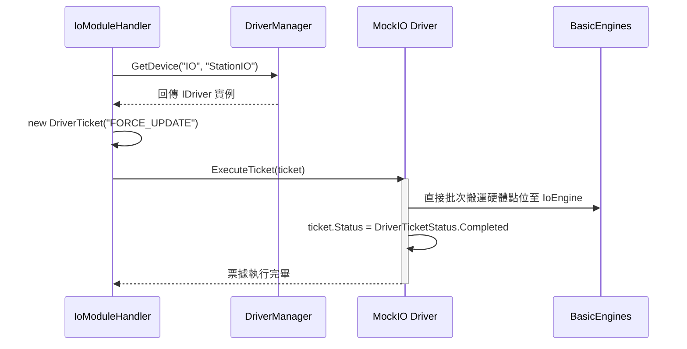

# 06. 硬體驅動與 Driver CSVI 設計 (Extend Driver CSVI)

ARCOSharp 採用 **Directory-Per-Driver 目錄隔離** 與 **DriverTicket 票據通訊架構**。硬體驅動程式完全獨立於核心排程器，可在不重新編譯主程式的情況下抽換與擴充。

---

## 1. 驅動程式拓撲結構 (Directory-Per-Driver)

每個硬體驅動程式必須封裝於獨立的子目錄中，置於對應模組之 `DRIVER/` 路徑下：

```
MODULES/IO/DRIVER/Advantech_PCI1750/
├── Advantech_PCI1750.csvi          # 4-in-1 虛擬儀器封裝包 (首選載入)
├── Advantech_PCI1750.Driver.dll    # 實作 IDriver 之主要組件
├── Advantech_PCI1750.Driver.pdb
├── Advantech_PCI1750.Driver.deps.json
└── Advantech_PCI1750.Driver.runtimeconfig.json
```

---

## 2. IDriver 介面契約規範

所有驅動程式必須實作 `ARCOS.Core.Drivers.IDriver`：

```csharp
namespace ARCOS.Core.Drivers;

public interface IDriver : IDisposable
{
    // 驅動程式型號名稱 (如 "Advantech_PCI1750", "MockIO")
    string DriverName { get; }

    // 硬體所屬模組類別 ("IO", "Motion", "Capture", "DAQ")
    string Category { get; }

    // 開機或熱載入時初始化，系統在此注入 BasicEngines 實例
    bool Initialize(BasicEngines engines);

    // 處理同步或非同步硬體通訊票據
    void ExecuteTicket(DriverTicket ticket);

    // 機台關機或切換型號時的資源釋放
    void Shutdown();

    // 建立驅動專屬的即時監控 UI 視圖 (回傳 Avalonia Control 或 null)
    object? CreateDriverView();
}
```

---

## 3. DriverTicket 票據通訊機制

上層模組（如 `IoModuleHandler`）與底層 Driver 之間**絕不進行強型別直接呼叫**，一律透過 `DriverTicket` 進行弱耦合資料交換：



### DriverTicket 常用命令慣例
- **`FORCE_UPDATE`**：要求 Driver 立即對硬體進行一次完整讀取/寫入刷新。
- **`SET_OUTPUT`**：帶有參數 `Channel=0`, `Value=1`。
- **`READ_INPUT`**：要求 Driver 將讀取之狀態寫入 `ticket.Result`。

---

## 4. 什麼是 CSVI (4-in-1 虛擬儀表封裝)？

副檔名 `.csvi` 是 ARCOS 自創的標準組件封裝格式。**其本質為一個標準的 .NET 8 動態連結庫 (DLL)**，內部透過嵌入式資源封裝了四種核心資產（4-in-1）：

```
[Target.csvi 檔案內部結構]
├── .NET 8 PE 執行檔二進位代碼 (IL Bytecode)
├── 內嵌資源 "CSVI.Manifest.json"   # 版本、作者、雜湊、相依性
├── 內嵌資源 "CSVI.RuntimeXaml.*"   # Avalonia XAML 視覺介面定義
└── 內嵌資源 "CSVI.Source.Bundle"   # 明文或 AES-256 加密之 .cs/.axaml 原始碼
```

### CSVI 三種封裝模式 (`CsviPackagingMode`)
1. **`PortableOpen` (開放攜帶)**：原始碼以 UTF-8 壓縮打包在組件內部。在現場可隨時透過 CsviStudio 一鍵解出並除錯。
2. **`PasswordLocked` (密碼保護)**：原始碼以 AES-256-GCM 加密，需輸入金鑰才可查看或逆向還原。
3. **`StrippedRelease` (純執行剝離)**：完全移除原始碼資源（0 bytes），僅保留編譯後的二進位執行碼。

---

## 5. 撰寫一個新驅動程式完整範例

```csharp
using ARCOS.Core.Drivers;

namespace ARCOS.Driver.CustomIo;

public class CustomIoDriver : IDriver
{
    public string DriverName => "CustomIoDriver";
    public string Category => "IO";
    private BasicEngines? _engines;

    public bool Initialize(BasicEngines engines)
    {
        _engines = engines;
        // 初始化實體硬體通訊 (如開啟 COM Port / Socket)
        return true;
    }

    public void ExecuteTicket(DriverTicket ticket)
    {
        try
        {
            switch (ticket.Command.ToUpperInvariant())
            {
                case "FORCE_UPDATE":
                    // 模擬自硬體暫存器批次讀取 16 個點位並同步至 IoEngine
                    for (int i = 0; i < 16; i++)
                    {
                        bool bitVal = ReadHardwareBit(i);
                        _engines?.Io.SetPort($"P0.{i}", bitVal);
                    }
                    ticket.Status = DriverTicketStatus.Completed;
                    break;

                case "WRITE_BIT":
                    string port = ticket.Parameters["Port"];
                    bool val = ticket.Parameters["Value"] == "1";
                    WriteHardwareBit(port, val);
                    ticket.Status = DriverTicketStatus.Completed;
                    break;

                default:
                    ticket.Status = DriverTicketStatus.Failed;
                    ticket.ErrorMessage = $"Unsupported command '{ticket.Command}'";
                    break;
            }
        }
        catch (Exception ex)
        {
            ticket.Status = DriverTicketStatus.Failed;
            ticket.ErrorMessage = ex.Message;
        }
    }

    public object? CreateDriverView() => null; // 無專屬 View

    public void Shutdown()
    {
        // 關閉硬體通訊連線
    }

    public void Dispose() => Shutdown();

    private bool ReadHardwareBit(int pin) => false;
    private void WriteHardwareBit(string port, bool state) { }
}
```
