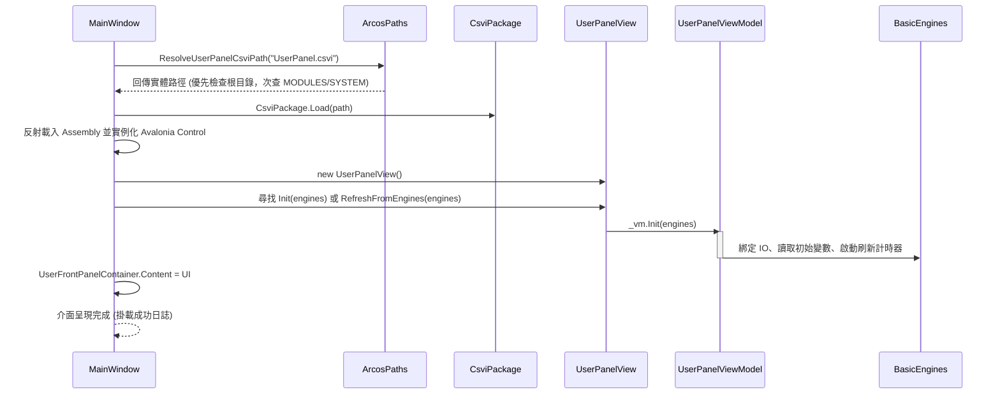

# 08. User Panel 自訂操作面板 (Extend User Panel)

在自動化機台交付給現場作業員時，操作員不需要看到複雜的排程編輯器，而是需要直觀的機台人機介面（HMI）。ARCOSharp 提供了主畫面「**User Tab**」的動態外掛面板機制——**`UserPanel.csvi`**。

---

## 1. User Panel 生命週期與載入機制



### 部署路徑與搜尋優先序
`ArcosPaths.ResolveUserPanelCsviPath` 依序探測：
1. 執行檔同層根目錄：`UserPanel.csvi` (最高優先權)
2. 系統模組目錄：`MODULES/SYSTEM/UserPanel.csvi`
3. 原始碼開發目錄：`src/PANELS/UserPanel/bin/...`

---

## 2. 雙向通訊介面與方法契約

自訂面板不需要依賴 MainWindow，只需提供以下方法契約（在 View 類別或 ViewModel 類別實作皆可，主程式透過反射自動探測並注入）：

```csharp
// 方式 A：直接在 View (UserControl) 中實作
public void Init(BasicEngines engines);
public void RefreshFromEngines(BasicEngines engines);

// 方式 B：在 View 的 DataContext (ViewModel) 中實作
public void Init(BasicEngines engines);
public void RefreshFromEngines(BasicEngines engines);
```

### 可在面板中進行的操作
- **直接控制硬體 IO**：`engines.Io.SetPort("DO_Cylinder", true)`
- **讀取即時感測器**：`bool on = engines.Io.GetPort("DI_Sensor")`
- **讀寫生產變數與統計**：`engines.Variable.Set("LotNumber", "2026-A1")`
- **接收腳本廣播指令**：腳本執行 `System@UserPanelCMD <args>` 時，可於面板內部訂閱或輪詢處理。

---

## 3. 從 0 到 1 自製面板完整範例

### 步驟 1：建立專案 `CustomHmiPanel.csproj`
```xml
<Project Sdk="Microsoft.NET.Sdk">
  <PropertyGroup>
    <TargetFramework>net8.0</TargetFramework>
    <ImplicitUsings>enable</ImplicitUsings>
    <Nullable>enable</Nullable>
    <AssemblyName>UserPanel</AssemblyName>
  </PropertyGroup>

  <ItemGroup>
    <PackageReference Include="Avalonia" Version="11.0.10" />
  </ItemGroup>

  <ItemGroup>
    <ProjectReference Include="..\..\ARCOS.Core\ARCOS.Core.csproj" />
  </ItemGroup>
</Project>
```

### 步驟 2：設計 XAML 畫面 `CustomHmiView.axaml`
```xml
<UserControl xmlns="https://github.com/avaloniaui"
             xmlns:x="http://schemas.microsoft.com/winfx/2006/xaml"
             x:Class="ARCOS.Panels.CustomHmi.CustomHmiView">
    <Border Background="#F8FAFC" Padding="20">
        <StackPanel Spacing="15" MaxWidth="500" HorizontalAlignment="Center">
            <TextBlock Text="專案自訂機台操作面板" FontSize="20" FontWeight="Bold" Foreground="#0F172A"/>

            <Border Background="White" BorderBrush="#E2E8F0" BorderThickness="1" CornerRadius="8" Padding="15">
                <StackPanel Spacing="10">
                    <TextBlock Text="氣缸手動夾緊/鬆開:" FontWeight="SemiBold"/>
                    <Button x:Name="BtnToggleClamp" Content="夾緊 (Toggle P0.0)" Height="36" Background="#0284C7" Foreground="White"/>
                </StackPanel>
            </Border>

            <TextBlock x:Name="TxtStatus" Text="狀態: 就緒" FontSize="14" Foreground="#10B981" FontWeight="Bold"/>
        </StackPanel>
    </Border>
</UserControl>
```

### 步驟 3：撰寫 Code-Behind `CustomHmiView.axaml.cs`
```csharp
using Avalonia.Controls;
using Avalonia.Markup.Xaml;
using ARCOS.Core.Drivers;

namespace ARCOS.Panels.CustomHmi;

public partial class CustomHmiView : UserControl
{
    private BasicEngines? _engines;

    public CustomHmiView()
    {
        InitializeComponent();
        var btn = this.FindControl<Button>("BtnToggleClamp");
        if (btn != null)
        {
            btn.Click += (_, _) =>
            {
                if (_engines == null) return;
                bool current = _engines.Io.GetPort("P0.0");
                _engines.Io.SetPort("P0.0", !current);
                
                var txt = this.FindControl<TextBlock>("TxtStatus");
                if (txt != null) txt.Text = $"氣缸狀態: {(!current ? "ON" : "OFF")}";
            };
        }
    }

    private void InitializeComponent()
    {
        AvaloniaXamlLoader.Load(this);
    }

    // 主程式載入時自動注入 BasicEngines
    public void Init(BasicEngines engines)
    {
        _engines = engines;
    }
}
```

### 步驟 4：發布與掛載驗證
1. 編譯專案：`dotnet build -c Release`
2. 將輸出之 `UserPanel.dll` 重新命名為 `UserPanel.csvi`。
3. 覆蓋至發行目錄根目錄：`dist/ARCOS_Runtime/UserPanel.csvi`。
4. 啟動 ARCOSharp，切換至第一分頁「User Tab」，自訂面板即刻呈現，點擊按鈕可直接雙向連動底層實體 IO！
