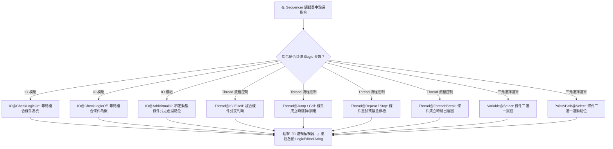

# 11 - 複合邏輯表達式編輯器使用與整合指南 (Logic Editor Guide)

本指南專為 ARCOSharp 系統的**自動化工程師、工藝腳本編程員與二次開發者**撰寫，詳細闡述 `$logic` 複合邏輯表達式視覺編輯器（`LogicEditorDialog`）的**使用時機**、**介面操作方法**、**語法規則體系**以及在自訂模組與指令導引視窗中的**二次開發調用方法**。

---

## 🎯 一、 為什麼需要 Logic Editor？（痛點與設計背景）

在 ARCOS 腳本體系中，條件判定由單一字串參數 `$logic` 承載。然而在實際工廠自動化產線上，條件判定往往高度複雜：
1. **多感測器複合聯鎖**：需要同時確認安全門（`SafetyDoor?`）、料件到位（`PartIn?`）、氣壓正常（`AirOK?`）且無警報（`~Alarm?`）。
2. **軟硬體混合判斷**：需要將實體硬體狀態（IO）與軟體演算法變數（Variable，如良品計數 `Count > 10`、溫度範圍 `Temp <> 20~80`、陣列非空 `ResultList != []`）進行交集運算。
3. **手動輸入之高出錯率**：
   - 漏括號、括號不對稱。
   - 運算子兩側缺漏運算元（如 `P0.0 & `）。
   - 變數名稱大小寫打錯、埠號別名遺漏結尾問號 `?`。
   - 現場調試時無法得知目前條件在機台上究竟是 True 還是 False。

**Logic Editor (`LogicEditorDialog`)** 應運而生——提供零猜測（Zero-Guessing）的視覺化組裝面板、確定性語法即時校驗，並具備向機台即時求值的試算能力。

---

## 🕒 二、 Logic Editor 的使用時機 (When to Use)

凡是指令簽名中包含 `$logic` 參數的場景，皆為 Logic Editor 的使用時機：



### 具體應用時機盤點：
1. **硬體安全光閘與到位等待**：
   - 指令：`IO@CheckLogicOn`
   - 情境：等待雙手啟動鈕按下且夾爪到位：`(BtnStart1? | BtnStart2?) & Cyl_InPos?`。
2. **生產超差或故障跳轉**：
   - 指令：`Thread@If` 或 `Thread@Jump`
   - 情境：料件瑕疵或累計超限即跳轉廢料盒：`DefectRate > 5.0 | ~PartPresent?`。
3. **製程溫度區間監控**：
   - 指令：`IO@CheckLogicOn`
   - 情境：熱壓溫度落在工藝窗口內才允許下壓：`Temp <> 180.0~195.0 & VacuumOK?`。
4. **陣列資料排空檢測**：
   - 指令：`Thread@If`
   - 情境：檢查料盤清單是否已取完：`TraySlots == []`。
5. **虛擬旗標動態定義**：
   - 指令：`IO@AddVirtualIO`
   - 情境：定義一個虛擬點位 `#StationReady?` 其值動態等同於 `SafetyDoor? & ~EMG? & (Count < 500)`。
6. **即時診斷與現場排查 (Live Diagnostics)**：
   - 機台卡在某個 `CheckLogicOn` 步驟時，工程師開啟編輯器點擊「⚡ 立即試算」，瞬間看清當前條件是哪一顆 Sensor 或哪一個變數未到位。

---

## 🛠️ 三、 介面功能與操作方法 (How to Use)

Logic Editor 視窗劃分為五大操作維度：

```
+-----------------------------------------------------------------------------------------+
|  🧩 ARCOS $logic 複合邏輯表達式視覺編輯器                                                 |
|  支援 IO 訊號 (&, |, ~, !)、Variable 關係比較、區間判定 (<>, </>)、空值檢查與括號群組        |
+-----------------------------------------------------------------------------------------+
| [分頁 1: 🔌 IO 訊號 (Ports & Aliases)]   [分頁 2: 📊 Variable 變數條件 (Comparisons)]   |
| --------------------------------------------------------------------------------------- |
|  選擇可用實體埠號或別名:                                                                 |
|  [ P0.0 (Sensor_Feed?)                ▼ ] [🔍 快速篩選: Sens   ]                        |
|  [ ➕ 插入 IO 原樣 (P0.0) ]  [ ➕ 插入 NOT IO (~P0.0) ]                                |
+-----------------------------------------------------------------------------------------+
| 運算符工具列:                                                                           |
| [ & (AND) ] [ | (OR) ] [ ~ (NOT) ] [ ( 括號 ] [ ) 括號 ] [ ⌫ 倒退 ] [ 🗑️ 清空 ]         |
+-----------------------------------------------------------------------------------------+
| 當前 $logic 表達式 (可手動編輯或點選插入):                 [ ⚡ 立即試算當前狀態 (Evaluate) ]|
| +-------------------------------------------------------------------------------------+ |
| | (Sensor_Feed? | Sensor_Bypass?) & (Count > 10) & ~Alarm?                            | |
| +-------------------------------------------------------------------------------------+ |
|  ✅ 語法有效 (Syntax Valid)                             ⚡ 試算結果: TRUE (條件成立)     |
+-----------------------------------------------------------------------------------------+
|                                                          [ 取消 ]  [ ✔ 確定帶入 (Apply) ]|
+-----------------------------------------------------------------------------------------+
```

### 步驟 1：選取或過濾運算元
- **若運算元為硬體訊號**：
  1. 切換至「`🔌 IO 訊號`」分頁。
  2. 透過下拉選單選擇目標實體埠（如 `P0.0`）或別名（如 `Sensor_Feed?`），支援右側搜尋框即時過濾。
  3. 點選「`➕ 插入 IO 原樣`」或「`➕ 插入 NOT IO`」。
- **若運算元為軟體變數條件**：
  1. 切換至「`📊 Variable 變數條件`」分頁。
  2. 下拉選取現有變數（如 `Count`、`Temp`）或在自訂文字框輸入變數名。
  3. 選擇比較運算子：
     - 常規比較：`==`、`!=`、`>`、`<`、`>=`、`<=`
     - 區間判定：`<> (區間內)`、`</> (區間外)`
     - 陣列/空值：`==[] (空陣列)`、`!=[] (非空陣列)`、`EXIST`、`NULL`
  4. 輸入右側閥值（如 `10`、`"OK"` 或 `20~80`）。
  5. 點選「`➕ 插入變數條件式`」，系統自動格式化為帶保護括號的子式（如 `(Temp <> 20~80)`）。

### 步驟 2：利用工具列串接複合邏輯
- 點選 `& (AND)` 或 `| (OR)` 將多個條件連接。
- 點選 `(` 與 `)` 進行優先順序分群。
- 若點錯，點擊 `⌫ 倒退` 可回退前一項，或點擊 `🗑️ 清空` 重置。

### 步驟 3：即時語法校驗確認
- 只要編輯器內的文字改變，下方狀態列將透過 `LogicEvaluator.ValidateSyntax` 進行實時解析：
  - **合法**：顯示 `✅ 語法有效 (Syntax Valid)`（深綠色）。
  - **異常**：顯示 `❌ 語法錯誤：缺少右括號 ')'` 或 `❌ 運算元缺失`（鮮紅色），此時「確定帶入」會自動防呆攔截。

### 步驟 4：⚡ 即時求值試算（可選）
- 點擊「`⚡ 立即試算當前狀態`」。
- 系統將當前表達式送交底層 `IoEngine` 與 `VariableEngine` 即時計算，右下角直接顯示當前是 `TRUE` 還是 `FALSE`。

### 步驟 5：確定帶入
- 點擊「`✔ 確定帶入`」，編輯結果將自動回填至父層導引視窗的 `$logic` 欄位，並更新生成的完整指令預覽。

---

## 📐 四、 支援的完整語法與運算子規範

| 類別 | 運算子 | 意義 | 範例 |
|---|---|---|---|
| **邏輯與** | `&` | 兩端皆為真才為真 | `P0.0 & P0.1` |
| **邏輯或** | `\|` | 任一端為真即為真 | `Sensor1? \| Sensor2?` |
| **邏輯非** | `~` 或 `!` | 訊號反相 | `~Alarm?`、`!Cyl_Out?` |
| **括號** | `(` `)` | 優先權分群 | `(A \| B) & C` |
| **數值比較** | `==`, `!=`, `>`, `<`, `>=`, `<=` | 數值/字串比較 | `Count > 5`、`State == "OK"` |
| **區間內** | `<> min~max` | $min \le val \le max$ | `Count <> 10~50` |
| **區間外** | `</> min~max` | $val < min \lor val > max$ | `Temp </> 0~100` |
| **陣列空** | `==[]` | 陣列未賦值或為空 `[]` | `Queue == []` |
| **陣列非空** | `!=[]` | 陣列包含至少一項元素 | `PartList != []` |
| **變數存在** | `EXIST <var>` | 變數已於記憶體中註冊 | `EXIST LotID` |
| **變數為空** | `NULL <var>` | 變數未宣告或為空字串 | `NULL ErrorMsg` |

> [!TIP]
> **變數 `$` 前綴彈性相容**：
> 在 ARCOSharp 中，變數名稱無論帶有 `$`（如 `$Count > 10`）或不帶 `$`（如 `Count > 10`），`LogicEvaluator` 皆能自動辨識並精確解析。

---

## 💻 五、 二次開發者整合指南 (Developer Integration)

若您正在開發新的指令模組（如客製化機器人模組、自訂溫控模組）或編寫新的導引視窗，請遵循以下模式整合 Logic Editor：

### 1. 在 XAML 前面板提供按鈕
```xml
<Grid ColumnDefinitions="*,Auto">
    <TextBlock Text="🔴 $logic (觸發條件表達式):" FontWeight="SemiBold" Foreground="#DC2626" VerticalAlignment="Center"/>
    <Button x:Name="BtnOpenLogicEditor" Content="🧩 邏輯編輯器..." FontSize="11" Padding="8,3" 
            Background="#EEF2FF" Foreground="#4F46E5" BorderBrush="#C7D2FE" BorderThickness="1" CornerRadius="4"/>
</Grid>
<TextBox x:Name="TxtLogicExpr" CornerRadius="4"/>
```

### 2. 在 C# Code-Behind 中一行非同步調用
```csharp
using ARCOS.Module.IO.Guidance; // 引用 LogicEditorDialog 所在命名空間

// 於按鈕事件中啟動編輯器
BtnOpenLogicEditor.Click += async (_, _) =>
{
    // 傳入既有表達式與目前執行緒之 BasicEngines
    string? result = await LogicEditorDialog.ShowLogicEditorDialogAsync(
        TxtLogicExpr.Text ?? string.Empty, 
        _engines, 
        this
    );

    // 若使用者點擊確定帶入，回填結果並刷新指令預覽
    if (!string.IsNullOrEmpty(result))
    {
        TxtLogicExpr.Text = result;
        UpdatePreview();
    }
};
```

### 3. 在指令執行器 (Module Handler) 中執行求值
在後端執行緒中處理指令時，使用 `LogicEvaluator.EvaluateLogic` 即可：
```csharp
using ARCOS.Core.Common;

public CommandResult Execute(ExecutionContext ctx, string action, string parameter)
{
    var parsed = ArgParaHelper.ParseKeyValueArgs(parameter, out var posArgs);
    if (posArgs.Count == 0) return CommandResult.Done();

    string logicExpr = posArgs[0];
    
    // 傳入 IO、Variable 引擎與當前 Thread 所屬分區 Section
    bool isTrue = LogicEvaluator.EvaluateLogic(
        logicExpr, 
        ctx.Engines.Io, 
        ctx.Engines.Variable, 
        ctx.CurrentSection
    );

    if (isTrue)
    {
        return CommandResult.Done();
    }
    
    return CommandResult.Wait();
}
```

---

## ✅ 六、 結語與架構效益

透過 Logic Editor 的全面標準化：
1. **編程防呆極大化**：徹底杜絕因括號缺失或運算子拼寫錯誤造成的產線停機異常。
2. **軟硬體無縫融合**：讓現場工程師得以透過一致的直觀介面，自由編排橫跨 PLC/IO 卡與軟體數據的複雜聯鎖規則。
3. **組件高複用性**：全系統共享同一套 UI 與 `LogicEvaluator` 核心，完全符合 ARCOSharp 二次開發大一統架構原則。
