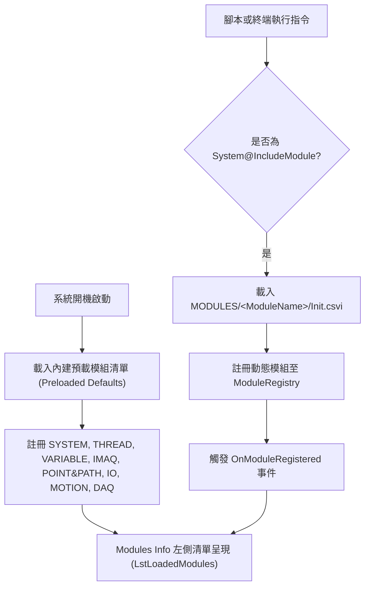
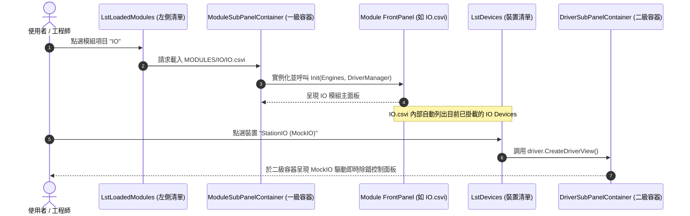

# 12. 統一模組中心與兩層式 SubPanel 架構規格書 (Unified Modules Info & Two-Tier SubPanel Spec)

本文檔定義 ARCOSharp 系統中 **「統一模組中心 (Modules Info)」** 的架構重構規範、底部主分頁收納標準、動態模組載入機制，以及**兩層式階層 SubPanel (Two-Tier Hierarchical SubPanel Routing)** 的設計與擴充規範。

---

## 1. 架構願景與重構動機 (Architectural Motivation)

ARCOSharp 的核心哲學是 **「一切皆模組（Everything is a Module / CSVI）」**。所有核心子引擎與外掛硬體均應具備統一的探索、展示、監控與控制規範。

### 現行架構痛點分析 (Pain Points)
1. **底部分頁過度膨脹 (Bottom Tabs Sprawl)**：
   - 底部導航欄常駐高達 10 個分頁，其中 `IMAQ Array`、`Point&Path`、`Threads`、`Parameter&Variable`、`WaveForm` 各自獨立佔位，畫面擁擠繁雜。
   - 這些分頁實質上對應於 ARCOS 核心引擎（Image/IMAQ、Point、Thread、Variable、Daq），卻以特殊視圖形式散落在主介面底部，破壞了「模組一致性」。
2. **Modules Info 靜態僵化 (Hardcoded Static Tabs)**：
   - 原 `Modules Info` 內部頂部採用 6 個硬編碼子分頁（1. System, 2. IO, 3. Motion, 4. DAQ, 5. MultiStation, 6. ExternalModule）。
   - 當產線腳本呼叫 `SYSTEM@INCLUDEMODULE` 動態引入新模組（如 `PLC`、`ROBOT`、`PY_VISION`）時，介面無法自動長出對應的模組分頁，失去動態外掛的靈活性。

### 統一重構願景 (Unified Vision)
* **底部分頁大幅瘦身**：底部僅保留核心主入口（`User Tab`、`Capture`、`Modules Info`、`Panel CMD`、`Remote`）。
* **Modules Info 統一收納中心**：
  - 頂部硬編碼子 Tab 全部移除。
  - 改採 **「左側動態模組清單 (Module Text List) + 右側動態統一 SubPanel」**。
  - 被收納的 5 個底部分頁與硬體模組，全部以模組項目的形式收錄於清單中。
* **兩層式 SubPanel (Two-Tier Routing)**：點選模組載入模組主視圖（`MODULES/<Name>/<Name>.csvi`）；硬體模組內部再列出裝置清單，點選裝置載入驅動視圖（`Driver FrontPanel`）。

---

## 2. 底部導航頁籤收納映射表 (Tab Bar Consolidation)

底部原有的 5 個獨立分頁直接移出底部導航列，並全數映射為 `Modules Info` 左側清單中的一級模組項目：

| 原底部分頁 (Bottom Tab) | 狀態 | 移入 Modules Info 對應模組 | 載入內容與核心職責 |
|---|---|---|---|
| **User Tab** | **保留** | - | 機台主操作畫面（作業員 HMI、UserPanel.csvi、Sequencer） |
| **Capture** | **保留** | - | 機台主視覺檢驗與對位輔助視窗 |
| **IMAQ Array** | **收納移除 ➔** | **`IMAQ`** | 各相機連續抓圖預覽、通道縮圖陣列與歷史影像檢驗 |
| **Point&Path** | **收納移除 ➔** | **`POINT&PATH`** | 點位資料庫（Point Table）、運動路徑軌跡教學與參數調整 |
| **Modules Info** | **升級保留** | - | **系統統一模組中心（本規格核心改造對象）** |
| **Threads** | **收納移除 ➔** | **`THREAD`** | 13 個主執行緒即時 PC、Call Stack、執行微步與 SubThread 監視 |
| **Parameter&Variable** | **收納移除 ➔** | **`VARIABLE`** | 全域變數、執行緒局部變數、配方參數之即時查詢與線上修改 |
| **WaveForm** | **收納移除 ➔** | **`DAQ`** | 類比採集通道波形、即時示波器視圖與觸發條件配置 |
| **Panel CMD** | **保留** | - | 快速手動發送文字指令與除錯終端 |
| **Remote** | **保留** | - | Telnet / TCP 遠端遙控服務狀態與連線 Session 監控 |

---

## 3. `Modules Info` 主頁面版面佈局 (Layout & Topology)

`Modules Info` 視圖全面改為清爽、對稱、具備高度擴展性的「Master-Detail / Two-Tier」佈局架構：

```
+--------------------------------------------------------------------------------------------------------+
|  Modules Info                                                                                         |
+--------------------------+-----------------------------------------------------------------------------+
|  Loaded Modules          |  Module SubPanel (Dynamic Container)                                        |
|  +--------------------+  |  +-----------------------------------------------------------------------+  |
|  | SYSTEM             |  |  | [第一層 Module FrontPanel: MODULES/<Selected>/<Selected>.csvi]        |  |
|  | THREAD             |  |  |                                                                       |  |
|  | VARIABLE           |  |  |  (例如選取 IO 模組時):                                                |  |
|  | IMAQ               |  |  |  +-------------------------+---------------------------------------+  |  |
|  | POINT&PATH         |  |  |  | Discovered Devices:     | Device Driver SubPanel (第二層)        |  |  |
|  | IO           [選取] |  |  |  | - StationIO             | [MockIO Control Panel]                |  |  |
|  | MOTION             |  |  |  | - RobotIO               |  DI 0-15: [●][○][●]...                |  |  |
|  | DAQ                |  |  |  | - Advantech_PCI1750 [選取]|  DO 0-15: [Set][Reset]...             |  |  |
|  | *CUSTOM_MODULE*    |  |  |  +-------------------------+---------------------------------------+  |  |
|  +--------------------+  |  +-----------------------------------------------------------------------+  |
+--------------------------+-----------------------------------------------------------------------------+
```

### 佈局組件定義 (XAML Component Spec)
* **左側模組清單 (`LstLoadedModules: ListBox`)**：
  - 固定寬度（推薦 `220px ~ 250px`）。
  - 綁定至 `ObservableCollection<ModuleInfoItem>`。
  - 支援圖示與模組狀態指示（Preloaded / Dynamic / Active）。
* **右側一級模組容器 (`ModuleSubPanelContainer: ContentControl`)**：
  - 填滿剩餘空間（`*`）。
  - 當左側選取項目變更時，依據模組型別動態掛載對應的 FrontPanel 視圖。

---

## 4. 模組註冊與動態載入體系 (Module Discovery & Registration)

模組清單由 **「開機預載」** 與 **「執行期動態引入」** 兩部分組成：



### 4.1 預載模組清單 (Default Preloaded Modules)
系統啟動時，以下 9 大核心模組自動進入清單：
1. **`SYSTEM`**：系統核心（運行日誌、Cycle Time 紀錄、系統資源統計、機台狀態）。
2. **`THREAD`**：執行緒核心（收納原 Threads Tab，13 個主執行緒與動態 SubThread 狀態矩陣）。
3. **`VARIABLE`**：變數管理（收納原 Parameter&Variable Tab，全域/區域變數查詢、修改與監視）。
4. **`IMAQ`**：視覺影像（收納原 IMAQ Array Tab，多相機影像陣列、檢驗圖表）。
5. **`POINT&PATH`**：點位路徑（收納原 Point&Path Tab，教導點位管理、多軸軌跡規劃）。
6. **`IO`**：數位/類比 IO 模組（管理 IO 裝置清單與驅動面板）。
7. **`MOTION`**：運動控制模組（管理軸控制器、馬達伺服、運動參數與手動寸動視圖）。
8. **`DAQ`**：資料採集模組（收納原 WaveForm Tab，高速採集通道、波形圖、觸發紀錄）。
9. **`CALL`**：外部獨立 CSVI 小程式管理中心（原 `ExternalModule` 正式對齊指令前綴更名為 `CALL`，掌管 `ExternalModules/*.csvi` 之狀態監控、即時測試與 CsviStudio 整合開發）。

### 4.2 動態載入指令 (`SYSTEM@INCLUDEMODULE`)
當自動化腳本執行：
```csv
1, SYSTEM@INCLUDEMODULE, "LASER"
```
1. 核心直譯器調用 `MODULES/LASER/Init.csvi` 完成初始化。
2. `ModuleRegistry` 登記新模組 `LASER`。
3. 觸發 `ModuleRegistered` 通知，UI 的 `LstLoadedModules` 即時追加 `LASER` 項目。
4. 使用者在 `Modules Info` 點擊 `LASER`，即載入 `MODULES/LASER/LASER.csvi`。

---

## 5. 兩層式 SubPanel 階層化調度機制 (Two-Tier SubPanel Routing)

系統定義兩層視圖路由協議，依模組性質區分為 **「資料/監控型模組」** 與 **「多裝置硬體型模組」**：



### 5.1 第一層：模組主視圖 (Tier 1: Module FrontPanel)
* **檔案約定**：置於 `MODULES/<ModuleName>/<ModuleName>.csvi`（或編譯後之 DLL）。
* **內建模組視圖解析**：
  - `SYSTEM` ➔ 內部封裝之 `SystemView` (Logs + Statistics)。
  - `THREAD` ➔ 封裝原 `TabThreads` 為獨立之 `ThreadMonitorView`。
  - `VARIABLE` ➔ 封裝原 `TabParamVar` 為獨立之 `VariableManagerView`。
  - `IMAQ` ➔ 封裝原 `TabImaqArray` 為獨立之 `ImaqArrayView`。
  - `POINT&PATH` ➔ 封裝原 `TabPointPath` 為獨立之 `PointPathView`。
  - `DAQ` ➔ 封裝原 `TabWaveform` 為獨立之 `DaqWaveformView`。
  - `CALL` ➔ 載入 `MODULES/CALL/CALL.csvi`（外部單檔 CSVI 管理與 CsviStudio 工作台）。

### 5.2 第二層：裝置驅動視圖 (Tier 2: Device Driver SubPanel)
專門用於掌管多個硬體裝置（Multiple Devices）的模組（如 `IO`、`MOTION`、`DAQ`）：
1. 模組的 FrontPanel 左側包含 `LstDevices`，列出該模組名下所有已註冊的 Device 實例（例如：`StationIO`、`ArmIO`、`LaserIO`）。
2. 使用者選取該 Device 時，模組 FrontPanel 的右側次級容器調用 `IDriver.CreateDriverView()`，載入該裝置專屬的驅動面板（例如 `MockIoView`、`Advantech1750View`）。
3. 驅動面板直接與底層硬體通訊，提供工程師點擊輸出測試（Output Force）、輸入指示燈（Input LEDs）即時刷新。

---

### 5.3 特殊型模組：CALL 模組與 CsviStudio 深度綁定架構

在 ARCOSharp 排程器中，所有外部獨立單檔小程式均使用指令 `Call@<Name>` 調用。將原 `ExternalModule` 正式更名為 **`CALL`** 模組，可達成指令語法（`Call@`）與模組名稱（`CALL`）的 100% 正交對稱。

當工程師在 `Modules Info` 選取 `CALL` 時，右側 SubPanel 載入 **`CALL.csvi`**，提供三大核心職責：

```
+----------------------------------------------------------------------------------------------------+
|  MODULE: CALL (External CSVI Management & CsviStudio Workbench)                                   |
+--------------------------+-------------------------------------------------------------------------+
|  Discovered CSVI Files   |  Execution Monitor & Interactive Test Harness                           |
|  +--------------------+  |  +-------------------------------------------------------------------+  |
|  | MyCalc.csvi        |  |  Last Invocation: Thread 01 | Duration: 1.42 ms | Status: SUCCESS        |  |
|  | BarcodeFilter.csvi |  |  Return Value: 30                                                    |  |
|  | AiDefectDetect.csvi|  |  -----------------------------------------------------------------  |  |
|  | MathFit.csvi       |  |  [Test Inputs]: "10,20"    [Mode]: [Debug (Call@) v]                 |  |
|  +--------------------+  |  [ ▶ Run Test ] -> Output: 30                                           |  |
|                          |  +-------------------------------------------------------------------+  |
|  [ ＋ New Call CSVI ]    |  CsviStudio Workbench Linkage:                                          |
|  [ 🛠 Open CsviStudio ]  |  [ ⚡ Launch CsviStudio Editor ] -> 直接在線上修改 C# 與 XAML 並熱重載     |
+--------------------------+-------------------------------------------------------------------------+
```

#### CALL.csvi 三大核心能力：
1. **外部 CSVI 發現與執行狀態監控 (Execution Monitor)**：
   - 即時掃描 `ExternalModules/*.csvi`。
   - 記錄各 CSVI 被哪個 Thread 呼叫、呼叫頻率、執行微秒延遲（Latency）、最後回傳值與例外日誌。
2. **即時互動測試儀 (Interactive Test Harness)**：
   - 無需在 Sequencer 寫程式碼，工程師可直接在 UI 輸入參數、選擇呼叫模式（`Debug`、`Runtime &`、`Reentrant &&`），手動觸發 `ICallCommand.Execute()` 檢驗運算結果。
3. **深度整合 CsviStudio (Authoring & Hot-Reload)**：
   - 介面提供 `[Open CsviStudio]` 按鈕或在右側容器嵌入 CsviStudio 工作台。
   - 借助 `CollectiblePluginContext` 的非鎖定（Non-locking MemoryStream）架構，工程師可在 CsviStudio 內直接撰寫 C# 代碼、設計 FrontPanel、編譯替換，系統立即無感熱重載，完全不需重開主程式！

---

## 6. 二次開發者指引：自訂模組之 FrontPanel 開發 (Developer Guide)

當您依據 [05. 動態模組擴充教學](./05_EXTEND_MODULE.md) 開發全新模組時，若希望該模組能在 `Modules Info` 中呈現專屬視圖，請遵循以下步驟：

### 步驟 1：建立模組主視圖 (`<ModuleName>.csvi`)
在模組目錄下提供主視圖：
```
MODULES/BARCODE/
├── BARCODE.Module.dll          # 模組指令直譯核心
├── Init.csvi                   # 初始化腳本
├── BARCODE.csvi                # 模組主視圖 (Front Panel)
└── DRIVER/
    └── KeyenceSR/
        └── KeyenceSR.Driver.dll
```

### 步驟 2：實作 `IModuleFrontPanel` 契約介面
在您的 View 或 ViewModel 實作生命週期注入介面：
```csharp
namespace ARCOS.Common.UI;

public interface IModuleFrontPanel
{
    // 當視圖被掛載入 Modules Info 一級容器時呼叫
    void OnMounted(BasicEngines engines, DriverManager driverManager);

    // 當使用者切換至其他模組或離開頁面時呼叫 (釋放計時器與繪圖資源)
    void OnUnmounted();
}
```

### 步驟 3：提供兩層式驅動掛載（若適用）
若您的模組掌管多個硬體裝置，建議在 `BARCODE.axaml` 中保留一個內部 `ContentControl`，並監聽裝置選取事件：
```csharp
private void OnDeviceSelected(string deviceName)
{
    var driver = _driverManager.GetDevice("BARCODE", deviceName);
    if (driver != null)
    {
        DeviceSubPanel.Content = driver.CreateDriverView();
    }
}
```

---

## 7. 驗證與驗收標準 (Acceptance Criteria)

1. **介面純淨度**：
   - 底部 `MainTabControl` 不得再出現 `IMAQ Array`、`Point&Path`、`Threads`、`Parameter&Variable`、`WaveForm` 5 個頁籤。
2. **開機預載完整度**：
   - 開機後點進 `Modules Info`，左側清單必定完整呈現 8 大預載模組（`SYSTEM`, `THREAD`, `VARIABLE`, `IMAQ`, `POINT&PATH`, `IO`, `MOTION`, `DAQ`）。
3. **無縫功能切換**：
   - 點擊 `THREAD` 必須能正常觀看 13 個主執行緒即時 PC 與微步狀態。
   - 點擊 `VARIABLE` 必須能查詢與修改全域變數。
   - 點擊 `IO` 必須能看見 Device List，選取 `StationIO` 後次級 SubPanel 必須正確載入 `MockIoView` 並可直接測試開關。
4. **動態載入即時響應**：
   - 執行 `SYSTEM@INCLUDEMODULE` 後，新模組自動動態列入左側清單，無需重啟系統。
