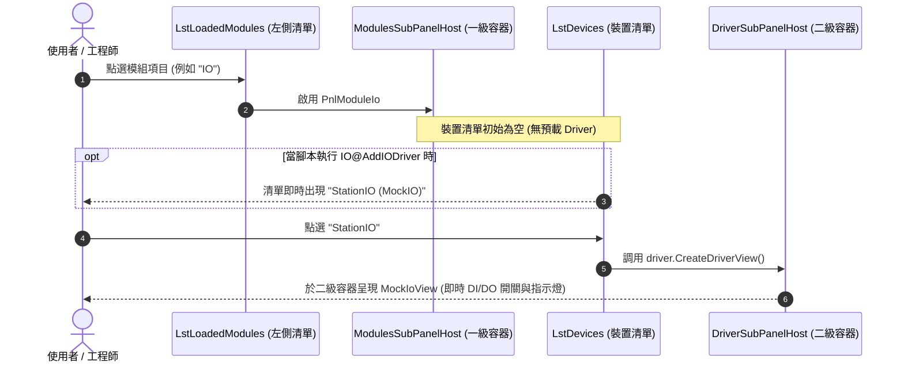

# 12. 統一模組中心與兩層式 SubPanel 架構規格書 (Unified Modules Info & Two-Tier SubPanel Spec)

本文檔定義 ARCOSharp 系統中 **「統一模組中心 (Modules Info)」** 的架構重構規範、底部主分頁收納標準、動態模組載入機制、**兩層式階層 SubPanel (Two-Tier Hierarchical SubPanel Routing)**，以及 **CSVI Studio 深度內嵌工作台與動態 MCP 服務規範**。

---

## 1. 架構願景與重構動機 (Architectural Motivation)

ARCOSharp 的核心哲學是 **「一切皆模組（Everything is a Module / CSVI）」**。所有核心子引擎、外部小程式與外掛硬體均應具備統一的探索、展示、監控與控制規範。

### 現行架構痛點分析 (Pain Points)
1. **底部分頁過度膨脹 (Bottom Tabs Sprawl)**：
   - 底部導航欄原先常駐高達 10 個分頁，其中 `IMAQ Array`、`Point&Path`、`Threads`、`Parameter&Variable`、`WaveForm` 各自獨立佔位，破壞主畫面俐落性與工控現場焦點。
   - 這些分頁實質上對應於 ARCOS 核心引擎（Image/IMAQ、Point、Thread、Variable、Daq），卻以特殊視圖形式散落在主介面底部。
2. **User Tab 包含硬編碼非模組控制項**：
   - 原 `User Tab` 左側包含硬編碼的 Station 資訊列與 `SUBPANEL VIEW` 快捷按鈕組，限制了客製化 `UserPanel.csvi` 的最大化發揮空間。
3. **Capture 頁籤操作工學需進化**：
   - 裝置清單（CamList、MotorList）過於狹小（僅 70px），不利於多相機多軸產線檢視。
   - 頂部硬編碼 CAM0~CAM11 單選按鈕列浪費空間且不夠靈活。
   - Snap 按鈕僅支援單次觸發，缺乏連續高速取像（Live）能力。
4. **硬體 Driver 預載造成虛擬設備污染**：
   - 開機自動載入 MockIO、MockMotion、MockCamera、MockDAQ，無法如實反映真實產線「依腳本配置動態掛載驅動」的行為。
5. **CSVI Studio 孤立於主程式之外**：
   - CsviStudio 原先為獨立 EXE，工程師與 AI Agent 無法在主機台介面同進程內即時修改程式碼、預覽與熱重載。

### 統一重構願景 (Unified Vision)
* **底部分頁終極精簡（6 大分頁）**：
  底部導覽列固定為：`User Tab` ➔ `Capture` ➔ `Modules Info` ➔ `Panel CMD` ➔ `Remote` ➔ **`CSVI STUDIO: MCP <PORT>`**。
* **User Tab 100% 純淨 SubPanel 化**：
  左側工作區域全數改為乾淨的 `UserPanelContainer`，專供載入自訂 `UserPanel.csvi`。
* **Capture 工學進化**：
  CamList/MotorList 長度加大 4 倍（280px），相機選取改由清單直選，Snap 具備「單擊單張 / 雙擊連續 5fps 取像」雙模式。
* **硬體 Driver 延遲載入 (On-Demand Loading Discipline)**：
  開機不預載任何硬體 Driver，直到執行指令（如 `IO@AddIODriver`）時才動態建立裝置並掛入二級 SubPanel。
* **CSVI Studio 深度內嵌與動態 MCP Server**：
  內嵌於第 6 個分頁，具備自動尋找可用 TCP Port 號機制，多開實例互不衝突，分頁標籤動態呈現 `CSVI STUDIO: MCP <PORT>`。

---

## 2. 底部導航頁籤配置與收納映射表 (Tab Bar Architecture)

底部導航列全面整併後，固定呈現 6 個專業主入口：

| 底部主分頁 (Bottom Tab) | 狀態 | 核心職責與設計規範 |
|---|---|---|
| **1. User Tab** | **升級保留** | **純淨 SubPanel 工作區**：全面清空寫死的頂部橫條與工具列按鈕，全域工作區 100% 專供載入 `UserPanel.csvi`。 |
| **2. Capture** | **升級保留** | **相機與視覺對位工學主畫面**：<br>• CamList 與 MotorList 垂直長度加大 4 倍（280px）。<br>• 移除頂部 CAM0~CAM11，改由 CamList 直選切換相機影像。<br>• 移除無用之 CaptureCMD。<br>• Snap 支援單擊單張、雙擊連續 5fps（200ms）高速取像。 |
| **3. Modules Info** | **升級保留** | **系統統一模組中心**：收納原 `IMAQ Array`、`Point&Path`、`Threads`、`Parameter&Variable`、`WaveForm` 5 大分頁。<br>• 左側：9 大預載核心/硬體模組清單 (`LstLoadedModules`)。<br>• 右側：統一動態 SubPanel 容器 (`ModulesSubPanelHost`)。 |
| **4. Panel CMD** | **保留** | 快速終端指令輸入列與日誌。 |
| **5. Remote** | **保留** | Telnet / TCP 遠端遙控服務狀態與連線 Session 監控。 |
| **6. CSVI STUDIO** | **全新內嵌** | **即時 IDE 與動態 MCP 服務工作台**：<br>• 內嵌完整 C# Logic 編輯器、XAML 畫布、Roslyn 編譯器與沙盒測試。<br>• 啟動 MCP Server 並自動尋找可用 Port，分頁標題動態顯示 `CSVI STUDIO: MCP <PORT>`。<br>• 支援 AI Agent 即時連線檢驗、修改與熱重載 CSVI。 |

---

## 3. 分頁工學與視圖規範 (Tab Ergonomic Specs)

### 3.1 User Tab：純淨 SubPanel 規範
* **佈局定義**：
  - 左側 70% 區域：移除非模組化的 `STATION 01: AUTO INSPECTION` 頂部 Banner 與 `SUBPANEL VIEW` ComboBox/按鈕組。
  - 改為單一滿版之 `<ContentControl x:Name="UserPanelContainer" Background="#FFFFFF" HorizontalContentAlignment="Stretch" VerticalContentAlignment="Stretch"/>`。
  - 系統開機或腳本執行 `System@UserPanelOpen, UserPanel.csvi` 時，直接將解析出的 `UserPanel` 實體無縫掛載於此。

### 3.2 Capture 頁籤：現代視覺工學規範
* **清單垂直長度加大 4 倍**：
  - `LstCaptureCameras`（CamList）與 `LstCaptureMotors`（MotorList For IMAQ）的高度由原本的 `70px` 擴增為 **`280px`**，大幅提升能見度與多裝置排程效率，水平寬度保持不變。
* **精簡冗餘控制項**：
  - 完整移除左側已不再使用的 `CaptureCMD` 區塊（`UpdateImage -1`）。
  - 移除頂部藍框之 `CAM0 ~ CAM11` 單選按鈕條。
* **相機選取驅動機制**：
  - 廢棄 RadioButton 輪詢，改為監聽 `LstCaptureCameras.SelectionChanged` 事件。
  - 當使用者點擊清單中的相機項目時，即時調用 `_engines.Image.GetFrame(camName)` 並將點陣影像推播至主畫布 `ImgLivePreview`。
* **Snap 按鈕雙模式（單張 / 連續 5fps）**：
  - **單擊（Single Click）**：執行單次取像 `PerformSnap()`。
  - **雙擊（Double Click）**：進入連續取像模式（Continuous Live Capture），啟動內部高精度計時器，以 **每秒 5 次（200ms）** 頻率循環調用取像；按鈕外觀轉為綠色或文字提示（如 `● LIVE (5fps)`）。
  - **連續中單擊（Click while running）**：立即終止計時器，平穩復原回單張 Snap 模式。

---

## 4. 模組註冊與硬體 Driver 延遲載入體系 (On-Demand Loading Discipline)

### 4.1 硬體 Driver 不開機預載規範
* **核心規範**：
  - 系統啟動時，`_driverManager` 嚴禁自動註冊任何 Mock 裝置實例（禁止預跑 `MockIO`、`MockCamera`、`MockMotion`、`MockDAQ`）。
  - 當使用者點入 `IO`、`CAPTURE`、`MOTION`、`DAQ` 模組時，左側裝置清單初態為空，右側二級 SubPanel 顯示等待掛載引導提示：
    ```
    [ 尚無已載入之硬體裝置 ]
    請於 Sequencer 腳本或終端執行指令以掛載硬體 (例如: IO@AddIODriver StationIO, MockIO)
    ```
* **指令動態掛載機制**：
  - 當腳本或 Panel CMD 執行例如：
    ```csv
    1, IO@AddIODriver, "StationIO, MockIO, StartPort=P0.0,BitCount=64,Interval=25"
    2, Capture@AddCam, "CamTop, MockCamera, CamIndex=0,Res=640x480"
    3, Motion@AddMotion, "RobotGantry, MockMotion, Mechanism=Gantry6Axis"
    4, DAQ@AddDAQ, "PressSensor, MockDAQ, Rate=1000,Channels=1"
    ```
  - `_driverManager` 動態載入 DLL、實例化驅動並加入裝置集合。
  - 觸發裝置更新通知，模組頁面之裝置清單即時出現該硬體，點擊後立刻調用 `CreateDriverView()` 掛入二級 SubPanel。

### 4.2 模組清單開機預載與動態擴充
系統開機時，`Modules Info` 左側清單預載以下 9 大模組：
1. **`SYSTEM`**（核心日誌與 RecordS 生產記錄儀表）：
   - **完全解耦 TimerEngine**：`Record` 職責為履歷與日誌打卡，與負責逾時防護之 `TimerEngine` 徹底權責分離，獨立建立 `RecordEngine`。
   - **統一資料結構**：系統全域 Log 與週期打卡（`Record`）本質皆為 `Timestamp + Message`，預設常駐 `SYSTEMLOG` 通道，支援使用者自訂打卡（如 `cycletime`）。
   - **2000 槽位固定環狀緩衝區 (Ring Buffer)**：預先配置 2000 筆槽位，寫入複雜度 $O(1)$，絕不使用動態拼接（`+=`）或無上限記憶體 Append，徹底避免長期運行之記憶體膨脹與 GC 停頓。
   - **1:1 原版工控介面還原**：左側 `[Get RecordS]` 按鈕與通道清單；右側頂部呈現 `RecordIndex` 與 `Capability: 2000`，搭配立體凹槽（Sunken Inset）高精度時間戳與訊息雙欄表格。
2. **`THREAD`**（13 主執行緒 PC 矩陣與微步監視）
3. **`VARIABLE`**（全域/局部變數線上查詢與修改）
4. **`POINT&PATH`**（6 軸 DRO 與教導點位資料庫）
5. **`CALL`**（外部 CSVI 管理與即時測試儀）
6. **`IO`**（IO 裝置清單與驅動 SubPanel）
7. **`CAPTURE`**（相機硬體清單、驅動 SubPanel ⇄ IMAQ 影像陣列檢視）
8. **`MOTION`**（軸控制器清單與驅動寸動 SubPanel）
9. **`DAQ`**（資料採樣裝置清單、驅動 SubPanel ⇄ ScottPlot 示波器）

當腳本執行 `System@IncludeModule <ModuleName>`（如 `PYTHON`）時，清單即時動態追加新項目。

### 4.3 CALL 模組雙 UI 視圖與整合除錯台規範 (CALL Module Dual-View & Test Harness)
CALL 模組不僅是外部 CSVI 小程式的調度宿主，更是工程師除錯單檔外掛的**一站式單元測試台 (Runtime Integration Testbench)**。為徹底杜絕傳統僅依靠黑漆漆終端印出日誌的「盲測」弊端，CALL 模組右側全面支援 CSVI「三位一體」架構中的雙重 UI 即時呈現：

1. **中欄 (Middle Column) 外掛清單**：
   - 條列 `ExternalModules/*.csvi` 所有已編譯組件。
   - 具備 `Refresh CSVI List` 與快捷跳轉 `🛠 Open CsviStudio` 編輯器按鈕。
2. **右欄頂部 (Top Test Bar) 互動測試工具列**：
   - 即時狀態列：`SELECTED CALL CSVI`、`LAST EXEC DURATION`、`STATUS / RETURN`。
   - 輸入測試參數 (`TxtCallTestArgs`)、執行模式 (`Debug` / `Runtime &` / `Reentrant &&`)、`▶ Run Test` 執行按鈕。
   - 增加 `📋 帶入導引參數 (Apply From Wizard)` 按鈕，一鍵讀取導引精靈中的輸入設定並填入測試列。
3. **右欄核心：雙視圖分頁容器 (`TabCallViews`)——遵循「先導引配置、後執行結果」認知工學**：
   - **第一分頁（預設焦點）：`⚙️ 參數導引精靈 (Wizard)`**：掛載選中 CSVI 之 `Wizard.axaml`。在不進入排程器腳本編輯器的情況下，直接呈現該指令的參數配置介面，工程師選取小程式後首先在此驗證精靈版面，並可一鍵將配置參數帶入測試列。
   - **第二分頁：`🖥️ 執行時前面板 (FrontPanel)`**：掛載選中 CSVI 之 `Panel.axaml` 或 `GetFrontPanelControl()`。即時呈現該小程式的運行期視覺回饋（如檢測指示燈、波形圖表、演算法結果卡片）。點擊 `▶ Run Test` 時系統可自動平滑切換至此分頁，第一時間目睹執行反饋。
4. **右欄底部：終端日誌 (Execution Console Log)**：
   - 緊湊暗色終端（高度約 130px），在不遮蔽上方 FrontPanel 與 Wizard 的前提下，即時輸出調用時間戳、耗時微秒、回傳狀態與日誌。工程師點擊 `▶ Run Test` 時可「眼觀 FrontPanel 視覺動態，耳聽 Console 狀態回傳」，達成真正零割裂的除錯體驗。

---

## 5. 兩層式 SubPanel 階層化調度機制 (Two-Tier SubPanel Routing)



---

## 6. CSVI Studio 深度內嵌與動態 MCP Server 規範 (Embedded IDE & MCP Spec)

### 6.1 內嵌設計 (Embedded UserControl Architecture)
* 將原獨立專案 `ARCOS.CsviStudio` 之編輯器、XAML 預覽、編譯服務解耦，封裝為Avalonia 控制項 `CsviStudioControl`。
* 位於主視窗底部導覽列之最後一個 TAB（第 6 個分頁）：
  `<TabItem x:Name="TabStudio" Header="CSVI STUDIO: MCP 48800">`。
* 具備完整現代工控淺色風格工具列：
  - `📂 Open .csvi`、`✨ New CSVI`、`⚡ Build & Save (Ctrl+S)`。
  - 編譯模式切換（`🟢 PortableOpen`、`🟡 PasswordLocked`、`🔴 StrippedRelease`）。
  - 左側原始碼編輯（`Logic.cs`, `Wizard.axaml`, `FrontPanel.axaml`, `Config.json`）。
  - 右側沙盒測試與即時畫布預覽。
  - 底部編譯日誌與例外堆疊。

### 6.2 MCP Server 動態 Port 探測與多開隔離 (Dynamic Port Discovery)
* **多開防衝突演算**：
  1. 系統啟動時，MCP 服務自基礎通訊埠（如 `48800`）開始探測可用 TCP Port（或透過 `TcpListener(IPAddress.Loopback, 0)` 由作業系統動態分派未佔用埠號）。
  2. 若發現已被先前的 ARCOSharp 實例佔用，則自動依序遞增（`48801`, `48802`...）直至綁定成功。
  3. 綁定成功後，非同步啟動 `McpTcpListener` 監聽 JSON-RPC 2.0 請求。
* **UI 動態回顯**：
  - 取得實際監聽的 Port（例如 `48800`）後，即時更新主介面分頁標題：
    ```csharp
    TabStudio.Header = $"CSVI STUDIO: MCP {mcpPort}";
    ```
  - 同時在 CsviStudio 頂部狀態列顯示：`🟢 MCP Active: 127.0.0.1:{mcpPort}`。
* **AI Agent 協同能力**：
  - 本地或遠端 AI Agent 可透過 JSON-RPC over TCP 直接連線該 Port，執行以下 MCP 工具：
    1. `csvi_list_modules`：掃描現存指令與硬體驅動清單。
    2. `csvi_inspect`：檢查指定 .csvi 組件的元數據 (Manifest)、保護模式與資源清單。
    3. `csvi_extract_source`：提取內嵌的 .cs 與 .axaml 原始碼。
    4. `csvi_load_in_studio`：指令 Studio UI 立即載入特定 CSVI 並更新代碼與預覽。
    5. `csvi_compile_and_pack`：傳入新程式碼並透過內建 Roslyn 工具鏈動態編譯封裝。
    6. `csvi_sandbox_execute`：以微秒級沙盒執行指定參數並回傳輸出與耗時。
    7. `csvi_capture_ui`：由 Studio 渲染視圖並截圖回傳給 Agent 進行視覺校驗。

### 6.3「零依賴」記憶體宿主對齊機制與 Roslyn 編譯核心架構 (Zero-Dependency Roslyn Architecture)

#### 1. 關於「預裝 SDK 與版本對齊」的底層機制
這正是 ARCOSharp 不採用傳統 `dotnet build` 命令列子進程，而是內嵌 Roslyn 記憶體編譯器的最核心原因！

如果採用傳統外部呼叫 `dotnet build` 的做法，會遇到兩個致命痛點：
1. **外部環境缺失**：在乾淨的工廠產線機台 (FA PC) 或現場無網環境中，作業系統通常只有執行時環境 (Runtime)，根本沒有安裝 .NET SDK。事實上，在 ARCOSharp 的實機系統測試中，全域的 `C:\Program Files\dotnet\dotnet.exe` 就完全沒有安裝 SDK，若直接呼叫 `dotnet build` 會立即報錯崩潰：`No .NET SDKs were found`。
2. **版本漂移 (Version Drift)**：若使用者電腦額外安裝了 .NET 6、7 或 9，或不同版本的 Avalonia，編譯產出的二進位 DLL 在進入 ARCOSharp 主程序時會發生 `TypeLoadException` 或 ABI 脫節。

#### 2. ARCOSharp CSVI Studio 的解決架構：「零依賴」記憶體宿主對齊機制
在核心編譯服務 `CsviCompilerService.cs` 中：
1. **內嵌 Roslyn 編譯器**：直接封裝微軟官方 `Microsoft.CodeAnalysis.CSharp`，全記憶體編譯，不呼叫任何外部 `dotnet.exe`。
2. **參考組件就地取材**：
   - 編譯引用直接從目前運行的 `AppDomain.CurrentDomain.GetAssemblies()` 與 `TRUSTED_PLATFORM_ASSEMBLIES` 抽取。
   - 自動精確綁定宿主執行時正在使用的 **.NET 8.0 BCL 系統庫** 以及目錄下的 **Avalonia 11.0.10**（`Avalonia.Base`、`Avalonia.Controls`、`Avalonia.Markup.Xaml.Loader`、`ARCOS.Core` 等）。
3. **100% 保證 ABI 對齊**：
   - 編譯時所用的參考，就是此刻 ARCOSharp 宿主正在執行的記憶體 DLL，版本一致性高達 100%。
   - 工具列右上角明確標記狀態徽章：`SDK: ARCOS-SDK-8.0.1 [✔ ALIGNED]`。
4. **極速與自主**：
   - 避開 MSBuild 冷啟動與檔案掃描，單次編譯封裝僅需 **50 ~ 100 毫秒**。
   - 完全離線運作，任何乾淨機台無須連網或額外安裝 Visual Studio / .NET SDK。

### 6.4 實機端到端熱重載驗收閉環 (Live Round-Trip Demonstration)

透過內嵌 MCP 伺服器與 CSVI Studio 編輯介面，系統實現了「載入 ➔ 修改 ➔ COMPILE ➔ 即時看到結果」的零中斷閉環：

1. **載入既存 CSVI (`csvi_load_in_studio`)**：
   - 呼叫 MCP 工具 `csvi_load_in_studio` 載入 `ExternalModules/TEST.csvi`。
   - UI 編輯器即時顯示解包後之 `Logic.cs`、`Wizard.axaml`、`Panel.axaml` 與修訂歷程。
   - 診斷控制台輸出：`Successfully opened TEST.csvi (Key: TestCalc, Mode: PortableOpen, Sources: 3)`。
2. **即時 XAML 預覽 (`Live XAML Preview`)**：
   - 右側分頁切換至 `Live XAML Preview`，Avalonia 執行期 XAML Loader (`AvaloniaRuntimeXamlLoader`) 即時解析並動態渲染出前面板控制項。
3. **熱重載修改與編譯 (`csvi_compile_and_pack`)**：
   - 傳入更新代碼（例如翠綠色卡片 `#064E3B` 與三參數連乘邏輯 `a * b * c`）。
   - Roslyn 於記憶體中在數十毫秒內完成 Emit 編譯、組件簽名、Manifest 打包與二進位寫入。
   - Studio 自動接獲刷新廣播，右側 `Live XAML Preview` 立即在毫秒內熱重載呈現新版面板。
4. **沙盒與主系統調用驗證 (`csvi_sandbox_execute` & `Call@TEST`)**：
   - 沙盒隔離執行：耗時僅 **2.37 ms**，回傳 `Status: Completed`。
   - 主系統 CALL 模組測試：於 `Modules Info` ➔ `CALL` 模組中點擊 `▶ Run Test`，耗時 **5 ms**，主系統日誌精確輸出：
     `[Thread 0:ThreadMain] [TEST.csvi V3 HOT-RELOADED] Product: 10 * 20 * 5 = 1000`。

---

## 7. 驗收標準與驗證指引 (Acceptance Criteria)

1. **User Tab 純淨性驗收**：
   - `User Tab` 內不再有 Station 橫條與快捷按鈕組，畫布全面提供 `UserPanelContainer`。
2. **Capture 頁籤工學驗收**：
   - `LstCaptureCameras` 與 `LstCaptureMotors` 垂直高度為 `280px`（加大 4 倍）。
   - 頂部無 `CAM0~CAM11` 按鈕；在 `CamList` 點選相機即切換預覽畫面。
   - `CaptureCMD` 區塊已徹底移除。
   - `Snap` 單擊取單張；雙擊切換每秒 5 次連續取像；再次單擊即停止。
3. **Driver 延遲載入驗收**：
   - 開機啟動時，`IO`、`CAPTURE`、`MOTION`、`DAQ` 裝置清單皆為空，次級 SubPanel 顯示未掛載提示。
   - 執行 `Add...` 指令後，裝置立即出現並可掛載驅動視圖。
4. **CSVI Studio 內嵌與 MCP Port 驗收**：
   - 底部第 6 個分頁成功呈現 `CSVI STUDIO: MCP <PORT>`。
   - 點進分頁可完整檢視與編輯 CSVI。
   - 當開啟多個主程式實例時，各實例之 MCP Port 號自動遞增且清晰可見。
5. **Desktop Cockpit 自動化驗證**：
   - 所有視圖切換與按鈕動作必須於零干擾 Windows 虛擬螢幕（`\\.\DISPLAY9`）通過 Desktop Cockpit 截圖與互動驗收。
6. **「零依賴」SDK 記憶體對齊與毫秒級熱重載驗收**：
   - 脫離外部 `dotnet.exe` SDK 與網路連線，CSVI Studio 在乾淨機台環境中透過 Roslyn 記憶體編譯僅需 50~100 ms。
   - 界面明確呈現 `SDK: ARCOS-SDK-8.0.1 [✔ ALIGNED]` 與 `🟢 MCP Active: 127.0.0.1:<PORT>`。
   - 支援外掛組件在未重啟 ARCOSharp 情況下，透過 MCP 完成即時代碼寫入、編譯打包、XAML 熱重載預覽與主系統無縫調度。
