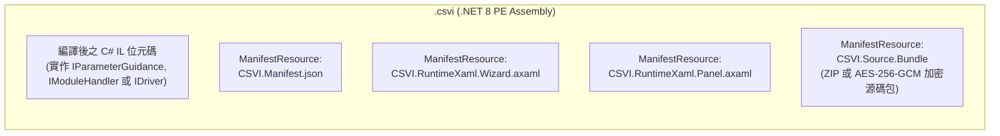

# 13. ARCOSharp 主程式、Basic Engines 與模組/指令 CSVI 完整開發聖經 (Complete Module & CSVI Development Guide)

> [!IMPORTANT]
> **本文件為獨立、自包含（Self-Contained）的 ARCOSharp 終極開發指南。**  
> 無論您是後續接手維護主程式的系統架構師、負責擴充新模組與指令的軟體工程師，或是編寫自動化腳本的 AI Agent，只需閱讀本文件，即可完整掌握：
> 1. **ARCOSharp 主程式與核心執行引擎運作機制**
> 2. **`BasicEngines` 七大基礎子引擎的所有核心函式用法與程式碼範例**
> 3. **如何從零建立一個標準 ARCOS 模組 (`MODULES/<Module>/`)**
> 4. **用來載入到 `Modules Info` 的模組主前面板 `<Module>.csvi` 完整格式與範本**
> 5. **用來執行單一指令與參數導引的 `<Action>.csvi` 完整格式與範本**
> 6. **CSVI 3.0 CLI 自動化編譯、部署與熱重載閉環**

---

## 目錄 (Table of Contents)

1. [ARCOSharp 主程式與核心架構總覽](#1-arcosharp-主程式與核心架構總覽)
2. [BasicEngines 七大基礎引擎完整 API 函式手冊](#2-basicengines-七大基礎引擎完整-api-函式手冊)
   - [2.1 IoEngine (`ctx.Engines.Io`) — 動態無限 IO 與虛擬旗標池](#21-ioengine-ctxenginesio--動態無限-io-與虛擬旗標池)
   - [2.2 VariableEngine (`ctx.Engines.Variable`) — 多層級分區符號表與集合引擎](#22-variableengine-ctxenginesvariable--多層級分區符號表與集合引擎)
   - [2.3 PointEngine (`ctx.Engines.Point`) 與 `MachinePoint` — 7 維點位與幾何路徑引擎](#23-pointengine-ctxenginespoint-與-machinepoint--7-維點位與幾何路徑引擎)
   - [2.4 ImageEngine (`ctx.Engines.Image` / `Imaq`) — OpenCvSharp 影像與非破壞性標註層](#24-imageengine-ctxenginesimage--imaq--opencvsharp-影像與非破壞性標註層)
   - [2.5 DaqEngine (`ctx.Engines.Daq`) — 多通道連續波形與包絡線比對引擎](#25-daqengine-ctxenginesdaq--多通道連續波形與包絡線比對引擎)
   - [2.6 TimerEngine (`ctx.Engines.Timer`) — 高精度計時器與計數器引擎](#26-timerengine-ctxenginestimer--高精度計時器與計數器引擎)
   - [2.7 RecordEngine (`ctx.Engines.Record`) — 2000 槽位 O(1) 環狀生產履歷與日誌引擎](#27-recordengine-ctxenginesrecord--2000-槽位-o1-環狀生產履歷與日誌引擎)
   - [2.8 輔助解析工具：`ArgParaHelper` 與 `LogicEvaluator`](#28-輔助解析工具argparahelper-與-logicevaluator)
3. [模組 (`MODULES/<Module>/`) 的建立規範與生命週期](#3-模組-modulesmodule-的建立規範與生命週期)
   - [3.1 模組標準目錄拓撲](#31-模組標準目錄拓撲)
   - [3.2 強制單一指令 `.csvi` 派發紀律（無靜默保底）](#32-強制單一指令-csvi-派發紀律無靜默保底)
   - [3.3 特殊字元指令與 Windows 檔名映射規則](#33-特殊字元指令與-windows-檔名映射規則)
   - [3.4 微步非阻塞狀態機 (`ctx.State`) 開發鐵律](#34-微步非阻塞狀態機-ctxstate-開發鐵律)
   - [3.5 模組基底專案 (`<Module>.Module.dll`) 建立步驟](#35-模組基底專案-modulemoduledll-建立步驟)
4. [CSVI 3.0 封包底層結構與內嵌資源規範](#4-csvi-30-封包底層結構與內嵌資源規範)
   - [4.1 什麼是 `.csvi`？](#41-什麼是-csvi)
   - [4.2 `CSVI.Manifest.json` 欄位規格詳解](#42-csvimanifestjson-欄位規格詳解)
   - [4.3 XAML 語法與轉義注意事項](#43-xaml-語法與轉義注意事項)
5. [用來載入到 `Modules Info` 的模組主前面板 `<Module>.csvi` 格式與範本](#5-用來載入到-modules-info-的模組主前面板-modulecsvi-格式與範本)
   - [5.1 `<Module>.csvi` 的定位與載入時機](#51-modulecsvi-的定位與載入時機)
   - [5.2 `<Module>.csvi` 的 4 個必備組成檔案與完整範例](#52-modulecsvi-的-4-個必備組成檔案與完整範例)
6. [單一指令 `<Action>.csvi` 格式與範本](#6-單一指令-actioncsvi-格式與範本)
   - [6.1 `<Action>.csvi` 的定位與三位一體職責](#61-actioncsvi-的定位與三位一體職責)
   - [6.2 `<Action>.csvi` 的 4 個必備組成檔案與完整範例](#62-actioncsvi-的-4-個必備組成檔案與完整範例)
   - [6.3 含微步等待 (`CommandResult.Wait`) 的 `<Action>.csvi` 範例](#63-含微步等待-commandresultwait-的-actioncsvi-範例)
7. [如何 Build `.csvi`（四大編譯與打包管道詳解）](#7-如何-build-csvi四大編譯與打包管道詳解)
   - [7.1 底層編譯原理：零外部 SDK 依賴的記憶體 Roslyn 編譯器](#71-底層編譯原理零外部-sdk-依賴的記憶體-roslyn-編譯器)
   - [7.2 管道一：使用 CLI 命令列編譯單一 `.csvi` (`--compile`)](#72-管道一使用-cli-命令列編譯單一-csvi---compile)
   - [7.3 管道二：使用 Python 腳本批次 Build 整個模組的所有 `.csvi`](#73-管道二使用-python-腳本批次-build-整個模組的所有-csvi)
   - [7.4 管道三：在 C# 程式碼中直接調用 `CsviCompilerService` 編譯](#74-管道三在-c-程式碼中直接調用-csvicompilerservice-編譯)
   - [7.5 管道四：使用 CSVI Studio GUI 或 MCP `csvi_compile_and_pack` 編譯](#75-管道四使用-csvi-studio-gui-或-mcp-csvi_compile_and_pack-編譯)
   - [7.6 Build 完成後的部署、同步與 `CommandExecutor` 註冊清單](#76-build-完成後的部署同步與-commandexecutor-註冊清單)
8. [CSVI Studio 完整使用手冊（GUI 操作、沙盒測試與 MCP 自動化）](#8-csvi-studio-完整使用手冊gui-操作沙盒測試與-mcp-自動化)
   - [8.1 CSVI Studio 的四種啟動與運行模式](#81-csvi-studio-的四種啟動與運行模式)
   - [8.2 GUI 工作台介面導覽與操作步驟](#82-gui-工作台介面導覽與操作步驟)
   - [8.3 三種原始碼保護模式 (`PortableOpen` / `PasswordLocked` / `StrippedRelease`)](#83-三種原始碼保護模式-portableopen--passwordlocked--strippedrelease)
   - [8.4 透過 `CsviPackage` 在程式中解包與讀取 `.csvi`](#84-透過-csvipackage-在程式中解包與讀取-csvi)
   - [8.5 內建 MCP Server (7 大 JSON-RPC 2.0 工具) 完整調用指南](#85-內建-mcp-server-7-大-json-rpc-20-工具-完整調用指南)
9. [`Call@` 獨立外部 `.csvi` 指令 (`ExternalModules/*.csvi`) 實作規範](#9-call-獨立外部-csvi-指令-externalmodulescsvi-實作規範)
   - [9.1 模組內指令 (`MODULES/<Module>/<Action>.csvi`) vs. `Call@` 獨立指令 (`ExternalModules/*.csvi`)](#91-模組內指令-modulesmoduleactioncsvi-vs-call-獨立指令-externalmodulescsvi)
   - [9.2 `CallModuleHandler` 執行期調度與三種後綴模式 (`Debug` / `&` / `&&`)](#92-callmodulehandler-執行期調度與三種後綴模式-debug----)
   - [9.3 回傳值自動寫入 `VariableEngine` 規則](#93-回傳值自動寫入-variableengine-規則)
   - [9.4 兩階段參數導引視窗 (`CallGuidanceWindow`) 與 `Modules Info` 整合測試台](#94-兩階段參數導引視窗-callguidancewindow-與-modules-info-整合測試台)
   - [9.5 `Call@` 獨立 `.csvi` (`ICallCommand` + `IParameterGuidance`) 完整實作範本](#95-call-獨立-csvi-icallcommand--iparameterguidance-完整實作範本)

---

## 1. ARCOSharp 主程式與核心架構總覽

ARCOSharp 是一套專為高速自動化機台設計的跨平台（以 Windows 工控環境為主）控制系統，基於 **.NET 8.0** 與 **Avalonia UI 11.0.10** 建構。

### 1.1 四大核心組件分工

| 專案組件 | 輸出目標 | 核心職責 |
|---|---|---|
| **`ARCOS.Core`** | `ARCOS.Core.dll` | **無 UI 依賴的執行核心**：包含 `ArcosThreadVM`（13 主執行緒 + 動態 SubThread 虛擬機）、`CommandExecutor`（單步指令直譯器與 `[[Label]]` 自癒跳轉）、`ModuleRegistry`（模組與指令 `.csvi` 註冊表）、`BasicEngines`（7 大基礎子引擎）與 `DriverManager`（硬體驅動與 `DriverTicket` 票據調度）。 |
| **`ARCOS.App`** | `ARCOS_App.exe` | **主程式 HMI 與排程器工作站**：負責主視窗 6 大底部分頁（`User Tab`、`Capture`、`Modules Info`、`Panel CMD`、`Remote`、`CSVI STUDIO`）、腳本排程器編輯器、參數導引視窗調度 (`ParameterGuidanceManager`) 與 `127.0.0.1:19528` 自動化伺服器。 |
| **`ARCOS.CsviStudio`** | `CSVI_Studio.dll` / `.exe` | **內嵌 Roslyn 編譯器與 CSVI 開發台**：既可作為內嵌於主視窗第 6 分頁的視覺化 IDE（含動態 MCP Server），亦可透過命令列 `--compile <srcDir> <outCsvi>` 在 50~100ms 內完成零外部 SDK 依賴的記憶體編譯與封裝。 |
| **`ARCOS.Remoter`** | `ARCOS_Remoter.exe` | **TCP/Telnet 遠端遙控服務**：監聽 Port `9527`（及各執行緒通道），提供外部 MES 或上位機以純文字協定高速讀寫 IO、變數與控制腳本。 |

### 1.2 最高架構準則與執行緒模型

1. **執行速度永遠第一，非 Active UI 零成本（Zero-Cost Inactive UI）**：
   - 每個執行緒 (`ExecutionContext`) 擁有獨立的背景高速 `CMDEXECUTE` 迴圈 (`StartBackgroundLoop`)。
   - 瞬時完成 (`CommandStatus.Completed`) 的指令會以 128 步為一個 Burst 全速衝刺執行（零 `Task.Delay`）；僅當指令回傳 `CommandStatus.Waiting`（PC 未推進）時，才讓出 `1ms` 供非阻塞輪詢。
   - 主視窗 `UiTimer_Tick` 嚴格檢查當前分頁與視窗可見度，凡未處於使用者當前檢視中的分頁或面板，**絕對禁止進行任何 UI 重繪或資料輪詢**。
2. **單一指令單一 `.csvi` 封裝 (`MODULES/<Module>/<Action>.csvi`)**：
   - 在 ARCOSharp 中，每一個腳本指令（例如 `IO@SetPort`、`Point&Path@Calculate`）都對應一個獨立的 `.csvi` 檔案（例如 `MODULES/IO/SetPort.csvi`、`MODULES/POINT&PATH/Calculate.csvi`）。
   - 每個模組目錄下還有一個與模組同名的 `<Module>.csvi`（例如 `MODULES/IO/IO.csvi`、`MODULES/POINT&PATH/Point&Path.csvi`），專門用來提供 `Modules Info` 分頁的模組主前面板。

### 1.3 單步指令執行生命週期 (`CommandExecutor.ExecuteStep`)

當執行緒執行到某一行指令（例如 `Point&Path@Calculate::P1=(100,200,0,0,0,0)`）時，`CommandExecutor.ExecuteStep(ExecutionContext ctx)` 依序執行以下 7 個步驟：

```mermaid
sequenceDiagram
    autonumber
    participant Loop as ExecutionContext 高速迴圈
    participant Exec as CommandExecutor
    participant Var as VariableEngine
    participant Reg as ModuleRegistry
    participant Csvi as <Action>.csvi (IModuleHandler)

    Loop->>Exec: ExecuteStep(ctx)
    Exec->>Exec: 讀取 ctx.Program[ctx.ProgIndex] (CommandItem)
    Exec->>Var: FilterParameters(item.RawParameter, ctx.CurrentSection)
    Var-->>Exec: 回傳展開 $(Var) / $Var 後的 filteredParam
    Exec->>Reg: ResolveCommandCsviPath(item.Module, item.Action)
    alt 找不到 MODULES/<Module>/<Action>.csvi
        Reg-->>Exec: null
        Exec->>Exec: HandleError() 記錄錯誤並跳轉 [[Label]] 或觸發 99:EMG Stop
    else 找到 <Action>.csvi
        Reg->>Reg: LoadCommandCsviHandler(csviPath) (含檔案時間戳熱重載快取)
        Reg-->>Exec: 回傳 csviHandler 實例
        Exec->>Csvi: csviHandler.Execute(item.Action, filteredParam, ctx)
        Csvi-->>Exec: 回傳 CommandResult (Completed / Waiting / Jump / Call / Return / Error)
        Exec->>Exec: 依據 CommandResult 更新 ctx.ProgIndex 與 ctx.State
    end
```

---

## 2. BasicEngines 七大基礎引擎完整 API 函式手冊

在任何模組或指令的 `Execute(string action, string filteredParam, ExecutionContext ctx)` 方法中，皆可透過 `ctx.Engines` 存取 `BasicEngines` 容器；而在參數導引視窗 `ShowGuidanceDialogAsync(string currentParam, BasicEngines engines, object? owner)` 或前面板 `RefreshFromEngines(BasicEngines engines)` 中，也會直接收到 `BasicEngines` 實例。

[`BasicEngines`](file:///d:/AntiGravity/ARCOSharp/src/ARCOS.Core/Drivers/BasicEngines.cs) 包含以下 7 大基礎子引擎：

```csharp
public class BasicEngines
{
    public IoEngine Io { get; }             // 1. 實體/虛擬 IO 與硬體批次搬運池
    public VariableEngine Variable { get; } // 2. 多分區動態變數、陣列游標與集合引擎
    public PointEngine Point { get; }       // 3. 7 維點位 (XYZUVWH)、料盤與座標轉換引擎
    public ImageEngine Image { get; }       // 4. OpenCvSharp 影像陣列、ROI 與非破壞性標註層
    public ImageEngine Imaq => Image;       //    (ImageEngine 別名)
    public DaqEngine Daq { get; }           // 5. 多通道波形採樣、濾波與包絡線比對引擎
    public TimerEngine Timer { get; }       // 6. 高精度計時器與計數器引擎
    public RecordEngine Record { get; }     // 7. 2000 槽位環狀緩衝日誌與生產履歷引擎
}
```

以下逐一列出每個子引擎的公開函式簽章、功能說明與實戰用法。

---

### 2.1 IoEngine (`ctx.Engines.Io`) — 動態無限 IO 與虛擬旗標池

原始碼位置：[`src/ARCOS.Core/Engines/IoEngine.cs`](file:///d:/AntiGravity/ARCOSharp/src/ARCOS.Core/Engines/IoEngine.cs)

`IoEngine` 將實體點位（預設 `P0.0` ~ `P63.7` 共 512 點，超過自動擴充）、使用者自訂別名（Alias）、虛擬 IO（Virtual IO）以及帶 `#` 號的系統狀態旗標整合在同一個執行緒安全的布林池中。

#### 核心 API 列表

| 方法簽章 | 功能說明 |
|---|---|
| `bool GetPort(string nameOrPort)` | 讀取單點狀態。支援常數（`"True"`, `"1"` 回傳 `true`；`"False"`, `"0"` 回傳 `false`）、虛擬 IO（如 `"System#Pause?"`, `"Tray1#Last?"`）、別名（如 `"StartBtn"`）與實體點位（如 `"P0.0"`）。若點位未定義預設回傳 `false`。 |
| `void SetPort(string nameOrPort, bool value)` | 寫入單點狀態。若名稱包含 `'#'` 或已註冊為虛擬 IO，寫入虛擬 IO 字典；若為別名則自動轉寫對應實體點；若為 `"True"`/`"False"` 常數則自動忽略。值改變時觸發 `IoChanged` 事件。 |
| `void SetPortName(string physicalPort, string aliasName)` | 雙向綁定實體點位與別名（例如將 `"P0.0"` 綁定為 `"Cylinder_Up"`），對應 `IO@SetPortName`。 |
| `void AddVirtualIO(string name, bool initialValue)` | 建立或覆寫虛擬 IO 並設定初始值，對應 `IO@VirtualIO`。 |
| `void Shift(IReadOnlyList<string> ioNames, int shiftCount)` | 將一組 IO 點位的狀態整批移位（正數向後移、負數向前移，超出邊界補 `false`），對應 `IO@Shift`。 |
| `bool[] GetBatch(string startPort, int bitCount)` | **【供 IO Driver Output 搬運使用】** 從指定實體起始點（如 `"P0.0"`）連續讀取 `bitCount` 個布林值（自動跨 Port 進位，如 `P0.7` 下一點為 `P1.0`）。 |
| `void SetBatch(string startPort, ReadOnlySpan<bool> values)` | **【供 IO Driver Input 搬運使用】** 將硬體讀回的布林陣列從 `startPort` 起整批寫入實體點位池。 |
| `Dictionary<string, bool> GetPortsBatch(IEnumerable<string> names)` | 依點位名稱清單一次讀取多個點位的狀態字典。 |
| `void RegisterDriver(string deviceName, string config = "")` | 註冊 IO 驅動裝置名稱與設定字串。 |
| `bool UnregisterDriver(string deviceName)` | 移除已註冊的 IO 驅動裝置。 |
| `IReadOnlyList<string> GetRegisteredDrivers()` | 取得目前所有已註冊的 IO 驅動裝置名稱清單。 |
| `IReadOnlyList<string> GetConfiguredPortNames(IoPortDirection direction = IoPortDirection.All)` | 取得供參數導引視窗下拉選單使用的點位清單（排序：自訂別名 ➔ 虛擬 IO ➔ `P0.0`~`P63.7` 實體點）。 |
| `IReadOnlyList<IoPortSnapshot> GetAllSnapshot()` | 取得所有虛擬 IO 與實體點位的完整快照清單（供 UI 與遠端監控使用）。 |

#### 系統自動維護的 `#` 虛擬 IO 旗標約定

| 虛擬 IO 名稱格式 | 觸發與維護模組 | 代表意義 |
|---|---|---|
| `System#Run?` / `System#Pause?` / `System#Error?` | `ExecutionContext` / `TimerEngine` | 系統運行中 / 全機暫停中 / 發生錯誤 |
| `$(ThreadName)#Run?` / `$(ThreadName)#Pause?` | `ExecutionContext` | 指定執行緒是否正在運行 / 局部暫停 |
| `$(TimerName)#Timeout?` | `TimerEngine` | 指定計時器是否已達目標秒數逾時 |
| `$(CounterName)#Over?` | `TimerEngine` (`CounterEngine`) | 指定計數器是否已遞減至 `<= 0` |
| `$(PointName)#Last?` | `PointEngine` | 料盤或路徑點陣列游標是否已抵達最後一點 |
| `$(PointName)#InRange?` | `PointEngine` | 點位是否落在 `ChkInRangeXY` 矩形範圍內 |
| `$(CamOrImaqName)#OK?` / `$(ImaqName)#Last?` | `ImageEngine` | 影像是否就緒 / 影像陣列游標是否抵達末幀 |
| `$(WaveName)#OK?` | `DaqEngine` | 波形資料採樣或公差比對是否合格 |

#### 實戰程式碼範例

```csharp
// 1. 綁定別名並操作輸出點
ctx.Engines.Io.SetPortName("P0.0", "Clamp_Valve");
ctx.Engines.Io.SetPort("Clamp_Valve", true); // 實際將 P0.0 設為 ON

// 2. 讀取輸入點或系統虛擬旗標
bool isSensorOn = ctx.Engines.Io.GetPort("P1.2");
bool isPalletFinished = ctx.Engines.Io.GetPort("TrayA#Last?");

// 3. 建立自訂狀態旗標供其他 Thread 判斷
ctx.Engines.Io.AddVirtualIO("VisionAlign#Ready?", true);
```

---

### 2.2 VariableEngine (`ctx.Engines.Variable`) — 多層級分區符號表與集合引擎

原始碼位置：[`src/ARCOS.Core/Engines/VariableEngine.cs`](file:///d:/AntiGravity/ARCOSharp/src/ARCOS.Core/Engines/VariableEngine.cs)

`VariableEngine` 支援雙層作用域（每個執行緒擁有獨立的 `ctx.CurrentSection`，查找時**先查當前 Section，查無則自動 Fallback 查 `"Global"`**），也可在變數名稱後加上 `@SectionName` 明確指定分區。此外，當變數內容以 `[A;B;C]` 格式儲存時，`VariableEngine` 內建一維陣列游標 (`CurrentIndex`) 與集合運算能力。

#### 核心 API 列表

| 分類 | 方法簽章 | 功能說明 |
|---|---|---|
| **基礎讀寫** | `string Get(string keyExpr, string currentSection = "Global")` | 讀取變數值（支援 `"Var"` 或 `"Var@Sec"`；內建系統變數 `"DATE"` 回傳 `yyyyMMdd`、`"TIME"` 回傳 `HHmmss`）。若該變數為陣列 `"[A;B;C]"`，**回傳目前 `CurrentIndex` 游標指向的元素**。若找不到變數會拋出 `KeyNotFoundException`。 |
| | `string GetRaw(string keyExpr, string currentSection = "Global")` | 讀取未拆解的原始字串（若為陣列則原樣回傳 `"[A;B;C]"`）。 |
| | `void Set(string key, string value, string targetSection = "Global")` | 設定變數值並將陣列游標歸 `0`（支援 `"Var@Sec"` 語法）。 |
| | `bool Delete(string key, string targetSection = "Global")` | 刪除指定變數。 |
| | `void Rename(string oldKey, string newKey, string targetSection = "Global")` | 重新命名變數。 |
| | `void ClearSection(string section)` | 清空指定分區的所有變數。 |
| **前置過濾** | `string FilterParameters(string rawParam, string currentSection = "Global")` | 將字串中的 `$(Var@Sec)`、`$(Var)`、`$Var@Sec`、`$Var` 自動替換為對應變數值（若變數不存在則保留原字串不報錯）。`CommandExecutor` 在執行每行指令前皆會自動呼叫此方法。 |
| **數值與字串** | `void Inc(string key, double step = 1, string section = "Global")` | 將變數轉為 `double` 後加上 `step` 寫回（若原值不存在則自 `0` 起算）。 |
| | `void Dec(string key, double step = 1, string section = "Global")` | 將變數減去 `step` 寫回。 |
| | `void Append(string key, string suffix, string section = "Global")` | 在字串尾端拼接 `suffix`。 |
| | `void Trim(string key, int start, int end, string section = "Global")` | 擷取 `0-based` 索引 `start` 到 `end`（**包含 `end`**）的子字串寫回。 |
| | `void Slice(string key, string separator, string section = "Global")` | 以 `separator` 切割字串，並轉存為 `"[A;B;C]"` 陣列格式。 |
| | `void Joint(string key, string separator, string section = "Global")` | 將 `"[A;B;C]"` 陣列元素以 `separator` 合併為單一字串寫回。 |
| | `void ShiftVariables(IReadOnlyList<string> vars, int shiftAmount, string section = "Global")` | 在多個變數之間環狀移位數值。 |
| **陣列與游標** | `void LResetIndex(string key, int index = 0, string section = "Global")` | 設定陣列變數的 `CurrentIndex` 游標位置。 |
| | `void LSetIndexValue(string key, int index, string val, string section = "Global")` | 修改陣列指定索引位置的元素值。 |
| | `(int Index, int Size) LGetIndexSize(string key, string section = "Global")` | 取得陣列目前的 `(CurrentIndex, 元素總數)`。 |
| | `bool LMoveNext(string key, string section = "Global")` | 陣列游標 `+1`，若未超過陣列尾端回傳 `true`（供 `Thread@ForeachLoop` 使用）。 |
| | `bool LFindIndexSet(string keyArr, string targetVal, IEnumerable<string> linkedArrs, string section = "Global")` | **【主鍵關聯檢索】** 在 `keyArr` 陣列中搜尋值等於 `targetVal` 的索引；命中後將 `keyArr` 與所有 `linkedArrs` 的游標同步切換至該索引並回傳 `true`。 |
| **佇列與堆疊** | `void LPush(string key, string val, string section = "Global")` | 從陣列頭部（索引 `0`）插入元素。 |
| | `void RPush(string key, string val, string section = "Global")` | 從陣列尾部追加元素。 |
| | `string LPop(string key, string section = "Global")` | 移除並回傳陣列頭部第一個元素。 |
| | `string RPop(string key, string section = "Global")` | 移除並回傳陣列尾部最後一個元素。 |
| | `void LInsert(string key, string value, string condition, string section = "Global")` | 依條件插入元素，`condition` 支援 `"Before[目標值]"` 或 `"After[目標值]"`。 |
| | `void LRemove(string key, string targetVal, string section = "Global")` | 移除陣列中所有值等於 `targetVal` 的元素。 |
| | `void LReverse(string key, string section = "Global")` | 反轉陣列元素順序。 |
| **集合運算** | `void SAdd(string key, string value, string section = "Global")` | 不重複加入元素（若已存在則忽略，不分大小寫）。 |
| | `void SUnion(string targetKey, string var1, string var2, string section = "Global")` | 計算 `var1` 與 `var2` 陣列的聯集，寫入 `targetKey`。 |
| | `void SDiff(string targetKey, string var1, string var2, string section = "Global")` | 計算 `var1` 差集 `var2`，寫入 `targetKey`。 |
| | `void SIntersection(string targetKey, string var1, string var2, string section = "Global")` | 計算 `var1` 與 `var2` 的交集，寫入 `targetKey`。 |
| **跨緒同步與檔案** | `void Publish(string varName)` / `bool Subscribe(string varName, int timeoutMs)` / `void Flush(string varName)` | 基於命名信號量的跨執行緒事件發布、等待與重置。 |
| | `void SaveToFile(string filePath, IEnumerable<string>? keys = null)` / `void LoadFromFile(string filePath)` | 將變數（可指定名稱或正則表達式清單）儲存為 INI 格式檔案或從檔案載入。 |

#### 實戰程式碼範例

```csharp
// 1. 寫入與讀取變數（優先使用 ctx.CurrentSection）
ctx.Engines.Variable.Set("BatchCount", "10", ctx.CurrentSection);
ctx.Engines.Variable.Inc("BatchCount", 5, ctx.CurrentSection); // 變為 "15"

// 2. 操作陣列與關聯游標
ctx.Engines.Variable.Set("BarcodeList", "[SN001;SN002;SN003]", "Global");
ctx.Engines.Variable.Set("ResultList",  "[PASS;FAIL;PASS]", "Global");

// 尋找 SN002 並連動 ResultList 的游標
if (ctx.Engines.Variable.LFindIndexSet("BarcodeList", "SN002", new[] { "ResultList" }, "Global"))
{
    string res = ctx.Engines.Variable.Get("ResultList", "Global"); // 自動取得 index 1 的 "FAIL"
}
```

---

### 2.3 PointEngine (`ctx.Engines.Point`) 與 `MachinePoint` — 7 維點位與幾何路徑引擎

原始碼位置：
- [`src/ARCOS.Core/Model/MachinePoint.cs`](file:///d:/AntiGravity/ARCOSharp/src/ARCOS.Core/Model/MachinePoint.cs)
- [`src/ARCOS.Core/Engines/PointEngine.cs`](file:///d:/AntiGravity/ARCOSharp/src/ARCOS.Core/Engines/PointEngine.cs)

#### `MachinePoint` 7 維資料結構 (`X, Y, Z, U, V, W, H`)

在 ARCOSharp 中，每一個機構點位都是 7 維結構：
- 前 6 維 `X, Y, Z, U, V, W` 為 `double` 座標值。若某軸設為 `double.PositiveInfinity`（腳本寫為 `inf`），代表運動時**屏蔽（不作動）該軸**。
- **第 7 維 `H` 為智慧雙模擴充字典 (`Dictionary<string, string>`)**：
  1. **代表半徑 (`Radius`)**：`pt.Radius` 屬性會自動讀寫 `pt.H["Radius"]`。當給定純數字（如 `H="15.5"` 或第 7 參數為 `15.5`）時，自動寫入 `pt.Radius = 15.5`。
  2. **攜帶點位附屬控制資訊**：當給定 `Key=Value;Key2=Value2`（例如 `"Radius=10;SetIO=P0.0;ClrIO=P0.1;Pose=Left"`）或 JSON 字串時，透過 `pt.ApplyHString(rawH)` 自動拆解並存入 `pt.H` 字典中，可透過 `pt.GetHValue("Pose")` 或 `pt.GetHString()` 存取。

#### `PointEngine` 核心 API 列表

| 方法簽章 | 功能說明 |
|---|---|
| `MachinePoint GetPoint(string pointExpr)` | 解析並取得點位複本。支援：<br>• `"P1"`：取 `P1` 目前游標指向的點位<br>• `"Tray[3]"`：取 `Tray` 陣列索引 `3` 的點位<br>• `"P1@XY"`：僅保留 `X, Y` 軸，其餘軸設為 `inf`<br>• `"P1@Z(50)"`：僅作動 `Z` 軸且座標覆寫為 `50` |
| `IReadOnlyList<MachinePoint> GetPointArray(string name)` | 取得指定點位名稱下的完整點陣列清單。 |
| `void SetPoint(string name, MachinePoint point)` | 覆寫為長度 1 的單點陣列，游標歸 `0`，並將 `$(name)#Last?` 設為 `true`（對應 `Calculate::$P=(...)`）。 |
| `void AppendPoint(string name, MachinePoint point)` | 將點位追加至陣列尾端，並自動更新 `$(name)#Last?`（對應 `Calculate::$P<=(...)` 或 `InsertOnePoint`）。 |
| `MachinePoint GetAndMoveNextPallet(string name)` | **【供 `Motion@GoPallet` 使用】** 取出目前游標點位並將游標 `+1`；當游標抵達最後一個點位時，自動將虛擬 IO `$(name)#Last?` 設為 `true`。 |
| `void ClearPoint(string name)` | 清空指定點位的陣列記憶。 |
| `void ResetPalletIndex(string name, int index = 0)` | 將點陣列游標重設至指定索引（預設 `0`），並同步更新 `$(name)#Last?`。 |
| `void EnableAxis(string name, string enabledAxes)` | 保留 `enabledAxes`（如 `"XYZ"`）包含的軸向，其餘軸設為 `PositiveInfinity`。 |
| `void GeneratePallet1D(string name, int totalCount)` | 以 `name[0]` 為起點、`name[1]` 為終點，線性插值產生 `totalCount` 個等距點位覆寫回 `name`。 |
| `void GeneratePallet2D(string name, int countX, int countY)` | 以 `name[0]` 為原點、`name[1]` 為 X 終點、`name[2]` 為 Y 終點，產生 `countX * countY` 網格矩陣覆寫回 `name`。 |
| `void GenerateCircle2DPath(string name, double startDeg, double endDeg, int segments)` | 以 `name[0]` 為圓心（半徑取自 `name[0].Radius` 或 `name[1]` 與圓心之距離），從 `startDeg` 到 `endDeg` 產生 `segments` 個圓弧分割點覆寫回 `name`。 |
| `void CoordWS2Edge(string wsName, MachinePoint xEndPt, MachinePoint yEndPt)` | 以 `wsName[0]` 原點與傳入的 X 終點、Y 終點建立三點工作區座標系。 |
| `void Point2WS(string pointName, string wsName)` | 將機構座標點位投影轉換為相對於 `wsName` 工作區的座標。 |
| `void WS2Point(string pointName, string wsName)` | 將工作區座標轉換回機構座標。 |
| `void SelfMotion(string pointName, string basePtName, string newPtName)` | 依據基準點 `basePtName` 到新位置 `newPtName` 的位移與 U 軸旋轉角，對 `pointName` 進行剛體旋轉平移補償。 |
| `bool CheckInRangeXY(string pointName, string rangePtName)` | 檢查 `pointName` 的 XY 座標是否落在 `rangePtName` 定義的矩形範圍內，並自動設定 `$(pointName)#InRange?`。 |
| `void SaveToFile(string? filePath = null)` / `void LoadFromFile(string? filePath = null)` | 將點位庫讀寫至 `POINT&PATH/Points.ini` 或指定檔案。 |

#### 實戰程式碼範例

```csharp
// 建立帶半徑與附屬 IO 資訊的 7 維點位
var pt = new MachinePoint(120.5, 250.0, -10.0, 0, 0, 0);
pt.ApplyHString("Radius=15;SetIO=P0.2;Pose=Right");
ctx.Engines.Point.SetPoint("PickPos", pt);

// 讀取點位與第 7 維 H 屬性
var loaded = ctx.Engines.Point.GetPoint("PickPos");
double r = loaded.Radius;                  // 15.0
string? pose = loaded.GetHValue("Pose");   // "Right"
```

---

### 2.4 ImageEngine (`ctx.Engines.Image` / `Imaq`) — OpenCvSharp 影像與非破壞性標註層

原始碼位置：[`src/ARCOS.Core/Engines/ImageEngine.cs`](file:///d:/AntiGravity/ARCOSharp/src/ARCOS.Core/Engines/ImageEngine.cs)

`ImageEngine` 基於 `OpenCvSharp.Mat` 管理各相機與飛拍影像陣列 (`ImaqFrame`)，提供非破壞性向量標註 (`OverlayShape`)、ROI 字串與像素到物理座標 (`mm`) 的校正轉換。

#### 核心 API 列表

| 方法簽章 | 功能說明 |
|---|---|
| `void SetSingleImage(string name, Mat image)` | 覆寫單張影像（自動釋放舊 `Mat` 防止記憶體洩漏），設 `$(name)#OK? = true`、`$(name)#Last? = true` 並觸發 `ImageUpdated`。 |
| `void AppendImage(string arrayName, Mat image)` | 將新影像複製壓入陣列尾端（供連続飛拍使用），更新 `$(arrayName)#OK?` 與 `$(arrayName)#Last?`。 |
| `ImaqFrame GetFrame(string nameExpr)` | 讀取影像幀，支援 `"Cam0"`（當前游標幀）或 `"FlyArr[3]"`（指定索引幀）。透過 `frame.Image` 取得 `OpenCvSharp.Mat`。 |
| `IReadOnlyList<ImaqFrame> GetFrameArray(string name)` | 取得指定名稱下的所有影像幀清單。 |
| `void ClearImaq(string name)` | 釋放該名稱下所有 `Mat` 非託管記憶體並清空陣列，設 `#OK? = false`。 |
| `void ResetImaqIndex(string name, int index = 0)` | 重設影像陣列游標索引並更新 `$(name)#Last?`。 |
| `bool LoadNextImaq(string camName, string arrayName)` | 將 `arrayName` 當前游標影像載入至 `camName`，並將游標 `+1`。 |
| `void AddOverlay(string name, OverlayShape shape)` / `void ClearOverlays(string name)` | 在當前影像幀新增或清空非破壞性幾何疊加層（`Circle`, `Line`, `Crosshair`, `Text`）。 |
| `void SetRoi(string name, string roiString)` / `string GetRoi(string name)` | 設定或讀取影像 ROI 描述字串（如 `"Rect(120, 80, 400, 300)"`）。 |
| `void SetCoord(string name, IReadOnlyList<MachinePoint> refPoints)` | 設定相機像素與機構座標的空間校正基準點。 |
| `(double WorldX, double WorldY, bool IsCalibrated) PixelToWorld(string name, double px, double py)` | 將像素座標 `(px, py)` 轉換為物理世界座標 `(WorldX, WorldY)`。 |
| `void SaveImage(string name, string filePath, bool includeOverlays = false)` | 將影像儲存至硬碟（可選擇是否將向量標註層燒錄進圖檔）。 |
| `void LoadImage(string name, string filePath)` / `void LoadFile2Imaq(string arrayName, string filePattern)` | 從硬碟載入單張圖檔或依萬用字元批次載入圖檔至影像陣列。 |

---

### 2.5 DaqEngine (`ctx.Engines.Daq`) — 多通道連續波形與包絡線比對引擎

原始碼位置：[`src/ARCOS.Core/Engines/DaqEngine.cs`](file:///d:/AntiGravity/ARCOSharp/src/ARCOS.Core/Engines/DaqEngine.cs)

`DaqEngine` 管理多通道類比採樣波形 (`WaveformEntry`)，提供移動平均/中位數濾波、最大最小值公差檢查與上下限波形包絡線比對。

#### 核心 API 列表

| 方法簽章 | 功能說明 |
|---|---|
| `void SetWaveform(string name, DateTime t0, double dt, double[] yData, int channel = 0)` | 存入完整採樣波形陣列 `yData`（採樣間隔秒數 `dt`），並設 `$(name)#OK? = true`。 |
| `void AppendSamples(string name, ReadOnlySpan<double> samples, int channel = 0)` | 於連續採樣模式下批次追加樣本點。 |
| `double GetInstantValue(string name, int channel = 0)` | 取得指定通道的最新一筆單點數值（對應 `DAQ@AnalogIn`）。 |
| `WaveformEntry GetWaveform(string name)` | 取得指定名稱的完整多通道波形物件。 |
| `void ApplyFilter(string name, DaqFilterType filterType, double param = 0, int channel = 0)` | 對波形進行數位濾波去毛刺（支援 `DaqFilterType.MovingAverage` 移動平均與 `DaqFilterType.Median` 中位數濾波，`param` 為視窗大小）。 |
| `bool CompareMaxMinInRange(string name, double max, double min, int channel = 0)` | 檢查波形所有樣本點是否皆落在 `[min, max]` 區間內，並將結果寫入 `$(name)#OK?`。 |
| `bool CompareCoverBy(string name, string upperSpecName, string lowerSpecName, int channel = 0)` | **【包絡線檢驗】** 逐點檢查波形 `name` 是否完全包覆於上限波形 `upperSpecName` 與下限波形 `lowerSpecName` 之間，並將結果寫入 `$(name)#OK?`。 |
| `void SaveWaveform(string name, string? filePath = null, int channel = 0)` / `void LoadWaveform(string name, string? filePath = null, int channel = 0)` | 將波形儲存為 `WAVEFORM/` 下的 `.csv` 檔案或從 `.csv` 載入。 |

---

### 2.6 TimerEngine (`ctx.Engines.Timer`) — 高精度計時器與計數器引擎

原始碼位置：[`src/ARCOS.Core/Engines/TimerEngine.cs`](file:///d:/AntiGravity/ARCOSharp/src/ARCOS.Core/Engines/TimerEngine.cs)

`TimerEngine` 基於 `Stopwatch.GetTimestamp()` 硬體高精度時鐘運作。
- **一般計時器**：當系統觸發 `System@SystemPause` 全機暫停時，自動凍結走時，恢復時自動扣除暫停期間的時間差。
- **`&` 特權計時器**：若計時器名稱以 `&` 結尾（例如 `"Watchdog&"`），則不受 `SystemPause` 影響，在全機暫停期間依然持續計時。

#### 核心 API 列表

| 方法簽章 | 功能說明 |
|---|---|
| `void TimerReset(string timerName, double timeoutSeconds)` | 啟動或重置高精度計時器，設定目標秒數 `timeoutSeconds`，並將虛擬 IO `$(timerName)#Timeout?` 設為 `false`。 |
| `bool TimerCheck(string timerName)` | 檢查計時器經過的有效秒數是否已達 `timeoutSeconds`。若已達標，自動將 `$(timerName)#Timeout?` 設為 `true` 並回傳 `true`。 |
| `long GetElapsedMs(string timerName)` | 取得計時器自重置以來已經過的有效毫秒數 (`ms`)。 |
| `void CounterReset(string counterName, int targetCount)` | 初始化命名計數器目標次數，並設 `$(counterName)#Over? = (targetCount <= 0)`。 |
| `bool CounterCheck(string counterName)` | 將計數器遞減 `1`；若遞減後 `<= 0`，自動將 `$(counterName)#Over?` 設為 `true` 並回傳 `true`。 |
| `int GetCount(string counterName)` | 取得計數器目前剩餘數值。 |
| `void SetSystemPause(bool isPaused)` | 設定或解除全機暫停狀態，同步更新 `"System#Pause?"` 並結算所有一般計時器的暫停時間差。 |

---

### 2.7 RecordEngine (`ctx.Engines.Record`) — 2000 槽位 O(1) 環狀生產履歷與日誌引擎

原始碼位置：[`src/ARCOS.Core/Engines/RecordEngine.cs`](file:///d:/AntiGravity/ARCOSharp/src/ARCOS.Core/Engines/RecordEngine.cs)

`RecordEngine` 專責管理系統日誌（預設通道 `"SYSTEMLOG"`）與生產週期打卡通道（如 `"cycletime"`），每個通道採用固定 **2000 槽位的環狀緩衝區 (`RecordChannel`)**，寫入複雜度恆為 $O(1)$，絕不發生長期運行的記憶體膨脹。

#### 核心 API 列表

| 方法簽章 | 功能說明 |
|---|---|
| `void Record(string recordName, string message)` | 向指定通道寫入一筆帶 `HH:mm:ss.fff` 時間戳的紀錄。<br>• 若 `message` 為 `"CLEAR"`（不分大小寫），清空該通道。<br>• 若 `message` 為 `"Start"`（不分大小寫），重置該通道的 CycleTime 起算時間戳。 |
| `double GetRecordElapsedSeconds(string recordName)` | 計算該通道自上次記錄 `"Start"` 以來經過的秒數（對應 `System@LogRecordCycleTime`）。 |
| `RecordChannel GetOrCreateChannel(string recordName, int capacity = 2000)` | 取得或建立指定的環狀緩衝通道。 |
| `RecordChannel? GetChannel(string recordName)` | 取得指定的環狀緩衝通道（若尚未建立則回傳 `null`）。讀取通道內紀錄時，可使用 `channel.Entries.Take(channel.Index)`（未滿一圈時）或檢查 `e != null && !string.IsNullOrEmpty(e.Message)` 取得 `RecordEntry(Timestamp, Message)`。 |
| `IReadOnlyList<string> GetAllRecordNames()` | 取得所有已建立的通道名稱清單（`"SYSTEMLOG"` 恆為第一項）。 |
| `void FlushSystemLogToFile()` | 將 `"SYSTEMLOG"` 緩衝區內尚未寫入磁碟的日誌批次沖刷至當次 Session Log 檔 (`LOGS/yyyyMMdd-HHmmss.log`)。 |

> [!TIP]
> 在指令 `Execute` 中，通常直接呼叫 `ctx.Log("訊息內容", isError: false)` 即可；`ctx.Log` 內部會自動加上 `[Thread Id:Name]` 前綴並寫入 `ctx.Engines.Record.Record("SYSTEMLOG", ...)`，若 `isError: true` 還會自動將 `"System#Error?"` 設為 `true`。

---

### 2.8 輔助解析工具：`ArgParaHelper` 與 `LogicEvaluator`

在撰寫指令的參數解析與條件判斷時，`ARCOS.Core.Common` 提供了兩個極為實用的靜態工具類：

1. **[`ArgParaHelper.ParseKeyValueArgs(string rawParam, out List<string> positionalArgs)`](file:///d:/AntiGravity/ARCOSharp/src/ARCOS.Core/Common/ArgParaHelper.cs)**：
   - 自動將逗號分隔的參數字串拆分為**位置參數 (`positionalArgs`)** 與**具名鍵值對 (`Dictionary<string, string>`)**。
   - 若指令尾端帶有錯誤跳轉標籤（如 `, [[ErrTag]]`），會自動提取並存入字典的 `"_ErrorLabel"` 鍵中。
   ```csharp
   // 假設 filteredParam 為 "CamTop, Exposure=2500, Gain=1.5, [[CamFail]]"
   var kv = ArgParaHelper.ParseKeyValueArgs(filteredParam, out var pos);
   string camName = pos[0];              // "CamTop"
   string exp = kv["Exposure"];          // "2500"
   string errTag = kv["_ErrorLabel"];    // "CamFail"
   ```

2. **[`LogicEvaluator.EvaluateLogic(string logicExpr, IoEngine io, VariableEngine? varEngine = null, string currentSection = "Global")`](file:///d:/AntiGravity/ARCOSharp/src/ARCOS.Core/Common/LogicEvaluator.cs)**：
   - 支援完整複合布林邏輯與數值/字串比較表達式，包含：
     - 邏輯運算：`&` (AND)、`|` (OR)、`^` (XOR)、`!` (NOT) 與括號 `(...)`
     - 比較運算：`==`, `!=`, `>`, `>=`, `<`, `<=`
     - 區間判斷：`inRange(val, min, max)`、`outRange(val, min, max)`
     - 空值判斷：`IsEmpty(val)`
   ```csharp
   bool pass = LogicEvaluator.EvaluateLogic("P0.0 & !System#Error? & ($Count >= 10)", ctx.Engines.Io, ctx.Engines.Variable, ctx.CurrentSection);
   ```

---

## 3. 模組 (`MODULES/<Module>/`) 的建立規範與生命週期

### 3.1 模組標準目錄拓撲

所有模組皆位於 `src/MODULES/<MODULE_NAME>/`（開發源碼目錄）與 `dist/ARCOS_Runtime/MODULES/<MODULE_NAME>/`（執行期發布目錄）。一個標準模組的目錄結構如下：

```text
MODULES/<MODULE_NAME>/
├── <MODULE_NAME>.csvi           # 【必備】Modules Info 專用的模組主前面板 CSVI (與模組同名，實作 IParameterGuidance, IModuleHandler)
├── <Action1>.csvi               # 【必備】單一指令 CSVI #1 (包含該指令的 Logic + Wizard + Panel)
├── <Action2>.csvi               # 【必備】單一指令 CSVI #2
├── Init.csvi                    # (選配) 當執行 System@IncludeModule::<MODULE_NAME> 時自動觸發的模組初始化 CSVI
├── <MODULE_NAME>.Module.dll     # (選配) 傳統 C# 模組基底組件；在 CSVI 3.0 純 CSVI 模組中可完全省略，系統會直接載入 <MODULE_NAME>.csvi 與 <Action>.csvi
└── DRIVER/                      # (若該模組有硬體驅動) 驅動隔離子目錄
    ├── Mock<Module>.csvi        # 驅動 CSVI 組件 (ComponentType = Driver)
    └── <VendorDriver>/          # 實體廠商驅動目錄 (含第三方 Unmanaged DLL)
```

> [!CAUTION]
> 1. **嚴禁再建立舊式 `USERPARAMETEREDITOR` 子目錄！** 在 CSVI 3.0 架構中，每個指令的參數導引視窗 (`Wizard.axaml`)、前面板 (`Panel.axaml`) 與執行邏輯 (`Logic.cs`) 都已經直接封裝在 `MODULES/<Module>/<Action>.csvi` 中。
> 2. **純 CSVI 模組免 `.Module.dll` 與 `.csproj` 衝突防範**：
>    - `ModuleRegistry` 與 `CommandExecutor` 原生支援直接載入 `MODULES/<Module>/<Module>.csvi` 並自動將 `<Module>@<Action>` 派發給 `MODULES/<Module>/<Action>.csvi`，因此建立新模組時**不需要**再額外建立 `.csproj` 編譯 `<Module>.Module.dll`。
>    - 若您仍在 `src/MODULES/<Module>/` 目錄下放置 `.csproj` 並同時保留 `*_Source/Logic.cs` 原始碼子目錄，**必須在 `.csproj` 中加入 `<ItemGroup><Compile Remove="*_Source\**" /></ItemGroup>`**，否則 MSBuild 預設會遞迴編譯子目錄中的 CSVI `Logic.cs` 而引發 `Avalonia` 命名空間缺失錯誤！
> 3. **`ExecutionContext` 命名空間撞車防範**：
>    - .NET BCL 的 `System.Threading` 內建有同名 `ExecutionContext`。在撰寫任何 CSVI `Logic.cs` 或測試檔時，請務必在檔案頂部加上別名宣告：
>      `using ExecutionContext = ARCOS.Core.Execution.ExecutionContext;`

### 3.2 強制單一指令 `.csvi` 派發紀律（無靜默保底）

在 ARCOSharp 的最新架構中：
1. **指令清單自動掃描 (`ModuleRegistry.GetCsviCommandsForModule`)**：
   - 當開啟指令選擇器 (`ComSelectWindow`) 或執行 `*@getCMD` 查詢模組支援的指令時，系統直接掃描 `MODULES/<Module>/*.csvi`，**自動排除與模組同名的 `<Module>.csvi` 及 `UserPanel.csvi`**，將其餘所有 `<Action>.csvi` 的檔名列為該模組的可用指令。
2. **執行期強制載入 `<Action>.csvi` (`CommandExecutor.ExecuteStep`)**：
   - 當執行 `<Module>@<Action>` 時，`CommandExecutor` 透過 `ModuleRegistry.ResolveCommandCsviPath(module, action)` 尋找對應的 `MODULES/<Module>/<Action>.csvi`。
   - **若找不到對應的 `<Action>.csvi` 檔案，系統絕對不會退回任何舊版內建 switch-case 保底，而是直接回傳 `CommandResult.Fail("Command CSVI file not found: ...")` 報錯！**
   - 找到 `<Action>.csvi` 後，`ModuleRegistry.LoadCommandCsviHandler(csviPath)` 會載入該 `.csvi` 組件內的 `IModuleHandler` 實例（並依據檔案 `LastWriteTimeUtc` 自動快取；一旦 `.csvi` 檔案重新編譯更新，下一次執行即自動熱重載最新邏輯）。

### 3.3 指令命名與 Windows 檔名 1:1 對應規範

在 CSVI 3.0 架構中，所有模組的指令皆遵循 **100% 零特例的 1:1 同名映射原則**（即 `<Module>@<Action>` 直接對應 `MODULES/<Module>/<Action>.csvi`，見 [`ModuleRegistry.cs`](file:///d:/AntiGravity/ARCOSharp/src/ARCOS.Core/Execution/ModuleRegistry.cs#L88-L140)）：

- **命名鐵律**：所有指令名稱 `<Action>` **必須符合 Windows 檔案系統命名規範**，嚴禁包含 `?`、`:`、`*`、`"`、`<`、`>`、`|`、`/`、`\` 等非法檔名字元。
- 只要符合 Windows 檔名規範（例如 `System@Note` ➔ `Note.csvi`、`Point&Path@Select` ➔ `Select.csvi`、`IO@SetPort` ➔ `SetPort.csvi`），系統即自動完成指令掃描、分派與熱重載，無須任何額外映射設定。

### 3.4 微步非阻塞狀態機 (`ctx.State`) 開發鐵律

> [!WARNING]
> **在任何指令的 `Execute()` 方法中，絕對禁止使用 `Thread.Sleep()`、`.Wait()` 或 `.Result` 進行同步阻塞！**  
> 同步阻塞會導致該執行緒無法響應 `System@Pause`（局部/全域暫停）、`System@Stop`（緊急停止）以及耗時凍結補償。

凡是需要等待時間或等待硬體/IO 狀態的指令，一律使用 `ctx.State`（型別為 [`CommandState`](file:///d:/AntiGravity/ARCOSharp/src/ARCOS.Core/Model/CommandState.cs)）實作微步狀態機：

```csharp
public class CommandState
{
    public int Step { get; set; }      // 微步階段指標 (指令初次進入時恆為 0，完成推進後自動歸 0)
    public long TimerMs { get; set; }  // 起始時間戳暫存器 (搭配 ctx.GetActiveClockMs() 扣除暫停時間)
    public object? Tag { get; set; }   // 任意自訂狀態物件或 DriverTicket 引用
}
```

- **回傳值控制**：
  - `CommandResult.Done()`：指令執行完畢，`ProgIndex` (PC) 自動 `+1`，且 `ctx.State.Reset()` 自動歸零。
  - `CommandResult.Wait()`：指令尚未完成，保持當前 `ProgIndex` 與 `ctx.State`，背景迴圈讓出 `1ms` 後再次進入同一行指令的 `Execute()`。
  - `CommandResult.Fail(string errorMessage, string? errorLabel = null)`：指令執行失敗，交由自癒機制尋找 `[[Label]]` 或觸發 `99: EMG Stop`。
  - `CommandResult.Jump(int targetLine)` / `CommandResult.JumpToLabel(string label)`：跳轉至指定行號或標籤。
  - `CommandResult.Call(string targetProgram)` / `CommandResult.Return()`：呼叫副程式或從副程式返回。

### 3.5 模組基底專案 (`<Module>.Module.dll`) 建立步驟

當要建立一個新模組（例如 `LASER`）時，其基底處理器 `LaserModuleHandler` 只需作為輕量轉發器（Trampoline），將執行請求委派給 `MODULES/LASER/<Action>.csvi`：

```csharp
using ARCOS.Core.Execution;
using ExecutionContext = ARCOS.Core.Execution.ExecutionContext;

namespace ARCOS.Module.Laser;

public class LaserModuleHandler : IModuleHandler
{
    public string ModuleName => "LASER";

    public IReadOnlyList<string> GetSupportedCommands() =>
        ModuleRegistry.GetCsviCommandsForModule("LASER") ?? Array.Empty<string>();

    public CommandResult Execute(string action, string filteredParam, ExecutionContext ctx)
    {
        // 直接解析並執行 MODULES/LASER/<action>.csvi，若缺檔立即報錯
        string? csviPath = ModuleRegistry.ResolveCommandCsviPath("LASER", action);
        if (csviPath == null)
        {
            return CommandResult.Fail($"Command CSVI file not found: MODULES/LASER/{action}.csvi");
        }

        var handler = (ctx.Registry ?? new ModuleRegistry()).LoadCommandCsviHandler(csviPath);
        if (handler == null)
        {
            return CommandResult.Fail($"Failed to load command CSVI handler from: {csviPath}");
        }

        return handler.Execute(action, filteredParam, ctx);
    }
}
```

---

## 4. CSVI 3.0 封包底層結構與內嵌資源規範

### 4.1 什麼是 `.csvi`？

`.csvi`（**C# Virtual Instrument**）本質上是一個由 Roslyn (`CsviCompilerService`) 動態編譯產生的標準 **.NET 8.0 PE 二進位組件 (`.dll`)**，並透過可回收載入上下文 (`CollectiblePluginContext`) 支援執行期熱重載與卸載。

每一個 `.csvi` 檔案內部除了編譯好的 C# IL 位元碼外，還固定封裝了以下 **Manifest Resources（內嵌資源）**：



1. **`CSVI.Manifest.json`**：描述此 CSVI 的格式版本、所屬模組、指令鍵值、組件類型與封裝模式。
2. **`CSVI.RuntimeXaml.Wizard.axaml`**：由 `Wizard.axaml` 嵌入而成，供 `ShowGuidanceDialogAsync` 在執行期透過 `AvaloniaRuntimeXamlLoader.Parse<Control>(xaml)` 動態渲染出參數導引對話框。
3. **`CSVI.RuntimeXaml.Panel.axaml`**：由 `Panel.axaml` 嵌入而成，供 `GetFrontPanelControl()` 在執行期動態渲染出即時監控前面板。
4. **`CSVI.Source.Bundle`**：將原始碼檔案（`Logic.cs`, `Wizard.axaml`, `Panel.axaml`）打包嵌入，讓工程師或 AI Agent 隨時可在內嵌的 **CSVI STUDIO** 中直接打開 `.csvi` 檢視、修改並重新編譯！

### 4.2 `CSVI.Manifest.json` 欄位規格詳解

在準備編譯一個 `.csvi` 時，來源資料夾中的 `CSVI.Manifest.json` 結構如下：

```json
{
  "FormatVersion": "3.0",
  "Module": "Point&Path",
  "CommandKey": "Point&Path@Calculate",
  "ComponentType": "Command",
  "SdkSignature": "ARCOS-SDK-8.0.1-Avalonia-11.0.10",
  "PackagingMode": "PortableOpen",
  "SourceEncrypted": false,
  "LastAuthor": "ARCOS",
  "RevisionHistory": []
}
```

- **`Module`**：模組名稱（如 `"System"`, `"IO"`, `"Point&Path"`, `"Motion"`）。
- **`CommandKey`**：
  - 若為**模組主前面板 `<Module>.csvi`**：填寫模組名稱本身（例如 `"Point&Path"` 或 `"IO"`）。
  - 若為**單一指令 `<Action>.csvi`**：填寫 `"<Module>@<Action>"`（例如 `"Point&Path@Calculate"` 或 `"IO@SetPort"`）。
- **`ComponentType`**（可填字串或整數）：
  - `"Command"` (`0`)：模組主前面板或單一指令 CSVI。
  - `"Driver"` (`1`)：硬體驅動 CSVI（實作 `IDriver`）。
  - `"Library"` (`2`)：共用函式庫或 UserPanel。
- **`PackagingMode`**（可填字串或整數）：
  - `"PortableOpen"` (`0`)：UTF-8 明文 ZIP 壓縮嵌入原始碼（預設，方便 CSVI Studio 直接開啟編輯）。
  - `"PasswordLocked"` (`1`)：以 PBKDF2 + AES-256-GCM 加密原始碼，需輸入密碼才可在 Studio 中解開原始碼，但不影響主程式載入執行。
  - `"StrippedRelease"` (`2`)：完全剝離原始碼（`CSVI.Source.Bundle` 為 0 bytes），僅保留 IL 與 RuntimeXaml。

### 4.3 XAML 語法與轉義注意事項

由於 `Wizard.axaml` 與 `Panel.axaml` 是在執行期透過 `AvaloniaRuntimeXamlLoader.Parse<Control>(xaml)` 動態解析的標準 XML：
1. **根節點必須是 `<UserControl>`**，並包含標準命名空間：
   ```xml
   <UserControl xmlns="https://github.com/avaloniaui"
                xmlns:x="http://schemas.microsoft.com/winfx/2006/xaml">
   ```
2. **嚴禁使用 `x:Class` 屬性**：因為 Runtime XAML Loader 直接將 XAML 解析為 `UserControl` 實例，不需要也不應綁定編譯期 Partial Class；控制項事件應在 C# 中透過 `ctrl.FindControl<Button>("BtnName")` 綁定，或透過 `ctrl.DataContext = new MyController(ctrl)` 綁定。
3. **XML 特殊字元必須轉義**：
   - 若模組名稱或說明文字含有 `&`（例如 **`Point&Path`**）、`<`、`>`、`"`，在 `.axaml` 的屬性值（如 `Text="..."` 或 `Watermark="..."`）中**必須轉義為 `&amp;`、`&lt;`、`&gt;`、`&quot;`**，否則會引發 `XmlException` 導致面板無法載入！

---

## 5. 用來載入到 `Modules Info` 的模組主前面板 `<Module>.csvi` 格式與範本

### 5.1 `<Module>.csvi` 的定位與載入時機

每個模組目錄下與模組同名的 **`MODULES/<Module>/<Module>.csvi`**（例如 `MODULES/IO/IO.csvi`、`MODULES/POINT&PATH/Point&Path.csvi`、`MODULES/LASER/LASER.csvi`）是該模組的**主前面板虛擬儀器（Master Module Instrument）**。

它的核心職責與載入流程如下：
1. **不參與單步指令列舉**：`ModuleRegistry.GetCsviCommandsForModule` 與 `ResolveCommandCsviPath` 會自動跳過與模組同名的 `<Module>.csvi`，避免它被當成名為 `<Module>@<Module>` 的腳本指令。
2. **掛載於 `Modules Info` 與 SubPanel**：
   - 當使用者切換至底部 **`Modules Info`** 分頁並點選左側模組清單，或呼叫 `ParameterGuidanceManager.Instance.GetFrontPanel("<Module>")` 時，主程式會載入 `MODULES/<Module>/<Module>.csvi`。
   - 呼叫其實作的 `GetFrontPanelControl()` 取得 Avalonia `Control` 並掛載至右側 `ModulesSubPanelHost`（或 `PnlModuleDynamicHost`）。
3. **自動注入 `BasicEngines`**：
   - 掛載完成後，主程式會透過反射自動尋找該 `Control` 或其 `DataContext` 上的 **`RefreshFromEngines(BasicEngines engines)`** 或 **`Init(BasicEngines engines)`** 方法，並將當前運行中的 `_engines` 實例傳入，讓模組主面板能直接讀寫 IO、變數、點位或觸發測試！

### 5.2 `<Module>.csvi` 的 4 個必備組成檔案與完整範例

要編譯出 `MODULES/<Module>/<Module>.csvi`，來源資料夾需準備以下 4 個檔案（以下以自訂模組 `LASER` 的 `LASER.csvi` 為例）：

#### (1) `CSVI.Manifest.json`

```json
{
  "FormatVersion": "3.0",
  "ComponentType": 0,
  "PackagingMode": 0,
  "Module": "LASER",
  "CommandKey": "LASER",
  "Author": "ARCOS",
  "RevisionSummary": "Standard CSVI 3.0 Master Module Instrument for LASER"
}
```

#### (2) `Logic.cs`（實作 `IParameterGuidance` 與 `IModuleHandler`，並提供 `RefreshFromEngines`）

```csharp
using System;
using System.Collections.Generic;
using System.IO;
using System.Threading.Tasks;
using Avalonia.Controls;
using Avalonia.Markup.Xaml;
using ARCOS.Core.Drivers;
using ARCOS.Core.Execution;
using ARCOS.Core.Guidance;
using ExecutionContext = ARCOS.Core.Execution.ExecutionContext;

namespace ARCOS.Module.Laser;

public class LaserMasterGuidance : IParameterGuidance, IModuleHandler
{
    // 注意：模組主面板的 CommandKey 與 ModuleName 均為模組名稱本身（不含 @）
    public string CommandKey => "LASER";
    public string ModuleName => "LASER";

    public IReadOnlyList<string> GetSupportedCommands() =>
        ModuleRegistry.GetCsviCommandsForModule("LASER") ?? Array.Empty<string>();

    public CommandResult Execute(string action, string filteredParam, ExecutionContext ctx)
        => CommandResult.Done();

    public bool Execute(BasicEngines engines, string parameter) => true;

    public CommandResult Execute(ExecutionContext ctx, string action, string parameter)
        => Execute(action, parameter, ctx);

    // 1. 載入 Wizard.axaml（供 CSVI Studio 預覽或模組級設定使用）
    public async Task<string?> ShowGuidanceDialogAsync(string currentParam, BasicEngines engines, object? owner = null)
    {
        using var stream = typeof(LaserMasterGuidance).Assembly.GetManifestResourceStream("CSVI.RuntimeXaml.Wizard.axaml");
        if (stream != null && owner is Window ownerWin)
        {
            using var reader = new StreamReader(stream);
            string xaml = reader.ReadToEnd();
            if (AvaloniaRuntimeXamlLoader.Parse<Control>(xaml) is Control wizCtrl)
            {
                var dlg = new Window
                {
                    Title = "LASER Master Instrument - Configuration",
                    Width = 620,
                    Height = 420,
                    WindowStartupLocation = WindowStartupLocation.CenterOwner,
                    Content = wizCtrl
                };
                var txtOut = wizCtrl.FindControl<TextBox>("TxtParamOut");
                var btnOk = wizCtrl.FindControl<Button>("BtnOk");
                var btnCancel = wizCtrl.FindControl<Button>("BtnCancel");
                if (btnCancel != null) btnCancel.Click += (_, _) => dlg.Close(null);
                if (btnOk != null) btnOk.Click += (_, _) => dlg.Close(txtOut?.Text?.Trim());
                return await dlg.ShowDialog<string?>(ownerWin);
            }
        }
        return currentParam;
    }

    // 2. 【關鍵】載入 Panel.axaml 並綁定 Controller，供 Modules Info 分頁掛載顯示
    public object? GetFrontPanelControl()
    {
        using var stream = typeof(LaserMasterGuidance).Assembly.GetManifestResourceStream("CSVI.RuntimeXaml.Panel.axaml");
        if (stream != null)
        {
            using var reader = new StreamReader(stream);
            string xaml = reader.ReadToEnd();
            if (AvaloniaRuntimeXamlLoader.Parse<Control>(xaml) is Control panelCtrl)
            {
                panelCtrl.DataContext = new LaserMasterPanelController(panelCtrl);
                return panelCtrl;
            }
        }
        return null;
    }
}

public sealed class LaserMasterPanelController
{
    private readonly Control _root;
    private BasicEngines? _engines;

    public LaserMasterPanelController(Control root)
    {
        _root = root;
        var btnFire = _root.FindControl<Button>("BtnTestLaser");
        var txtStatus = _root.FindControl<TextBlock>("TxtLaserStatus");

        if (btnFire != null)
        {
            btnFire.Click += (_, _) =>
            {
                if (_engines != null)
                {
                    _engines.Io.SetPort("Laser#Active?", true);
                    _engines.Record.Record("SYSTEMLOG", "[LASER Master Panel] Manual test triggered.");
                }
                if (txtStatus != null)
                {
                    txtStatus.Text = $"Laser Test Triggered @ {DateTime.Now:HH:mm:ss}";
                }
            };
        }
    }

    // 【關鍵】主程式掛載此面板時，會自動透過反射呼叫 RefreshFromEngines(BasicEngines) 注入引擎實例
    public void RefreshFromEngines(BasicEngines engines)
    {
        _engines = engines;
        var txtStatus = _root.FindControl<TextBlock>("TxtLaserStatus");
        if (txtStatus != null)
        {
            bool isReady = _engines.Io.GetPort("Laser#Ready?");
            txtStatus.Text = isReady ? "Laser Ready (ONLINE)" : "Laser Standby";
        }
    }
}
```

#### (3) `Panel.axaml`（呈現於 `Modules Info` 的模組主前面板 UI）

```xml
<UserControl xmlns="https://github.com/avaloniaui"
             xmlns:x="http://schemas.microsoft.com/winfx/2006/xaml"
             Width="680" Height="440">
    <Grid RowDefinitions="Auto,*" Margin="12" Background="#F8FAFC">
        <Border Grid.Row="0" Background="#0F172A" CornerRadius="6" Padding="14,10" Margin="0,0,0,10">
            <Grid ColumnDefinitions="*,Auto">
                <StackPanel>
                    <TextBlock Text="LASER Master Module FrontPanel" Foreground="#F8FAFC" FontWeight="Bold" FontSize="14"/>
                    <TextBlock Text="雷射模組狀態監控與手動測試儀表板" Foreground="#94A3B8" FontSize="11"/>
                </StackPanel>
                <TextBlock Name="TxtLaserStatus" Grid.Column="1" Text="Ready" Foreground="#38BDF8" VerticalAlignment="Center" FontSize="12"/>
            </Grid>
        </Border>
        <Border Grid.Row="1" Background="White" BorderBrush="#E2E8F0" BorderThickness="1" CornerRadius="6" Padding="16">
            <StackPanel Spacing="12">
                <TextBlock Text="LASER 模組手動控制區" FontWeight="SemiBold" Foreground="#1E293B"/>
                <Button Name="BtnTestLaser" Content="手動觸發雷射測試 (Set Laser#Active?)" Background="#0284C7" Foreground="White" Padding="14,8"/>
            </StackPanel>
        </Border>
    </Grid>
</UserControl>
```

#### (4) `Wizard.axaml`（模組預設導引面板）

```xml
<UserControl xmlns="https://github.com/avaloniaui"
             xmlns:x="http://schemas.microsoft.com/winfx/2006/xaml"
             Width="620" Height="420">
    <Grid RowDefinitions="Auto,*,Auto" Margin="16" Background="#F8FAFC">
        <Border Grid.Row="0" Background="#1E293B" CornerRadius="6" Padding="14,10" Margin="0,0,0,12">
            <TextBlock Text="LASER Module Configuration" Foreground="#F8FAFC" FontSize="15" FontWeight="Bold"/>
        </Border>
        <Border Grid.Row="1" Background="White" BorderBrush="#CBD5E1" BorderThickness="1" CornerRadius="6" Padding="16">
            <TextBox Name="TxtParamOut" Text="" IsReadOnly="True"/>
        </Border>
        <StackPanel Grid.Row="2" Orientation="Horizontal" HorizontalAlignment="Right" Spacing="10" Margin="0,12,0,0">
            <Button Name="BtnCancel" Content="取消" Width="88"/>
            <Button Name="BtnOk" Content="套用" Width="100" Background="#2563EB" Foreground="White"/>
        </StackPanel>
    </Grid>
</UserControl>
```

---

## 6. 單一指令 `<Action>.csvi` 格式與範本

### 6.1 `<Action>.csvi` 的定位與三位一體職責

模組下的每一個指令都必須編譯為獨立的 **`MODULES/<Module>/<Action>.csvi`**（例如 `MODULES/LASER/SetPower.csvi`、`MODULES/IO/SetPort.csvi`、`MODULES/POINT&PATH/Calculate.csvi`）。

一個 `<Action>.csvi` 內部的類別**必須同時實作 `IParameterGuidance` 與 `IModuleHandler` 兩個介面**，一舉包辦三大職責：
1. **指令執行邏輯 (`IModuleHandler.Execute`)**：
   - 當 `CommandExecutor` 執行到 `<Module>@<Action>::<Param>` 時，直接載入此 `<Action>.csvi` 並呼叫其 `Execute(string action, string filteredParam, ExecutionContext ctx)`。
2. **參數導引精靈 (`IParameterGuidance.ShowGuidanceDialogAsync`)**：
   - 當使用者在排程器表格中雙擊該行指令的參數欄時，`ParameterGuidanceManager` 直接載入此 `<Action>.csvi`，呼叫 `ShowGuidanceDialogAsync` 渲染內嵌的 `CSVI.RuntimeXaml.Wizard.axaml`，讓使用者透過下拉選單（可即時讀取 `engines.Io`、`engines.Variable`、`engines.Point` 現有清單）配置參數並回傳組合後的參數字串。
3. **單步除錯前面板 (`IParameterGuidance.GetFrontPanelControl`)**：
   - 渲染內嵌的 `CSVI.RuntimeXaml.Panel.axaml`，供 CSVI Studio 或測試台即時預覽與單步觸發。

### 6.2 `<Action>.csvi` 的 4 個必備組成檔案與完整範例

以下以 `LASER@SetPower` 指令（檔案路徑：`MODULES/LASER/SetPower.csvi`，語法：`LASER@SetPower::$PowerPercent, $Channel`）為例，展示完整標準範本：

#### (1) `CSVI.Manifest.json`

```json
{
  "FormatVersion": "3.0",
  "ComponentType": 0,
  "PackagingMode": 0,
  "Module": "LASER",
  "CommandKey": "LASER@SetPower",
  "Author": "ARCOS",
  "RevisionSummary": "Standard CSVI 3.0 command package for LASER@SetPower"
}
```

#### (2) `Logic.cs`（同時實作 `IParameterGuidance` 與 `IModuleHandler`）

```csharp
using System;
using System.Collections.Generic;
using System.Globalization;
using System.IO;
using System.Threading.Tasks;
using Avalonia.Controls;
using Avalonia.Markup.Xaml;
using ARCOS.Core.Common;
using ARCOS.Core.Drivers;
using ARCOS.Core.Execution;
using ARCOS.Core.Guidance;
using ExecutionContext = ARCOS.Core.Execution.ExecutionContext;

namespace ARCOS.Module.Laser;

public class LaserSetPowerGuidance : IParameterGuidance, IModuleHandler
{
    // 1. 明確宣告此 CSVI 對應的完整指令鍵值與模組名稱
    public string CommandKey => "LASER@SetPower";
    public string ModuleName => "LASER";

    public IReadOnlyList<string> GetSupportedCommands() => new[] { "SetPower" };

    // 2. 【核心執行邏輯】由 CommandExecutor 在腳本運行時直接呼叫
    public CommandResult Execute(string action, string filteredParam, ExecutionContext ctx)
    {
        if (string.IsNullOrWhiteSpace(filteredParam))
        {
            return CommandResult.Fail("LASER@SetPower requires power percentage parameter.");
        }

        var parts = filteredParam.Split(',', StringSplitOptions.TrimEntries);
        if (!double.TryParse(parts[0], NumberStyles.Any, CultureInfo.InvariantCulture, out double power) ||
            power < 0 || power > 100)
        {
            return CommandResult.Fail($"Invalid power value '{parts[0]}'. Expected 0 ~ 100.");
        }

        string channel = parts.Length >= 2 ? parts[1] : "Ch1";

        // 寫入變數與虛擬 IO 狀態
        ctx.Engines.Variable.Set($"LaserPower_{channel}", power.ToString("F1", CultureInfo.InvariantCulture), ctx.CurrentSection);
        ctx.Engines.Io.SetPort($"Laser_{channel}#PowerOn?", power > 0);
        ctx.Log($"[LASER@SetPower] Set {channel} power to {power:F1}%");

        return CommandResult.Done();
    }

    // 3. 供 CSVI Studio 沙盒快速測試呼叫的轉發介面
    public bool Execute(BasicEngines engines, string parameter)
    {
        var dummyProg = new ProgramTable();
        var ctx = new ExecutionContext(0, "GuidanceExec", dummyProg, engines, new DriverManager(engines));
        return Execute("SetPower", parameter, ctx).Status != CommandStatus.Error;
    }

    public CommandResult Execute(ExecutionContext ctx, string action, string parameter)
    {
        return Execute("SetPower", parameter, ctx);
    }

    // 4. 【參數導引精靈】在排程器雙擊參數欄時彈出 Wizard.axaml
    public async Task<string?> ShowGuidanceDialogAsync(string currentParam, BasicEngines engines, object? owner = null)
    {
        using var stream = typeof(LaserSetPowerGuidance).Assembly.GetManifestResourceStream("CSVI.RuntimeXaml.Wizard.axaml");
        if (stream != null && owner is Window ownerWin)
        {
            using var reader = new StreamReader(stream);
            string xaml = reader.ReadToEnd();
            if (AvaloniaRuntimeXamlLoader.Parse<Control>(xaml) is Control wizCtrl)
            {
                var dlg = new Window
                {
                    Title = "LASER@SetPower - Parameter Guidance",
                    Width = 620,
                    Height = 420,
                    WindowStartupLocation = WindowStartupLocation.CenterOwner,
                    Content = wizCtrl
                };

                var txtInput = wizCtrl.FindControl<TextBox>("TxtPowerInput");
                var txtOut = wizCtrl.FindControl<TextBox>("TxtParamOut");
                var btnOk = wizCtrl.FindControl<Button>("BtnOk");
                var btnCancel = wizCtrl.FindControl<Button>("BtnCancel");

                string initVal = string.IsNullOrWhiteSpace(currentParam) ? "80.0, Ch1" : currentParam;
                if (txtInput != null)
                {
                    txtInput.Text = initVal;
                    txtInput.KeyUp += (_, _) =>
                    {
                        if (txtOut != null) txtOut.Text = txtInput.Text ?? "";
                    };
                }
                if (txtOut != null) txtOut.Text = initVal;

                if (btnCancel != null) btnCancel.Click += (_, _) => dlg.Close(null);
                if (btnOk != null) btnOk.Click += (_, _) =>
                {
                    string res = txtOut?.Text?.Trim() ?? "";
                    if (string.IsNullOrEmpty(res) && txtInput != null) res = txtInput.Text?.Trim() ?? "";
                    dlg.Close(res);
                };

                return await dlg.ShowDialog<string?>(ownerWin);
            }
        }
        return string.IsNullOrWhiteSpace(currentParam) ? "80.0, Ch1" : currentParam;
    }

    // 5. 【指令前面板】載入 Panel.axaml
    public object? GetFrontPanelControl()
    {
        using var stream = typeof(LaserSetPowerGuidance).Assembly.GetManifestResourceStream("CSVI.RuntimeXaml.Panel.axaml");
        if (stream != null)
        {
            using var reader = new StreamReader(stream);
            string xaml = reader.ReadToEnd();
            if (AvaloniaRuntimeXamlLoader.Parse<Control>(xaml) is Control panelCtrl)
            {
                panelCtrl.DataContext = new LaserSetPowerPanelController(panelCtrl);
                return panelCtrl;
            }
        }
        return null;
    }
}

public sealed class LaserSetPowerPanelController
{
    public LaserSetPowerPanelController(Control root)
    {
        var btn = root.FindControl<Button>("BtnTestCmd");
        var txt = root.FindControl<TextBlock>("TxtCmdStatus");
        if (btn != null)
        {
            btn.Click += (_, _) =>
            {
                if (txt != null) txt.Text = $"Executed LASER@SetPower @ {DateTime.Now:HH:mm:ss}";
            };
        }
    }
}
```

#### (3) `Wizard.axaml`（指令參數導引視窗 UI）

```xml
<UserControl xmlns="https://github.com/avaloniaui"
             xmlns:x="http://schemas.microsoft.com/winfx/2006/xaml"
             Width="620" Height="420">
    <Grid RowDefinitions="Auto,*,Auto" Margin="16" Background="#F8FAFC">
        <Border Grid.Row="0" Background="#1E293B" CornerRadius="6" Padding="14,10" Margin="0,0,0,12">
            <StackPanel Spacing="4">
                <TextBlock Text="LASER@SetPower — 參數導引精靈" Foreground="#F8FAFC" FontSize="15" FontWeight="Bold"/>
                <TextBlock Text="設定雷射輸出功率百分比 (0~100) 與通道名稱" Foreground="#94A3B8" FontSize="12"/>
            </StackPanel>
        </Border>
        <Border Grid.Row="1" Background="White" BorderBrush="#CBD5E1" BorderThickness="1" CornerRadius="6" Padding="16">
            <StackPanel Spacing="12">
                <TextBlock Text="指令參數設定 ($PowerPercent, $Channel)：" FontWeight="SemiBold" Foreground="#334155"/>
                <TextBox Name="TxtPowerInput" Text="80.0, Ch1" Watermark="例如: 80.0, Ch1"/>
                <TextBlock Text="組合預覽：" FontWeight="SemiBold" Foreground="#334155" Margin="0,8,0,0"/>
                <TextBox Name="TxtParamOut" IsReadOnly="True" Background="#F1F5F9" Text="80.0, Ch1"/>
            </StackPanel>
        </Border>
        <StackPanel Grid.Row="2" Orientation="Horizontal" HorizontalAlignment="Right" Spacing="10" Margin="0,12,0,0">
            <Button Name="BtnCancel" Content="取消" Width="88"/>
            <Button Name="BtnOk" Content="套用參數" Width="100" Background="#2563EB" Foreground="White"/>
        </StackPanel>
    </Grid>
</UserControl>
```

#### (4) `Panel.axaml`（指令單步測試前面板 UI）

```xml
<UserControl xmlns="https://github.com/avaloniaui"
             xmlns:x="http://schemas.microsoft.com/winfx/2006/xaml"
             Width="640" Height="400">
    <Grid RowDefinitions="Auto,*" Margin="12" Background="#F8FAFC">
        <Border Grid.Row="0" Background="#0F172A" CornerRadius="6" Padding="14,10" Margin="0,0,0,10">
            <Grid ColumnDefinitions="*,Auto">
                <StackPanel>
                    <TextBlock Text="LASER@SetPower Instrument Panel" Foreground="#F8FAFC" FontWeight="Bold" FontSize="14"/>
                    <TextBlock Text="設定雷射輸出功率百分比與通道" Foreground="#94A3B8" FontSize="11"/>
                </StackPanel>
                <TextBlock Name="TxtCmdStatus" Grid.Column="1" Text="Ready" Foreground="#38BDF8" VerticalAlignment="Center" FontSize="12"/>
            </Grid>
        </Border>
        <Border Grid.Row="1" Background="White" BorderBrush="#E2E8F0" BorderThickness="1" CornerRadius="6" Padding="16">
            <StackPanel Spacing="10">
                <TextBlock Text="單步測試面板" FontWeight="SemiBold" Foreground="#1E293B"/>
                <Button Name="BtnTestCmd" Content="測試觸發 LASER@SetPower" Background="#0284C7" Foreground="White" Padding="14,8"/>
            </StackPanel>
        </Border>
    </Grid>
</UserControl>
```

---

### 6.3 含微步等待 (`CommandResult.Wait`) 的 `<Action>.csvi` 範例

若指令需要等待外部 IO 或計時（例如 `IO@WaitPort::$Port, $State, $TimeoutSec, [[ErrorLabel]]`），在 `<Action>.csvi` 的 `Execute` 中應搭配 `ctx.State.Step` 與 `ctx.GetActiveClockMs()`（自動扣除暫停時間的時鐘）撰寫：

```csharp
public CommandResult Execute(string action, string filteredParam, ExecutionContext ctx)
{
    var kv = ArgParaHelper.ParseKeyValueArgs(filteredParam, out var pos);
    if (pos.Count < 1) return CommandResult.Fail("WaitPort requires at least port name.");

    string port = pos[0];
    bool targetState = pos.Count < 2 || (pos[1].Equals("1") || pos[1].Equals("On", StringComparison.OrdinalIgnoreCase) || pos[1].Equals("True", StringComparison.OrdinalIgnoreCase));
    double timeoutSec = (pos.Count >= 3 && double.TryParse(pos[2], out double t)) ? t : 0.0;
    kv.TryGetValue("_ErrorLabel", out string? errLabel);

    // 立即檢查條件是否已滿足
    if (ctx.Engines.Io.GetPort(port) == targetState)
    {
        return CommandResult.Done();
    }

    // Step 0：首次進入等待，記錄當下有效時鐘毫秒數
    if (ctx.State.Step == 0)
    {
        ctx.State.TimerMs = ctx.GetActiveClockMs();
        ctx.State.Step = 1;
        return CommandResult.Wait();
    }

    // Step 1：非阻塞輪詢階段，檢查是否逾時
    if (timeoutSec > 0)
    {
        long elapsedMs = ctx.GetActiveClockMs() - ctx.State.TimerMs;
        if (elapsedMs >= (long)(timeoutSec * 1000.0))
        {
            return CommandResult.Fail($"WaitPort '{port}'=={targetState} timed out after {timeoutSec}s.", errLabel);
        }
    }

    return CommandResult.Wait();
}
```

---

## 7. 如何 Build `.csvi`（四大編譯與打包管道詳解）

### 7.1 底層編譯原理：零外部 SDK 依賴的記憶體 Roslyn 編譯器

ARCOSharp 的 `.csvi` 編譯完全**不依賴外部 `dotnet build` 或 MSBuild**，而是由 [`CsviCompilerService.cs`](file:///d:/AntiGravity/ARCOSharp/src/ARCOS.CsviStudio/Services/CsviCompilerService.cs) 直接呼叫內嵌的 **`Microsoft.CodeAnalysis.CSharp` (Roslyn)** 在記憶體中完成：
1. **自動引用對齊**：編譯器直接從當前運行中的 `AppDomain` 與 `TRUSTED_PLATFORM_ASSEMBLIES` 抽取 `.NET 8.0` 系統庫、`ARCOS.Core.dll` 與 `Avalonia 11.0.10` 所有組件，**100% 保證編譯出的 `.csvi` 與主程式 ABI 完全一致**。
2. **極速封裝**：單一 `.csvi` 的 C# 語法樹解析、Manifest JSON 注入、`CSVI.RuntimeXaml.*` 嵌入、`CSVI.Source.Bundle` 壓縮/加密與 PE 二進位 Emit 僅需 **50 ~ 100 ms**。
3. **無網產線機台亦可即時編譯**：即使工廠現場 IPC 沒有安裝 Visual Studio 或 .NET SDK，只要能執行 ARCOSharp，就能在機台上直接修改並重新 Build `.csvi`！

---

### 7.2 管道一：使用 CLI 命令列編譯單一 `.csvi` (`--compile`)

當您準備好一個包含以下 4 個檔案的來源目錄（例如 `d:\temp\Laser_SetPower_Src\`）：
- `Logic.cs`（C# 邏輯，實作 `IParameterGuidance` 與 `IModuleHandler`）
- `Wizard.axaml`（參數導引 XAML）
- `Panel.axaml`（前面板 XAML）
- `CSVI.Manifest.json`（或 `manifest.json`）

即可在 PowerShell 中直接執行 `CSVI_Studio.dll --compile`：

```powershell
# 基本語法（明文可攜模式 PortableOpen）：
# dotnet CSVI_Studio.dll --compile <來源資料夾路徑> <輸出 .csvi 路徑>
& "D:\Users\arco0\.dotnet\dotnet.exe" "d:\AntiGravity\ARCOSharp\src\ARCOS.CsviStudio\bin\Release\net8.0\CSVI_Studio.dll" `
    --compile "d:\temp\Laser_SetPower_Src" `
    "d:\AntiGravity\ARCOSharp\src\MODULES\LASER\SetPower.csvi"

# 密碼加密語法（當 CSVI.Manifest.json 中 PackagingMode 設為 "PasswordLocked" 或 1 時，第 4 個參數傳入密碼）：
& "D:\Users\arco0\.dotnet\dotnet.exe" "d:\AntiGravity\ARCOSharp\src\ARCOS.CsviStudio\bin\Release\net8.0\CSVI_Studio.dll" `
    --compile "d:\temp\Laser_SetPower_Src" `
    "d:\AntiGravity\ARCOSharp\src\MODULES\LASER\SetPower.csvi" `
    "MySecretPass123"
```

> [!WARNING]
> 1. **請務必帶上 `--compile` 參數**：若在自動化腳本或終端機中不帶參數直接執行 `dotnet CSVI_Studio.dll`，它會以獨立 GUI 視窗與背景 MCP TCP 伺服器模式常駐啟動，導致命令列工作階段等待視窗關閉而掛起。
> 2. **完整 .NET SDK 路徑**：在本開發環境中，系統預設 `%PATH%` 下的 `dotnet` 可能僅為 Runtime Host；若需執行 `dotnet build` 或 `dotnet test`，請統一使用完整路徑 `& "D:\Users\arco0\.dotnet\dotnet.exe"`。

- **編譯成功時**（Exit Code = `0`），終端機輸出：
  ```text
  SUCCESS: Compiled d:\AntiGravity\ARCOSharp\src\MODULES\LASER\SetPower.csvi (9728 bytes) in 75 ms
  ```
- **編譯失敗時**（Exit Code = `1`），終端機直接印出 Roslyn 行號與錯誤原因：
  ```text
  Compilation failed with 1 error(s):
    Logic.cs(24,15): error CS0103: The name 'foo' does not exist in the current context
  ```

---

### 7.3 管道二：使用 Python 腳本批次 Build 整個模組的所有 `.csvi`

當開發一個完整模組（包含 1 個給 `Modules Info` 用的 `<Module>.csvi` 主前面板，以及 10~30 個單一指令 `<Action>.csvi`）時，最推薦撰寫 Python 腳本自動建立暫存資料夾並呼叫 `CSVI_Studio.dll --compile`，同時將產出複製到 `src/MODULES/<MODULE>/` 與 `dist/ARCOS_Runtime/MODULES/<MODULE>/`：

```python
import sys
import os
import json
import shutil
import subprocess
import tempfile

if hasattr(sys.stdout, "reconfigure"):
    sys.stdout.reconfigure(encoding="utf-8")

DOTNET_EXE = r"D:\Users\arco0\.dotnet\dotnet.exe"
CSVI_STUDIO_DLL = r"d:\AntiGravity\ARCOSharp\src\ARCOS.CsviStudio\bin\Release\net8.0\CSVI_Studio.dll"
SRC_MOD_DIR = r"d:\AntiGravity\ARCOSharp\src\MODULES\LASER"
DIST_MOD_DIR = r"d:\AntiGravity\ARCOSharp\dist\ARCOS_Runtime\MODULES\LASER"

os.makedirs(SRC_MOD_DIR, exist_ok=True)
os.makedirs(DIST_MOD_DIR, exist_ok=True)

def build_csvi(file_name: str, logic_cs: str, wizard_axaml: str, panel_axaml: str, manifest: dict):
    with tempfile.TemporaryDirectory() as tmpdir:
        with open(os.path.join(tmpdir, "Logic.cs"), "w", encoding="utf-8") as f:
            f.write(logic_cs)
        with open(os.path.join(tmpdir, "Wizard.axaml"), "w", encoding="utf-8") as f:
            f.write(wizard_axaml)
        with open(os.path.join(tmpdir, "Panel.axaml"), "w", encoding="utf-8") as f:
            f.write(panel_axaml)
        with open(os.path.join(tmpdir, "CSVI.Manifest.json"), "w", encoding="utf-8") as f:
            json.dump(manifest, f, indent=2, ensure_ascii=False)

        out_src = os.path.join(SRC_MOD_DIR, file_name)
        proc = subprocess.run(
            [DOTNET_EXE, CSVI_STUDIO_DLL, "--compile", tmpdir, out_src],
            capture_output=True, text=True, encoding="utf-8"
        )
        if proc.returncode != 0:
            raise RuntimeError(f"FAILED compiling {file_name}:\n{proc.stdout}\n{proc.stderr}")
        print(proc.stdout.strip())

        # 同步複製至 dist 執行期目錄
        if os.path.isdir(DIST_MOD_DIR):
            shutil.copy2(out_src, os.path.join(DIST_MOD_DIR, file_name))
```

---

### 7.4 管道三：在 C# 程式碼中直接調用 `CsviCompilerService` 編譯

若您需要在 C# 單元測試、自訂工具或動態插件產生器中直接於記憶體內將程式碼字串編譯成 `.csvi`，可直接引用 `ARCOS.CsviStudio.Services.CsviCompilerService`：

```csharp
using ARCOS.Core.Csvi;
using ARCOS.CsviStudio.Services;

var compiler = new CsviCompilerService();

var sources = new Dictionary<string, string>
{
    ["Logic.cs"] = myCSharpCodeString,
    ["Wizard.axaml"] = myWizardXamlString,
    ["Panel.axaml"] = myPanelXamlString
};

var manifest = new CsviManifest
{
    FormatVersion = "3.0",
    Module = "LASER",
    CommandKey = "LASER@SetPower",
    ComponentType = CsviComponentType.Command,
    PackagingMode = CsviPackagingMode.PortableOpen
};

CompilationResult result = compiler.Compile("SetPower", sources, manifest, password: null);
if (result.Success)
{
    File.WriteAllBytes(@"d:\AntiGravity\ARCOSharp\src\MODULES\LASER\SetPower.csvi", result.AssemblyBytes);
}
else
{
    foreach (var err in result.Errors) Console.WriteLine(err);
}
```

---

### 7.5 管道四：使用 CSVI Studio GUI 或 MCP `csvi_compile_and_pack` 編譯

- **GUI 一鍵編譯**：在 CSVI Studio 畫面中修改 `Logic.cs`、`Wizard.axaml`、`Panel.axaml` 後，點擊頂部工具列的 **`⚡ Compile & Save (.csvi)`** 按鈕，即可直接重新編譯並覆寫原 `.csvi` 檔案。
- **MCP 遠端編譯**：透過 TCP `127.0.0.1:48800` 呼叫 MCP 工具 `csvi_compile_and_pack`（詳見第 8.5 節），傳入 JSON 參數即可在背景完成編譯打包並同步刷新 Studio 預覽畫面。

---

### 7.6 Build 完成後的部署、同步與 `CommandExecutor` 註冊清單

當一個模組的所有指令 `<Action>.csvi` 與主面板 `<Module>.csvi` 都 Build 完畢後，請執行以下收尾檢查：
1. **確認雙目錄同步**：確認 `src/MODULES/<MODULE>/*.csvi` 與 `dist/ARCOS_Runtime/MODULES/<MODULE>/*.csvi` 檔案數量與內容完全一致。
2. **加入強制 `.csvi` 執行檢查清單**：
   - 在 [`CommandExecutor.cs`](file:///d:/AntiGravity/ARCOSharp/src/ARCOS.Core/Execution/CommandExecutor.cs#L73-L93) 的 `ExecuteStep` 與 `ExecuteCommandLine` 中，將該模組加入強制檢查條件（確保執行該模組指令時直接載入 `<Action>.csvi`，若缺檔立即報錯，不退回舊保底）。
3. **執行自動化測試**：
   ```powershell
   & "D:\Users\arco0\.dotnet\dotnet.exe" test "d:\AntiGravity\ARCOSharp\tests\ARCOS.Core.Tests\ARCOS.Core.Tests.csproj" -c Release --nologo -v minimal
   ```

---

## 8. CSVI Studio 完整使用手冊（GUI 操作、沙盒測試與 MCP 自動化）

原始碼位置：
- 核心控制項：[`src/ARCOS.CsviStudio/Controls/CsviStudioControl.axaml.cs`](file:///d:/AntiGravity/ARCOSharp/src/ARCOS.CsviStudio/Controls/CsviStudioControl.axaml.cs)
- MCP 伺服器：[`src/ARCOS.CsviStudio/Mcp/McpServer.cs`](file:///d:/AntiGravity/ARCOSharp/src/ARCOS.CsviStudio/Mcp/McpServer.cs)
- 沙盒執行器：[`src/ARCOS.CsviStudio/Services/SandboxExecutor.cs`](file:///d:/AntiGravity/ARCOSharp/src/ARCOS.CsviStudio/Services/SandboxExecutor.cs)

**CSVI Studio** 是 ARCOSharp 專為開發、檢視、預覽、除錯與打包 `.csvi` 虛擬儀器所打造的整合開發環境 (IDE)。

---

### 8.1 CSVI Studio 的四種啟動與運行模式

1. **模式一：ARCOSharp 主程式內嵌分頁（最常用）**
   - 啟動 `ARCOS_App.exe` 後，查看主視窗底部導覽列的第 6 個分頁：**`CSVI STUDIO: MCP 48800`**。
   - 點擊該分頁即可直接在主機台介面內打開任何 `.csvi`、即時修改 C# 與 XAML、預覽畫面並一鍵重新編譯，完全不需切換外部軟體。
2. **模式二：獨立桌面視窗模式 (Standalone GUI)**
   - 可直接單獨啟動 `CSVI_Studio.exe`，或在命令列帶入欲開啟的 `.csvi` 檔案路徑：
     ```powershell
     & "D:\Users\arco0\.dotnet\dotnet.exe" "d:\AntiGravity\ARCOSharp\src\ARCOS.CsviStudio\bin\Release\net8.0\CSVI_Studio.dll" `
         "d:\AntiGravity\ARCOSharp\src\MODULES\POINT&PATH\Calculate.csvi"
     ```
3. **模式三：CLI 無頭編譯器模式 (`--compile`)**
   - 如第 7.2 節所述，傳入 `--compile <sourceDir> <outputCsvi> [password]` 即可在命令列瞬間完成編譯並退出。
4. **模式四：MCP Server 模式（TCP 動態埠號 或 `--mcp` Stdio）**
   - 當主程式或獨立 CSVI Studio 啟動時，會自動從 Port `48800` 起尋找可用埠號（若多開實例則自動遞增為 `48801`, `48802`...），啟動 TCP JSON-RPC 2.0 監聽服務，並在分頁標題與右上角狀態列顯示 `🟢 MCP Active: 127.0.0.1:48800`。
   - 亦可透過命令列 `--mcp` 旗標以標準輸入輸出 (Stdio) 模式啟動供外部 MCP Client 掛載：
     ```powershell
     & "D:\Users\arco0\.dotnet\dotnet.exe" "d:\AntiGravity\ARCOSharp\src\ARCOS.CsviStudio\bin\Release\net8.0\CSVI_Studio.dll" --mcp
     ```

---

### 8.2 GUI 工作台介面導覽與操作步驟

CSVI Studio 採用左右雙欄 + 底部診斷日誌的現代工控佈局：

```text
+---------------------------------------------------------------------------------------------------+
| [📂 Open .csvi] [✨ New Template] [⚡ Compile & Save (.csvi)] [📤 Export Source]  Mode:[PortableOpen v] |
| Current File: Calculate.csvi [Point&Path@Calculate]        🟢 MCP Active: 127.0.0.1:48800 [ALIGNED] |
+-------------------------------------------------+-------------------------------------------------+
| 左側：原始碼與修訂紀錄編輯區 (SourceTabs)       | 右側：即時預覽與沙盒測試區                      |
| [Logic.cs] [Wizard.axaml] [Panel.axaml] [Rev]   | [Live XAML Preview] [Sandbox Test Runner]       |
|                                                 |                                                 |
|  public class PointPathCalculateGuidance ...    |  +-------------------------------------------+  |
|  {                                              |  | Point&Path@Calculate — 參數導引精靈        |  |
|      public CommandResult Execute(...)          |  | 指令參數設定： [ P1=(100,200,300,0,0,0) ] |  |
|      {                                          |  | 組合預覽：     [ P1=(100,200,300,0,0,0) ] |  |
|          ...                                    |  |                        [取消] [套用參數]  |  |
|      }                                          |  +-------------------------------------------+  |
|  }                                              |                                                 |
+-------------------------------------------------+-------------------------------------------------+
| 底部：編譯診斷與系統日誌 (DiagnosticsBox)                                                         |
| [18:30:05] ✔ Roslyn Compilation Succeeded in 68 ms -> Calculate.csvi (10240 bytes)                |
+---------------------------------------------------------------------------------------------------+
```

#### 核心操作流程：

1. **開啟現有 `.csvi` (`📂 Open .csvi`)**：
   - 點擊 `📂 Open .csvi` 選擇任一 `.csvi` 檔案（如 `MODULES/POINT&PATH/Calculate.csvi`）。
   - Studio 會自動解析內嵌的 `CSVI.Manifest.json` 與 `CSVI.Source.Bundle`，將程式碼載入左側四個分頁：
     - **`Logic.cs`**：C# 核心邏輯。
     - **`Wizard.axaml`**：參數導引視窗 XAML。
     - **`Panel.axaml`**：即時監控前面板 XAML。
     - **`Revision History`**：該組件的歷次編譯修訂紀錄。
2. **所見即所得 XAML 即時預覽 (`Live XAML Preview`)**：
   - 當您在左側切換至 **`Wizard.axaml`** 分頁並打字修改時，右側 **`Live XAML Preview`** 畫布會**隨著每一次按鍵即時重新渲染參數導引視窗**。
   - 當您在左側切換至 **`Panel.axaml`** 分頁並修改時，右側畫布會**即時切換並渲染前面板 UI**（若組件包含動態產生的控制項，Studio 還會自動嘗試呼叫 `CreateDriverView()` 或 `GetFrontPanelControl()` 渲染真實互動控制項）。
3. **隔離沙盒測試 (`Sandbox Test Runner`)**：
   - 切換右側分頁至 **`Sandbox Test Runner`**。
   - 在 `Test Parameter ($param)` 輸入框填入測試參數（例如 `"P1=(10,20,30,0,0,0)"`），點擊 **`▶ Run in Sandbox`**。
   - `SandboxExecutor` 會在隔離的 `BasicEngines` 沙盒中直接編譯並執行當前編輯器中的 `Execute()` 邏輯，並輸出執行狀態（`SUCCESS` / `FAILED`）、修改後的 IO / 變數 / 點位快照，以及精確到小數點後 4 位的微秒級耗時（例如 `Elapsed: 0.4215 ms`）。
4. **一鍵編譯與熱重載 (`⚡ Compile & Save (.csvi)`)**：
   - 修改並驗證無誤後，點擊 **`⚡ Compile & Save (.csvi)`**。
   - Roslyn 在數十毫秒內完成編譯並寫回 `.csvi` 檔案。由於主程式 `ModuleRegistry` 具備檔案時間戳 (`LastWriteTimeUtc`) 偵測機制，**無需重啟 ARCOSharp 主程式，下一次執行該指令或開啟導引視窗時即自動生效！**
5. **匯出原始碼 (`📤 Export Source`)**：
   - 點擊後會在該 `.csvi` 同目錄下自動建立 `<檔名>_Source/` 資料夾，將 `Logic.cs`、`Wizard.axaml`、`Panel.axaml` 匯出成獨立檔案，方便納入外部版本控制或批次腳本。

---

### 8.3 三種原始碼保護模式 (`PortableOpen` / `PasswordLocked` / `StrippedRelease`)

在 CSVI Studio 頂部工具列的 `ModeCombo` 下拉選單（或 `CSVI.Manifest.json` 的 `PackagingMode` 欄位）中，支援三種智慧財產權保護等級：

| 模式名稱 | 枚舉值 | 內部 `CSVI.Source.Bundle` 行為 | 適用情境 |
|---|---|---|---|
| **`🟢 PortableOpen`** | `0` | 以 UTF-8 ZIP 壓縮嵌入完整 `.cs` 與 `.axaml` 原始碼 | 內部標準模組、開源範例或需要隨時在現場機台用 CSVI Studio 直接打開修改的指令。 |
| **`🟡 PasswordLocked`** | `1` | 以 **PBKDF2 (100,000 次迭代) + AES-256-GCM** 強加密原始碼包 | 交付給客戶或協力廠的演算法/製程模組。主程式執行與顯示 UI 完全不需密碼；但若有人用 CSVI Studio 打開想看 C# 原始碼，必須輸入正確密碼才能解鎖。 |
| **`🔴 StrippedRelease`** | `2` | **完全移除原始碼資源 (`0 bytes`)**，僅保留編譯後 IL 與 Runtime XAML | 最終量產機台最高機密核心演算法發布，徹底杜絕原始碼外流。 |

---

### 8.4 透過 `CsviPackage` 在程式中解包與讀取 `.csvi`

若您需要在 C# 程式或診斷腳本中讀取任一 `.csvi` 的 Manifest、Runtime XAML 或解包其內嵌原始碼，可直接使用 [`ARCOS.Core.Csvi.CsviPackage`](file:///d:/AntiGravity/ARCOSharp/src/ARCOS.Core/Csvi/CsviPackage.cs)：

```csharp
using ARCOS.Core.Csvi;

// 載入並解包 .csvi (若為 PasswordLocked 可於第 2 參數傳入密碼)
CsviPackage pkg = CsviPackage.LoadFromFile(
    @"d:\AntiGravity\ARCOSharp\src\MODULES\POINT&PATH\Calculate.csvi",
    password: null,
    unpackSources: true
);

Console.WriteLine($"Module: {pkg.Manifest.Module}");
Console.WriteLine($"CommandKey: {pkg.Manifest.CommandKey}");
Console.WriteLine($"Mode: {pkg.Manifest.PackagingMode}");

// 讀取解包出的原始碼字典 (Logic.cs, Wizard.axaml, Panel.axaml)
foreach (var kvp in pkg.EmbeddedSourceFiles)
{
    Console.WriteLine($"--- Source File: {kvp.Key} ({kvp.Value.Length} chars) ---");
}

// 卸載 CollectiblePluginContext 釋放記憶體
pkg.Unload();
```

---

### 8.5 內建 MCP Server (7 大 JSON-RPC 2.0 工具) 完整調用指南

CSVI Studio 內建完整的 **Model Context Protocol (MCP)** 伺服器（預設監聽 TCP `127.0.0.1:48800`，每行一筆 UTF-8 JSON-RPC 2.0 訊息）。AI Agent 或外部自動化腳本可直接透過 TCP Socket 連線並呼叫以下 7 大工具：

| MCP 工具名稱 (`params.name`) | 功能說明 | 必填參數 (`params.arguments`) |
|---|---|---|
| **`csvi_list_modules`** | 遞迴掃描 `MODULES/` 下所有 `.csvi` 檔案清單與路徑 | (無必填，可選 `modulesRoot`) |
| **`csvi_inspect`** | 讀取指定 `.csvi` 的 Manifest 元數據、SHA256、資源清單與修訂歷史 | `csviPath` (可選 `password`) |
| **`csvi_extract_source`** | 提取 `.csvi` 內嵌的 `Logic.cs`、`Wizard.axaml`、`Panel.axaml` 原始碼字串 | `csviPath` (可選 `password`) |
| **`csvi_load_in_studio`** | 通知 CSVI Studio GUI 主視窗立即載入指定 `.csvi` 並刷新編輯器與預覽畫布 | `csviPath` |
| **`csvi_compile_and_pack`** | 將傳入的 `sourceFiles` 字典透過內建 Roslyn 編譯打包輸出為 `.csvi` | `outputPath`, `commandKey`, `sourceFiles` (可選 `module`, `componentType`, `packagingMode`, `password`) |
| **`csvi_sandbox_execute`** | 在隔離沙盒中執行指定 `.csvi` 的 `Execute()` 並回傳耗時與輸出結果 | `csviPath`, `parameter` |
| **`csvi_capture_ui`** | 渲染指定 `.csvi` 的 `Wizard` 或 `Panel` 視圖並輸出 PNG 截圖供視覺驗證 | `csviPath` (可選 `target`: `"Wizard"`\|`"Panel"`, `outputPath`, `width`, `height`) |

#### Python 連線 CSVI Studio MCP Server 自動化調用範例

```python
import socket
import json

def call_csvi_mcp(tool_name: str, arguments: dict, port: int = 48800) -> dict:
    req = {
        "jsonrpc": "2.0",
        "id": 1,
        "method": "tools/call",
        "params": {
            "name": tool_name,
            "arguments": arguments
        }
    }
    with socket.create_connection(("127.0.0.1", port), timeout=10) as sock:
        payload = json.dumps(req, ensure_ascii=False) + "\n"
        sock.sendall(payload.encode("utf-8"))
        with sock.makefile("r", encoding="utf-8") as reader:
            line = reader.readline()
            return json.loads(line)

# 範例 1：檢查 Calculate.csvi 的 Manifest 與結構
res = call_csvi_mcp("csvi_inspect", {
    "csviPath": r"d:\AntiGravity\ARCOSharp\src\MODULES\POINT&PATH\Calculate.csvi"
})
print(res)

# 範例 2：在沙盒中測試執行 Calculate.csvi
test_res = call_csvi_mcp("csvi_sandbox_execute", {
    "csviPath": r"d:\AntiGravity\ARCOSharp\src\MODULES\POINT&PATH\Calculate.csvi",
    "parameter": "P1=(100,200,300,0,0,0)"
})
print(test_res)
```

---

## 9. `Call@` 獨立外部 `.csvi` 指令 (`ExternalModules/*.csvi`) 實作規範

原始碼位置：
- 介面定義：[`src/ARCOS.Core/Execution/ICallCommand.cs`](file:///d:/AntiGravity/ARCOSharp/src/ARCOS.Core/Execution/ICallCommand.cs)
- 執行調度器：[`src/ARCOS.Core/Execution/Handlers/CallModuleHandler.cs`](file:///d:/AntiGravity/ARCOSharp/src/ARCOS.Core/Execution/Handlers/CallModuleHandler.cs)
- 兩階段導引視窗：[`src/ARCOS.App/Dialogs/CallGuidanceWindow.axaml.cs`](file:///d:/AntiGravity/ARCOSharp/src/ARCOS.App/Dialogs/CallGuidanceWindow.axaml.cs)
- 參考範例：[`src/EXTERNALMODULES/MyCsvi/`](file:///d:/AntiGravity/ARCOSharp/src/EXTERNALMODULES/MyCsvi/)（編譯產出 `ExternalModules/mycsvi.csvi`）

除了放在 `MODULES/<Module>/<Action>.csvi` 的系統模組指令外，ARCOSharp 還提供專門用來取代傳統 LabVIEW 外部 `.vi` 的 **`Call@` 獨立外部 `.csvi` 機制**，讓產線或專案工程師能為單一特定演算法（如 AOI 直方圖分析、自訂數值擬合、特殊條碼校驗、MES Web API 呼叫）建立一個單檔 `.csvi` 丟進 `ExternalModules/` 目錄即可直接呼叫。

---

### 9.1 模組內指令 (`MODULES/<Module>/<Action>.csvi`) vs. `Call@` 獨立指令 (`ExternalModules/*.csvi`)

| 比較項目 | 模組內指令 (`MODULES/<Module>/<Action>.csvi`) | `Call@` 獨立外部指令 (`ExternalModules/*.csvi`) |
|---|---|---|
| **放置目錄** | `src/MODULES/<Module>/` 與 `dist/ARCOS_Runtime/MODULES/<Module>/` | `ExternalModules/` 與 `dist/ARCOS_Runtime/ExternalModules/` |
| **腳本呼叫語法** | `<Module>@<Action>::$param1, $param2` (如 `IO@SetPort::P0.0`) | `Call@<FileName>.csvi&::$param1, $param2, $ReturnVar` |
| **核心執行介面** | `IModuleHandler` (`Execute(action, filteredParam, ctx)`) | **`ICallCommand`** (`object? Execute(IReadOnlyList<string> args, ExecutionContext ctx)`)，亦向下相容 `IModuleHandler` |
| **回傳值處理** | 回傳 `CommandResult` 控制狀態機，需自行呼叫 `ctx.Engines.Variable.Set` | 直接 `return` 計算結果（如 `double`, `string`），由 `CallModuleHandler` **自動注入最後一個位置參數指定的變數** |
| **參數導引流程** | 雙擊參數欄直接彈出該指令的 `Wizard.axaml` | **兩階段導引**：先彈出 `CallGuidanceWindow` 選擇 `.csvi` 檔案與模式 (`Debug`/`&`/`&&`)，點擊「下一步」再彈出該 `.csvi` 內嵌的 `Wizard.axaml` |

---

### 9.2 `CallModuleHandler` 執行期調度與三種後綴模式 (`Debug` / `&` / `&&`)

當腳本執行 `Call@mycsvi.csvi&::Cam1, 30, 200, HistScore` 時，[`CallModuleHandler.Execute`](file:///d:/AntiGravity/ARCOSharp/src/ARCOS.Core/Execution/Handlers/CallModuleHandler.cs#L41-L133) 的運作流程如下：

1. **解析三種執行模式後綴**：
   - **無後綴 (`Call@mycsvi.csvi`) — `Debug` 模式**：供開發除錯階段使用。
   - **單 `&` 後綴 (`Call@mycsvi.csvi&`) — `Runtime` 模式（預設推薦）**：背景全速執行，不開視窗。
   - **雙 `&&` 後綴 (`Call@mycsvi.csvi&&`) — `Reentrant` 多執行緒可重入模式**：每次呼叫皆透過 `Activator.CreateInstance` 建立全新無狀態實例，支援 13 個主執行緒或 SubThread 同時並行呼叫同一個 `.csvi`。
2. **路徑解析與向下相容 (`ArcosPaths.ResolveExternalModuleCsviPath`)**：
   - 自動在 `ExternalModules/` 目錄搜尋對應的 `.csvi`（若舊腳本寫為 `Call@MyAlgo.vi&`，系統會自動將 `.vi` 轉映射至 `ExternalModules/MyAlgo.csvi`）。
   - 除了 `.csvi` / `.dll` 外，若目標是 `.exe` 或 `.bat`，`CallModuleHandler` 也會自動以子進程啟動並擷取 `StandardOutput` 作為回傳值，且支援 `TimeOut=秒數` 逾時強制終止與 `[[ErrorLabel]]` 異常跳轉。
3. **不鎖檔熱重載 (`PluginLoadManager.LoadOrReloadAssembly`)**：
   - 透過 `CollectiblePluginContext` 從記憶體載入 `ExternalModules/<Name>.csvi`；當工程師在 CSVI Studio 重新編譯覆寫該 `.csvi` 時，下一次執行 `Call@` 會自動偵測檔案更新並熱重載新版組件。

---

### 9.3 回傳值自動寫入 `VariableEngine` 規則

在 `ICallCommand.Execute(IReadOnlyList<string> args, ExecutionContext ctx)` 回傳 `object? result` 後，[`CallModuleHandler.AssignReturnValue`](file:///d:/AntiGravity/ARCOSharp/src/ARCOS.Core/Execution/Handlers/CallModuleHandler.cs#L145-L178) 會自動依以下優先順序將 `result.ToString()` 寫入當前執行緒的變數分區 (`ctx.CurrentSection`)：

1. **優先順序 1（具名參數）**：若參數中含有 `ReturnVar=VarName` 或 `OutVar=VarName`，寫入該變數。
2. **優先順序 2（最後一個位置參數）**：檢查 `args` 的最後一個位置參數（如 `Call@mycsvi.csvi&::12.5, 37.5, SumResult` 中的 `SumResult` 或 `$SumResult`），只要它是合法變數識別字（非純數字、非 `true`/`false` 常數），就自動執行：
   ```csharp
   ctx.Engines.Variable.Set("SumResult", resultStr, ctx.CurrentSection);
   ```

---

### 9.4 兩階段參數導引視窗 (`CallGuidanceWindow`) 與 `Modules Info` 整合測試台

1. **排程器中的兩階段參數導引 ([`CallGuidanceWindow.axaml.cs`](file:///d:/AntiGravity/ARCOSharp/src/ARCOS.App/Dialogs/CallGuidanceWindow.axaml.cs))**：
   - **階段 1（選檔與模式）**：當使用者在排程器選取 `Call@` 指令並雙擊參數欄時，首先彈出 `CallGuidanceWindow`，自動掃描列出 `ExternalModules/*.csvi` 所有檔案，並提供 `Runtime (&)`、`Debug`、`Reentrant (&&)` 單選鈕。
   - **階段 2（專屬參數精靈）**：點擊「下一步」時，自動將指令欄更新為 `Call@<選中檔名><模式後綴>`（例如 `Call@mycsvi.csvi&`），接著載入該 `.csvi` 內的 `IParameterGuidance` 並彈出其專屬 `Wizard.axaml` 視窗，完成參數配置。
2. **`Modules Info` ➔ `CALL` 雙視圖整合除錯台**：
   - 在主視窗底部 `Modules Info` 點選左側 **`CALL`** 模組時：
     - 左欄列出 `ExternalModules/*.csvi` 所有外掛檔案。
     - 右欄提供 **`⚙️ 參數導引精靈 (Wizard)`** 與 **`🖥️ 執行時前面板 (FrontPanel)`** 雙分頁即時預覽，並可點擊 `📋 帶入導引參數` 與 `▶ Run Test` 直接在主程式內單步實測該外部 `.csvi` 的輸出與微秒級耗時。

---

### 9.5 `Call@` 獨立 `.csvi` (`ICallCommand` + `IParameterGuidance`) 完整實作範本

要建立一個放在 `ExternalModules/` 下供 `Call@` 調用的獨立 `.csvi`（例如 `ExternalModules/mycsvi.csvi`），準備以下 4 個檔案並使用 `CSVI_Studio.dll --compile` 編譯即可：

#### (1) `CSVI.Manifest.json`

```json
{
  "FormatVersion": "3.0",
  "Module": "Call",
  "CommandKey": "mycsvi.csvi",
  "ComponentType": "Command",
  "SdkSignature": "ARCOS-SDK-8.0.1-Avalonia-11.0.10",
  "PackagingMode": "PortableOpen",
  "LastAuthor": "ARCOS",
  "RevisionSummary": "External Call CSVI for AOI Histogram and Calculation"
}
```

#### (2) `Logic.cs`（實作 `ICallCommand` 與 `IParameterGuidance`）

```csharp
using System;
using System.Collections.Generic;
using System.IO;
using System.Threading.Tasks;
using Avalonia.Controls;
using Avalonia.Markup.Xaml;
using ARCOS.Core.Drivers;
using ARCOS.Core.Execution;
using ARCOS.Core.Guidance;
using ExecutionContext = ARCOS.Core.Execution.ExecutionContext;

namespace ExternalModules.MyCsvi;

public class MyCsviInstrument : ICallCommand, IParameterGuidance
{
    public string CommandKey => "Call@mycsvi.csvi";

    // 1. 【核心執行入口】供 Call@mycsvi.csvi&::$arg1, $arg2, $ReturnVar 調用
    public object? Execute(IReadOnlyList<string> args, ExecutionContext ctx)
    {
        // 模式 A：若傳入兩個數值，計算兩數相加並回傳（自動寫入最後一個參數指定的變數）
        if (args.Count >= 2 && double.TryParse(args[0], out double v1) && double.TryParse(args[1], out double v2))
        {
            double sum = v1 + v2;
            ctx.Log($"[mycsvi.csvi] Calculation mode: {v1} + {v2} = {sum}");
            return sum;
        }

        // 模式 B：AOI 直方圖分析 (CamName, MinThreshold, MaxThreshold, ReturnVar)
        string camName = args.Count > 0 ? args[0].Trim() : "Cam1";
        int minThresh = args.Count > 1 && int.TryParse(args[1], out int min) ? min : 0;
        int maxThresh = args.Count > 2 && int.TryParse(args[2], out int max) ? max : 255;

        double score = Math.Round((minThresh + maxThresh) / 2.0 * 0.85, 2);
        ctx.Log($"[mycsvi.csvi] AOI Histogram '{camName}' [{minThresh}, {maxThresh}] -> Score: {score}");
        return score;
    }

    // 2. 供 CSVI Studio 沙盒測試使用的轉發方法
    public bool Execute(BasicEngines engines, string parameter)
    {
        var dummyProg = new ProgramTable();
        var ctx = new ExecutionContext(0, "Sandbox", dummyProg, engines, new DriverManager(engines));
        var args = parameter.Split(',', StringSplitOptions.TrimEntries);
        Execute(args, ctx);
        return true;
    }

    // 3. 【第二階段參數導引視窗】載入內嵌 Wizard.axaml
    public async Task<string?> ShowGuidanceDialogAsync(string currentParam, BasicEngines engines, object? owner = null)
    {
        using var stream = typeof(MyCsviInstrument).Assembly.GetManifestResourceStream("CSVI.RuntimeXaml.Wizard.axaml");
        if (stream != null && owner is Window ownerWin)
        {
            using var reader = new StreamReader(stream);
            string xaml = reader.ReadToEnd();
            if (AvaloniaRuntimeXamlLoader.Parse<Control>(xaml) is Control wizCtrl)
            {
                var dlg = new Window
                {
                    Title = "Call@mycsvi.csvi - Parameter Guidance",
                    Width = 600,
                    Height = 400,
                    WindowStartupLocation = WindowStartupLocation.CenterOwner,
                    Content = wizCtrl
                };
                var txtInput = wizCtrl.FindControl<TextBox>("TxtCallInput");
                var txtOut = wizCtrl.FindControl<TextBox>("TxtParamOut");
                var btnOk = wizCtrl.FindControl<Button>("BtnOk");
                var btnCancel = wizCtrl.FindControl<Button>("BtnCancel");

                string initVal = string.IsNullOrWhiteSpace(currentParam) ? "Cam1, 30, 200, HistScore" : currentParam;
                if (txtInput != null)
                {
                    txtInput.Text = initVal;
                    txtInput.KeyUp += (_, _) => { if (txtOut != null) txtOut.Text = txtInput.Text ?? ""; };
                }
                if (txtOut != null) txtOut.Text = initVal;

                if (btnCancel != null) btnCancel.Click += (_, _) => dlg.Close(null);
                if (btnOk != null) btnOk.Click += (_, _) => dlg.Close(txtOut?.Text?.Trim());
                return await dlg.ShowDialog<string?>(ownerWin);
            }
        }
        return currentParam;
    }

    // 4. 【執行時前面板】供 Modules Info -> CALL 分頁或 Debug 模式預覽
    public object? GetFrontPanelControl()
    {
        using var stream = typeof(MyCsviInstrument).Assembly.GetManifestResourceStream("CSVI.RuntimeXaml.Panel.axaml");
        if (stream != null)
        {
            using var reader = new StreamReader(stream);
            string xaml = reader.ReadToEnd();
            if (AvaloniaRuntimeXamlLoader.Parse<Control>(xaml) is Control panelCtrl)
            {
                return panelCtrl;
            }
        }
        return null;
    }
}
```

#### (3) 編譯與部署至 `ExternalModules/`

```powershell
# 編譯至根目錄 ExternalModules 與 dist/ARCOS_Runtime/ExternalModules
& "D:\Users\arco0\.dotnet\dotnet.exe" "d:\AntiGravity\ARCOSharp\src\ARCOS.CsviStudio\bin\Release\net8.0\CSVI_Studio.dll" `
    --compile "d:\temp\MyCsvi_Src" `
    "d:\AntiGravity\ARCOSharp\ExternalModules\mycsvi.csvi"

Copy-Item "d:\AntiGravity\ARCOSharp\ExternalModules\mycsvi.csvi" `
    "d:\AntiGravity\ARCOSharp\dist\ARCOS_Runtime\ExternalModules\mycsvi.csvi" -Force
```


