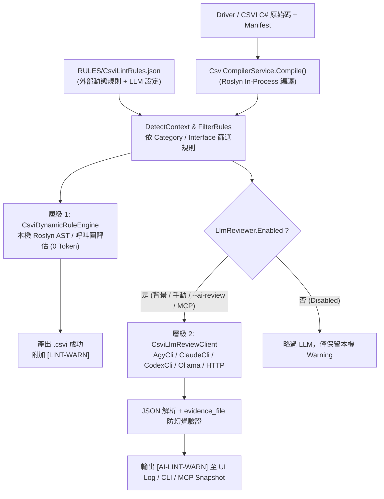

# 14. CSVI Studio AI 審查與動態規則引擎指南 (AI Lint & Dynamic Rule Engine)

在 **ARCOSharp** 二次開發與硬體驅動移植流程中，開發人員可能各自使用不同的編輯器或 AI 輔助工具，但最終程式碼與 `.csvi` 元件都必須通過 **CSVI Studio** 進行編譯、封裝或 MCP 工具驗收。

本手冊說明 CSVI Studio 內建的 **雙層 Lint 與 LLM 語意審查機制**，包含如何設定呼叫的 LLM 後端（AGY / Claude / Codex / Ollama / OpenAI-Compatible / Gemini HTTP）、如何於外部設定檔撰寫可隨時擴充的審查規則，以及如何透過 CLI 與 MCP 讀取審查結果。

---

## 1. 核心設計原則 (Design Philosophy)

1. **僅發 Warning，絕不阻斷 `.csvi` 編譯 (`WarningOnly`)**：
   - 不論本機靜態規則違規（`[LINT-WARN]`）、LLM 檢出潛在問題（`[AI-LINT-WARN]`），或是外部 AI 端點離線／逾時／未設定 API Key，CSVI Studio 一律正常產出 `.csvi` 組件並回傳成功，LLM 失敗時僅輸出提示訊息並安全略過，不耽誤產線開發與調機節奏。
2. **規則外部化、不寫死於程式 (`RULES/CsviLintRules.json`)**：
   - 所有規則與 LLM Prompt 範本皆存於 [CsviLintRules.json](../../RULES/CsviLintRules.json)（打包時由 `pack_runtime.ps1` 一併部署至執行目錄的 `RULES\CsviLintRules.json`）。
   - 新增或調整規則後無須重新編譯 CSVI Studio，只要在介面點擊 **`🔄 重載規則檔`** 即可立即套用。
3. **雙層過濾：零 Token 靜態快篩 ＋ 語意深層審查**：
   - 先依目標類別（`IO`、`Capture`、`Motion`、`DAQ` 等）與實作介面（`IDriver`、`IParameterGuidance`、`IModuleHandler`）過濾出適用的規則，避免將不相關類別的規則餵入 LLM 浪費 Token 或造成誤報。



---

## 2. 如何設定 CSVI Studio 呼叫 LLM 端點？

### 2.1 透過 CSVI Studio 圖形介面設定
在 **獨立版 `CSVI_Studio.exe`** 或 **主程式底部 `CSVI STUDIO: MCP <PORT>` 分頁** 右側切換至 **`🛡 AI & Lint 規則`** 分頁（實作於 [CsviLintSettingsPanel.cs](../../src/ARCOS.CsviStudio/Controls/CsviLintSettingsPanel.cs)）：

1. 勾選 **`啟用 LLM 語意審查 (僅顯示 Warning，不擋編譯)`**。
2. 勾選 **`編譯 .csvi 後於背景自動審查`**（編譯後背景非同步呼叫，不凍結 UI；亦可隨時點擊 **`🔍 立即 AI 審查目前程式碼`** 手動觸發）。
3. 從 **`LLM Provider:`** 下拉選單選擇後端，系統會自動帶入預設端點與模型：

| Provider | 預設 Endpoint / CLI | 預設 Model | API Key / `$Env` 與 `CLI Args` 建議 | 實作呼叫方式 |
|---|---|---|---|---|
| **`AgyCli`** *(目前預設)* | `agy` | `gemini-3.8-flash-low` | 留白（沿用本機 `agy` CLI 登入狀態） | 直接透過 `ProcessStartInfo.ArgumentList` 執行 `agy --disable-slash-commands --output-format json --model <model> -p <prompt>`；Prompt 超過 24,000 字元自動改由暫存檔傳遞並拆包 `response` 欄位 |
| **`ClaudeCli`** | `claude` | 留空或填模型名稱 | `CLI Args` 預設 `-p`（可自行覆蓋） | 透過 UTF-8 `stdin` 將 Prompt 送給 `claude -p` |
| **`CodexCli`** | `codex` | 留空或填模型名稱 | `CLI Args` 預設 `exec -` | 透過 UTF-8 `stdin` 將 Prompt 送給 `codex exec -` |
| **`Ollama`** | `http://localhost:11434/api/chat` | `qwen2.5-coder:7b` | 留白 | `POST /api/chat`（`stream: false`, `format: "json"`, `temperature: 0`） |
| **`OpenAiCompatible`** | `https://api.openai.com/v1/chat/completions` *(或內網 vLLM / LM Studio URL)* | `gpt-4o-mini` | 建議填 `$OPENAI_API_KEY` | `POST` Chat Completions JSON，帶 `Bearer` 驗證標頭 |
| **`GeminiHttp`** | `https://generativelanguage.googleapis.com/v1beta/models/{model}:generateContent` | `gemini-2.5-flash` | 建議填 `$GOOGLE_API_KEY` | `POST` 帶 `x-goog-api-key` Header 與 `responseMimeType: "application/json"` |
| **`CustomCli`** | 自訂執行檔／腳本路徑 | 選填 | `CLI Args` 留空走 `stdin`，或使用 `{prompt_file}` 佔位符 | 將 Prompt 寫入 `stdin` 或 UTF-8 暫存檔並以檔案路徑代換 `{prompt_file}` |
| **`Disabled`** | — | — | — | 完全關閉外部 LLM 呼叫，只保留本機 Roslyn `[LINT-WARN]` |

> [!TIP]
> **金鑰環境變數安全守則**：`API Key / $Env:` 欄位支援 `$變數名稱` 寫法（由 `CsviLlmReviewClient.ResolveApiKey` 於執行期從系統環境變數讀取）。切勿將明文金鑰直接貼入 `RULES/CsviLintRules.json` 並推送至 GitHub。

4. 點擊 **`💾 儲存設定`** 即寫入設定檔。

### 2.2 直接編輯 `RULES/CsviLintRules.json`
若要統一團隊設定，可直接修改 [CsviLintRules.json](../../RULES/CsviLintRules.json) 中的 `LlmReviewer` 區段，修改後於 UI 按 **`🔄 重載規則檔`** 即可生效：

```json
"LlmReviewer": {
  "Enabled": true,
  "RunAfterBuild": true,
  "Provider": "AgyCli",
  "EndpointOrCommand": "agy",
  "Model": "gemini-3.8-flash-low",
  "ApiKeyEnvOrLiteral": "",
  "CliArgsTemplate": "",
  "TimeoutSeconds": 60,
  "PromptTemplate": "..."
}
```

---

## 3. 如何撰寫 Check Driver / 程式的動態 RULE？

### 3.1 `Rules[]` 欄位結構說明
每條規則皆定義於 [CsviLintRules.json](../../RULES/CsviLintRules.json) 的 `"Rules"` 陣列（對應 [CsviLintConfig.cs](../../src/ARCOS.CsviStudio/Services/CsviLintConfig.cs) 的 `CsviLintRuleDefinition`）：

```json
{
  "Id": "IO-06",
  "Enabled": true,
  "Category": "IO",
  "RequiresInterface": "IDriver",
  "Title": "緊急停止與寫入輸出前須確認硬體 Handle 有效",
  "PromptInstruction": "請從資料流與狀態檢查邏輯判斷：執行實體 DO 寫入或復歸前，必須確認硬體通訊 Handle/連線有效；若斷線不可吞掉失敗並回報成功。注意各廠牌硬體 SDK 函式命名不同，不可憑單一函式名稱硬判。",
  "LocalStaticCheck": {
    "Kind": "None"
  }
}
```

| 欄位 | 說明 |
|---|---|
| `Id` | 規則代號（例如 `IO-01`、`DRV-01`、`CAP-01`），會顯示於 `[LINT-WARN][Id]` 與 `[AI-LINT-WARN][Id]`。 |
| `Enabled` | 布林值，`true` 啟用、`false` 停用。 |
| `Category` | 適用模組分類（如 `"IO"`、`"Capture"`、`"Motion"`、`"DAQ"`；填 `"*"` 代表全部組件皆套用）。 |
| `RequiresInterface` | 限定實作介面（`"*"`、`"IDriver"`、`"IParameterGuidance"`、`"IModuleHandler"`）。 |
| `Title` | 簡短規則名稱（顯示於規則列表與 Warning 前綴）。 |
| `PromptInstruction` | **送給 LLM 審查的核心語意準則**。應明確寫出風險成因與判斷準則，並提醒 LLM 依資料流與生命週期語意判斷（避免只認特定 SDK 名稱）。 |
| `LocalStaticCheck` | 選填的本機 Roslyn 快篩規則；若此規則純靠 LLM 審查，設為 `{ "Kind": "None" }` 即可。 |

### 3.2 `LocalStaticCheck.Kind` 支援的 7 種本機靜態檢查
若某條規則同時具備明確的程式結構特徵，可在 [CsviDynamicRuleEngine.cs](../../src/ARCOS.CsviStudio/Services/CsviDynamicRuleEngine.cs) 免耗 Token 直接快篩（並產出 `[LINT-WARN]`）：

| `Kind` | 用途說明 | 主要設定參數 |
|---|---|---|
| `None` | 不跑本機靜態檢查，純交給 LLM 語意審查 | — |
| `InitMustCall` | 從進入點（如 `Init`）同步可達路徑中必須呼叫特定方法與參數 token（自動排除 `Task.Run` / `StartNew` / `new Thread` Lambda 與 `*Loop` 背景函式，防止背景迴圈誤充初始化） | `EntryMethods`, `FollowPrivateCalls`, `RequiredMethodTokens`, `RequiredArgumentTokens` |
| `LoopMustNotCall` | 從背景掃描方法（如 `WorkerLoop`、`PollLoop`、`ScanLoop`）遞迴路徑內禁止呼叫特定寫入／覆蓋組合 | `EntryMethods`, `ForbiddenMethodTokens`, `ForbiddenArgumentTokens` |
| `MethodMustCatch` | 指定方法體內必須存在至少一個 `try/catch` 區塊 | `EntryMethods` |
| `MustSubscribeEvent` | 程式碼須訂閱指定事件名稱（`<Token> +=`） | `RequiredTokens` |
| `DisposalSafety` | 當原始碼命中 `TriggerIfSourceContains`（如 `CancellationTokenSource`）時，檢查 `Shutdown()` 須含 `.Cancel(` 且 `Dispose()` 須呼叫 `Shutdown(` | `TriggerIfSourceContains` |
| `RegexMustMatch` | 全文多行正規表示式必須命中 | `Pattern` |
| `RegexMustNotMatch` | 全文多行正規表示式禁止命中 | `Pattern` |

### 3.3 `PromptTemplate` 佔位符與 LLM 回覆格式
`LlmReviewer.PromptTemplate` 支援四個自動展開佔位符：
- `{driver_name}`：組件／驅動名稱
- `{category}`：辨識到的模組分類
- `{rules_text}`：所有命中本類別且 `Enabled: true` 規則展開的 `- {Id} ({Title}): {PromptInstruction}` 清單
- `{numbered_source}`：附上 `L0001:` 行號的所有 `.cs` 原始碼內容

LLM 依範本規定回傳 JSON 結構：
```json
{
  "summary": "一句話總結審查結論",
  "results": [
    {
      "rule_id": "IO-01",
      "status": "PASS 或 FAIL",
      "evidence_file": "Logic.cs",
      "evidence_lines": "L18-L24",
      "reasoning": "簡潔說明原因（繁體中文）"
    }
  ]
}
```
解析器（`CsviLlmReviewClient.ParseResponseIntoWarnings`）會在遇到 `FAIL` 時發出 `[AI-LINT-WARN]`；若模型回報 `PASS` 但 `evidence_file` 引用了不存在的檔名，亦會發出防幻覺人工複核 Warning。

### 3.4 目前內建規則一覽
預設隨庫規則（見 [CsviLintRules.json](../../RULES/CsviLintRules.json)）包含：
- **`IO-01` (`InitMustCall` + LLM)**：`Init()` 啟動背景掃描或輸出前，須先回讀一次硬體 DO 初值並寫入 `IoEngine.SetBatch(OutStart, ...)`，防止啟動瞬間把原本開啟中的閥門／汽缸洗成 `false`。
- **`IO-02` (`LoopMustNotCall` + LLM)**：進入 `WorkerLoop` / `PollLoop` / `ScanLoop` 後只准寫 DO／讀 DI，不可重讀硬體 DO 覆蓋 `OutStart`。
- **`IO-03` (`MethodMustCatch` + LLM)**：背景輪詢迴圈須捕捉 `OperationCanceledException` 與通訊例外。
- **`IO-04` (`Kind: None`, LLM 語意檢查)**：`PostTicket(DriverTicket)` 須非阻塞入隊且每個命令分支須呼叫 `SetCompleted`/`SetFailed`，`Init()` 重入前須對舊 `CancellationTokenSource` 呼叫 `Cancel()`。
- **`IO-05` (`MustSubscribeEvent` + LLM)**：須於 `Init()` 訂閱 `IoEngine.IoChanged`，防止週期 DI 回寫覆蓋外部手動注入狀態。
- **`DRV-01` (`DisposalSafety` + LLM)**：凡持有 `CancellationTokenSource` 之 `IDriver`，須於 `Shutdown()` 取消並於 `Dispose()` 呼叫 `Shutdown()`。
- **`CAP-01` (`Kind: None`, LLM 語意檢查)**：Capture Driver 無硬體連線或斷線時須安全降級並維護 `$(DeviceName)#OK? = false`。

---

## 4. 命令列 (CLI) 與 MCP Server 自動化整合

### 4.1 命令列編譯加跑 AI 審查
除了在桌面版介面觸發之外，也支援於終端機／CI 直接呼叫（實作於 [Program.cs](../../src/ARCOS.CsviStudio/Program.cs)）：

```powershell
CSVI_Studio.exe --compile "<來源資料夾>" "<輸出.csvi>" --ai-review
```

執行後若原始碼無 C# 語法錯誤，即使觸發 `[LINT-WARN]` 或 `[AI-LINT-WARN]` 仍會回傳 `Exit Code = 0` 並正常輸出 `.csvi`，同時於標準輸出列出靜態 Warning 與 AI 摘要／明細，並同步寫入最新審查快照。

### 4.2 CSVI Studio MCP Server (`--mcp`) 讀取工具
外部 AI Agent（如 Claude Desktop、Codex CLI、Antigravity 等）透過 `CSVI_Studio.exe --mcp` 連線 [McpServer.cs](../../src/ARCOS.CsviStudio/Mcp/McpServer.cs) 時，可使用以下工具讀取與觸發檢查結果：

1. **`csvi_compile_and_pack`**：
   - 永遠回傳 `"warnings": [...]`（包含編譯診斷與本機 Roslyn `[LINT-WARN]`）。
   - 傳入選配參數 `"runAiReview": true` 時，會同步等待已設定的 LLM（如 `AgyCli`）完成審查並回傳 `"aiReview": { "executed", "succeeded", "provider", "summary", "warnings", "passedRuleIds", "infoMessage" }`。
2. **`csvi_ai_review`**：
   - 可直接傳入 `sourceFiles`（原始碼字典）或 `csviPath`（自動解包可攜式 `.csvi` 內原始碼），一次取回 `staticWarnings` 與 `aiReview`。
3. **`csvi_get_last_review`**：
   - 讀取跨行程共享快照 `%LOCALAPPDATA%\ARCOS\csvi_last_review.json`（實作於 `CsviReviewHistoryStore`）。不論剛剛是由 GUI 編譯按鈕、GUI 手動審查按鈕、CLI `--ai-review` 或 MCP 執行的審查，外部 MCP Client 皆可藉此讀取最新一筆 `StaticWarnings`、`AiSummary` 與 `AiWarnings`。

---

## 5. 原始碼索引與單元測試

- 動態規則與 LLM 設定檔：[RULES/CsviLintRules.json](../../RULES/CsviLintRules.json)
- 設定讀寫與供應商預設：[src/ARCOS.CsviStudio/Services/CsviLintConfig.cs](../../src/ARCOS.CsviStudio/Services/CsviLintConfig.cs)
- 本機 AST / Call Graph 規則引擎：[src/ARCOS.CsviStudio/Services/CsviDynamicRuleEngine.cs](../../src/ARCOS.CsviStudio/Services/CsviDynamicRuleEngine.cs)
- 多端點 LLM 呼叫與快照存取：[src/ARCOS.CsviStudio/Services/CsviLlmReviewClient.cs](../../src/ARCOS.CsviStudio/Services/CsviLlmReviewClient.cs)
- 編譯管線串接：[src/ARCOS.CsviStudio/Services/CsviCompilerService.cs](../../src/ARCOS.CsviStudio/Services/CsviCompilerService.cs)
- UI 設定面板：[src/ARCOS.CsviStudio/Controls/CsviLintSettingsPanel.cs](../../src/ARCOS.CsviStudio/Controls/CsviLintSettingsPanel.cs)
- MCP 工具實作：[src/ARCOS.CsviStudio/Mcp/McpServer.cs](../../src/ARCOS.CsviStudio/Mcp/McpServer.cs)
- 打包部署腳本（複製 `RULES/` 至執行區）：[tools/pack_runtime.ps1](../../tools/pack_runtime.ps1)
- 單元與 MCP 整合測試：[tests/ARCOS.Drivers.Tests/CsviLintEngineTests.cs](../../tests/ARCOS.Drivers.Tests/CsviLintEngineTests.cs)
